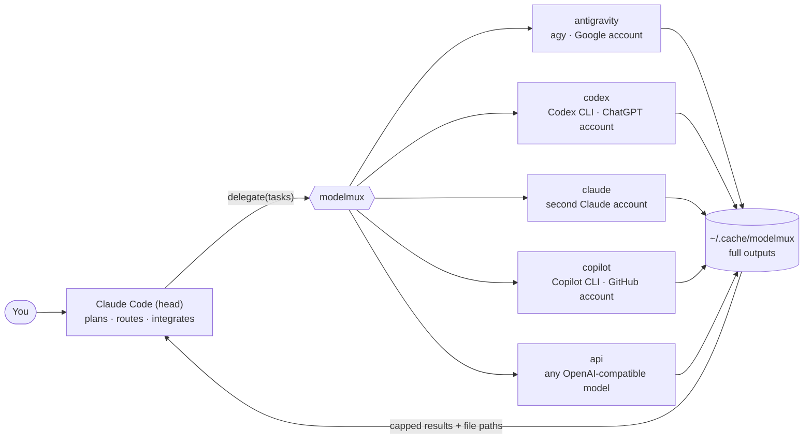

# modelmux

**English** · [简体中文](i18n/README.zh-CN.md) · [日本語](i18n/README.ja.md) · [한국어](i18n/README.ko.md) · [Español](i18n/README.es.md)

**Let Claude Code hand its grunt work to your other AI subscriptions: in parallel, read-only by default, from one dependency-free Python file.**

[](https://github.com/JayPokale/modelmux/actions/workflows/ci.yml)


<p align="center"></p>

- **`/modelmux:review`**: Codex, Gemini (through Antigravity), GitHub Copilot and a second Claude account review your diff at the same time, read-only. Claude merges what they found, counts how many models flagged each problem, and checks every finding against the code. In [our benchmark](bench/README.md), each of 32 bugs (23 planted, 9 real regressions from open-source projects) was flagged by at least three of the four models.
- **`/modelmux:race <task>`**: every model attempts the same fix in its own git worktree; your tests pick the winner, and nothing touches your tree until you say so.
- **Everyday delegation**: Claude hands long reads and boilerplate to whichever subscription fits. Summarizing three papers this way cost Claude **59% fewer tokens** (74% less cost) for the same answers.

You pay for Claude. Maybe also ChatGPT, Google AI, a second Claude seat, or you run an open model on a GPU. Yet your best model's quota still goes on reading PDFs and writing boilerplate while the others sit idle.

modelmux makes Claude Code the **head**. It plans, splits a job into self-contained subtasks, sends each one to a model that is good enough for it, and keeps its own quota for the hard parts:

- a 60-page paper goes to **Antigravity** (Gemini), which reads it and returns 150 words
- "write tests for `parse_date()`" goes to **Codex**, which writes and runs them
- mid-complexity work goes to your **second Claude account**
- a second opinion on a tricky change goes to **GitHub Copilot**, which offers models from several vendors
- classifying 2,000 lines goes to **any OpenAI-compatible model** (Ollama, vLLM, OpenRouter, Qwen, ...)

These all run at once, from a single tool call. Each worker is the vendor's own CLI, logged in with your own subscription, so the CLI workers need no API keys.

## How it works



- **The head is the router.** modelmux ships its routing policy as MCP server instructions, which stay in Claude Code's system prompt every session, even when the tool itself is deferred behind tool search. No extra router model, no classifier to train.
- **Workers see only their brief.** Each subtask is a standalone prompt plus file paths, never your conversation.
- **Results land on disk.** The head gets a capped copy plus the file path. To chain workers, pass that path to the next task; the text never has to pass through the head's context.

## Features

- **Parallel fan-out:** one `delegate` call runs up to 8 subtasks concurrently, across different workers.
- **Subscription-first:** drives official CLIs in their headless modes with your existing logins.
- **Read-only by default:** every worker runs in its CLI's no-write mode unless the head sets `write: true` (see [Safety](#safety)).
- **Quota-safe:** cancelling in Claude Code (Esc) kills the worker's whole process tree. Each task also has a timeout.
- **Context-cheap:** at most ~60k characters come back per call; full outputs stay on disk.
- **Auto-detected workers:** only the workers you actually have are offered to the head.
- **Slash commands** (plugin install): `/modelmux:review` has every worker review your diff in parallel; `/modelmux:race` has them all attempt the same fix; `/modelmux:ask` gets a second opinion from all of them; `/modelmux:setup` shows what's ready.
- **Isolated writers:** `isolate: true` gives each writing task its own git worktree and hands back a patch, so parallel writers never collide.
- **Background mode:** `background: true` returns at once, so Claude keeps working while workers run.
- **Read guard** (plugin install): the first time Claude starts a big read in a session (more than 5 pages of a long PDF, or 500+ lines of a 200 KB+ file), it is asked once to delegate instead; reading it again goes through. On a 16-page deep read this [halved Claude's cost but took minutes instead of seconds](bench/README.md#read-guard-a-deep-read-with-and-without-it); `MODELMUX_READ_GUARD=0` turns it off.
- **Zero dependencies:** about 400 lines of standard-library Python. Read it before you trust it with your accounts.

## Quick start

Requirements: Python 3.9+, Linux (tested) or macOS (untested), [Claude Code](https://github.com/anthropics/claude-code), and at least one worker:

| worker | needs | good for |
|---|---|---|
| `antigravity` | [Antigravity CLI](https://antigravity.google) (`agy`), logged in | long PDFs, papers, many-file reading, web research; Gemini, plus other models listed by `agy models` |
| `codex` | [Codex CLI](https://github.com/openai/codex), logged in | well-specified coding, tests, refactors, reviews |
| `claude` | a second Claude Code account + `MODELMUX_CLAUDE_DIR` | general work on separate quota |
| `copilot` | [GitHub Copilot CLI](https://github.com/github/copilot-cli), logged in | code review, focused coding questions, second opinions; models from several vendors |
| `api` | `MODELMUX_API_BASE` + `MODELMUX_API_MODEL` | bulk or simple work on any OpenAI-compatible model |

```bash
git clone https://github.com/JayPokale/modelmux ~/.local/share/modelmux
claude mcp add -s user modelmux -- python3 ~/.local/share/modelmux/server.py
claude mcp list        # modelmux: ... ✔ Connected
```

Or install it as a Claude Code plugin, which `claude plugin update modelmux` keeps current:

```bash
claude plugin install modelmux --marketplace JayPokale/modelmux
```

A plugin's server reads its settings from your environment, so with the plugin, `export` the `MODELMUX_*` variables below in your shell profile instead of passing `-e`. Use one install method, not both.

**Other heads.** Codex CLI and Copilot CLI can drive modelmux too, so they can hand work to Claude, Gemini and each other (both tested with a round trip to the `claude` worker):

```bash
codex mcp add modelmux -- python3 ~/.local/share/modelmux/server.py
copilot mcp add modelmux -- python3 ~/.local/share/modelmux/server.py
```

Codex asks before each MCP call. For `codex exec`, add `default_tools_approval_mode = "approve"` under `[mcp_servers.modelmux]` in `~/.codex/config.toml`. The slash commands are Claude Code only.

Restart Claude Code. Workers are detected at startup. To see which are ready and how to enable the rest, run `python3 server.py doctor` (or `/modelmux:setup` with the plugin); `doctor --live` also sends each one a tiny prompt to prove its login works.

**Second Claude account:**

```bash
CLAUDE_CONFIG_DIR=~/.claude-2 claude    # log in once with the other account, then exit
claude mcp remove -s user modelmux
claude mcp add -s user modelmux -e MODELMUX_CLAUDE_DIR=$HOME/.claude-2 \
  -- python3 ~/.local/share/modelmux/server.py
```

Keep `-e` after the server name: it accepts several values and would otherwise swallow the name.

**OpenAI-compatible endpoint.** The server inherits Claude Code's environment, so put these in your shell profile. `claude mcp add -e` would store the key in plain text in `~/.claude.json`.

```bash
export MODELMUX_API_BASE=http://localhost:11434/v1   # e.g. Ollama
export MODELMUX_API_MODEL=qwen3:32b
export MODELMUX_API_KEY=...                          # only if the endpoint needs one
```

The `api` worker has no tools, so modelmux pastes file text into the prompt. PDFs need `pdftotext` (poppler-utils).

## Usage

Work as usual. The head delegates when it pays off, and you can nudge it:

> Read the six papers in `./papers` and draft a related-work section. Delegate the reading.

> Have codex add tests for `src/dates.py` in the background while you review the API design.

> Translate `locales/en.json` into Hindi, Spanish and German via the api worker, one task per language.

### Slash commands (plugin install)

| command | what it does |
|---|---|
| `/modelmux:review [--base <ref>] [focus]` | every worker reviews your uncommitted changes (or the branch since `<ref>`) in parallel, read-only; Claude merges the findings, counts how many models flagged each, and checks them against the code |
| `/modelmux:ask <question>` | the same question to every worker; you get the consensus, the disagreements and Claude's verdict |
| `/modelmux:race <task>` | every write-capable worker attempts the same change in its own git worktree, in parallel; Claude runs your tests on each attempt, compares the patches and applies the best one when you agree |
| `/modelmux:setup` | which workers are ready, and the exact step to enable each missing one |

### The `delegate` tool

```json
{
  "tasks": [
    {"worker": "antigravity", "prompt": "Extract method, datasets and headline metric. Max 120 words.",
     "files": ["papers/attention.pdf"]},
    {"worker": "codex", "prompt": "Add unit tests for parse_date() in src/dates.py covering time zones. Run them.",
     "cwd": "/home/me/project", "write": true},
    {"worker": "api", "prompt": "Label each line bug / feature / question. Output CSV.",
     "files": ["issues.txt"]}
  ]
}
```

| field | required | meaning |
|---|---|---|
| `worker` | yes | one of the detected workers |
| `prompt` | yes | standalone brief: goal, context, constraints, exact output format |
| `files` | no | paths the worker should read: PDFs, code, earlier result files |
| `cwd` | no | working directory; defaults to where Claude Code was launched |
| `write` | no | allow edits inside `cwd` (default `false`) |
| `model` | no | override the worker's default model |
| `isolate` | no | write in a private git worktree under `<repo>/.modelmux/` (HEAD plus your uncommitted and untracked files); the result names a patch holding only the worker's changes. Implies `write` |

Top level, next to `tasks`: `"background": true` returns at once with the result paths, so the head keeps working while workers run; each file appears when its task ends, then a `done` file.

Each task comes back under a header naming its full-output file:

```text
## [1] antigravity ok 24s -> ~/.cache/modelmux/20261117-002241-eb1r2fv1/1-antigravity.md
...
## [2] codex ok 11s -> ~/.cache/modelmux/20261117-002241-eb1r2fv1/2-codex.md
...
## [3] api FAILED 0s -> ~/.cache/modelmux/20261117-002241-eb1r2fv1/3-api.md
FileNotFoundError: /home/me/project/issues.txt
```

## Safety

| worker | read-only (default) | `write: true` |
|---|---|---|
| `antigravity` | `agy -p … --mode plan` | `--mode accept-edits --sandbox` |
| `codex` | `codex exec -s read-only` | `-s workspace-write` |
| `claude` | `claude -p --tools Read,Grep,Glob,WebSearch` | `--permission-mode acceptEdits` |
| `copilot` | `copilot -p … --allow-all-tools --available-tools view rg glob web_fetch` | adds `apply_patch edit create`; never a shell |
| `api` | no tools | n/a |

- **Why plan mode for `agy`:** with `toolPermission: always-proceed` in agy's settings, `agy -p` runs shell commands without asking. In testing, plan mode still answered questions about files but executed nothing, even with that setting on.
- **Why an allowlist for `copilot`:** headless Copilot needs `--allow-all-tools`, which also auto-approves every MCP server in your Copilot config (one of ours could delete cloud databases). `--available-tools` hides everything else from the model, MCP servers included.
- **Prompt injection is real.** Workers read whatever files you hand them, and a hostile document can try to instruct them. Read-only mode limits the damage but cannot make injection impossible; for example, a worker could put file contents into a web search. Don't delegate secrets.
- **Data leaves your head account.** Briefs and files go to each worker's provider. If your head runs on a work account, check your organization's policy before delegating its data to personal accounts.
- **Where `write: true` can write:** inside `cwd`, plus the system temp directory for `codex` and `copilot` (their defaults). For `antigravity`, `claude` and `copilot` it also covers the directories of any listed files outside `cwd`, because those are granted with `--add-dir`. With `isolate: true`, in-repo paths in `files` and in the brief are rewritten to the worktree, so no writer is pointed at your own tree. A repository kept under `/tmp` is still reachable by `codex` and `copilot` through the temp-directory rule.
- **Never give two parallel tasks write access to overlapping files**, unless each has `isolate: true`: then each works in its own git worktree and your tree is untouched until you apply a patch. `isolate` is not a filesystem sandbox: a tracked symlink that points outside the repository can be written through, and files a worker creates that match `.gitignore` stay out of its patch.

## Terms of service

modelmux runs each vendor's official CLI in its documented non-interactive mode, logged in as you. It does not extract tokens, scrape web apps or proxy APIs. You are still responsible for following each provider's terms. Don't use it to share accounts or resell access.

## Field notes

What we found building this, in case it saves you an afternoon:

- **Gemini CLI with a personal Google login now fails** with `IneligibleTierError: This client is no longer supported for Gemini Code Assist for individuals. To continue using Gemini, please migrate to the Antigravity suite of products`. That's why the Google worker drives Antigravity's `agy`, whose print mode works with the same login. On our account, `agy models` also listed Claude and GPT-OSS models.
- **`agy -p` executes tools without asking under `toolPermission: always-proceed`.** Use `--mode plan` for anything meant to be read-only.
- **In plan mode, `agy` sometimes returns only a plan** ("Plan generated in [...]. Please review and approve to proceed") and stops. modelmux asks read-only Antigravity tasks for the complete answer in the reply.
- **A nested `claude -p` inherits the parent session's variables** (`CLAUDECODE`, `CLAUDE_CODE_*`, `CLAUDE_EFFORT`, ...). modelmux strips them so every worker is a clean session on the other account.
- **`claude --bare` never reads OAuth credentials**, so it can't use a subscription login. Workers must not use it.
- **Copilot CLI's `--allow-all-tools` approves your MCP servers too**, and `--deny-tool shell --deny-tool write` doesn't stop them. Allowlist with `--available-tools` instead.
- **Claude Code refuses edits under `.git`**, even inside a git worktree placed there, so isolated worktrees live in `<repo>/.modelmux/` instead.
- **A plugin's preprocessing command runs only if `allowed-tools` matches it exactly**, and a quoted path argument such as `python3 "…/server.py"` doesn't match. Execute the script directly.
- **Models cite line numbers inside a `.diff` file** unless told otherwise; the review brief asks for line numbers in the current file.
- **Claude Code may defer MCP tools**, which hides their descriptions until loaded. Routing policy therefore belongs in server instructions, not tool descriptions.

Tested with agy 1.4.6, codex-cli 0.163.0, Claude Code 2.1.323, GitHub Copilot CLI 1.0.112 and Python 3.14 on Arch Linux (November 2026). CLIs change often, so if a worker breaks, please open an issue with your CLI version.

## Configuration

| variable | default | effect |
|---|---|---|
| `MODELMUX_CLAUDE_DIR` | unset | config dir of a second Claude Code account; enables `claude` |
| `MODELMUX_API_BASE` | unset | OpenAI-compatible base URL ending in `/v1`; enables `api` together with `MODELMUX_API_MODEL` |
| `MODELMUX_API_MODEL` | unset | model name sent to that endpoint |
| `MODELMUX_API_KEY` | unset | bearer token for that endpoint |
| `MODELMUX_TIMEOUT` | `1200` | seconds per task |
| `MODELMUX_READ_GUARD` | on | `0` turns off the plugin's read guard |

Full outputs are written to `~/.cache/modelmux/` and are safe to delete at any time. Isolated worktrees live in `<repo>/.modelmux/`, which modelmux adds to the repository's local `.git/info/exclude`; remove one with `git worktree remove --force <dir>` and `git branch -D <branch>`. The `api` worker honours `http_proxy`/`no_proxy`.

## FAQ

**How is this different from OpenAI's Codex plugin for Claude Code?** That plugin drives Codex only, one job at a time, with OpenAI's own rescue and session-transfer flows. modelmux drives whichever subscriptions you have (Codex, Gemini through Antigravity, Copilot, a second Claude, local models), several at once, from one call.

**Will it burn my other quotas?** Every task spends the quota of the worker that runs it. `/modelmux:review` and `/modelmux:ask` send one task per worker, so they cost one request on each; plain delegation runs only what Claude decides to hand off. `python3 server.py doctor` shows which workers are enabled.

**Does `/modelmux:review` save Claude's quota?** No. On our small benchmark change, Claude reviewing alone took 13s and $0.033 of its quota; `/modelmux:review` took 59s and $0.122, plus one review on each worker, because Claude merges and verifies four reports. Use it for agreement and second opinions. To save quota, delegate reading and grunt work.

**Is it allowed by the providers' terms?** modelmux runs each vendor's official CLI in its documented headless mode, logged in as you; see [Terms of service](#terms-of-service). It doesn't proxy APIs, extract tokens or share accounts.

**Is it slower?** Often, yes. A parallel call is as slow as its slowest worker. Delegated reading took a minute where Claude alone took 13 seconds in [our benchmark](bench/README.md), but it used 59% fewer of Claude's tokens. A four-model `/modelmux:review` takes about a minute. Use `background: true` to keep Claude working while workers run.

**Does it need Claude Code?** No. Any MCP client can be the head (see Quick start), but the slash commands are a Claude Code plugin feature.

## Alternatives

Good tools exist in this space; choose by what you need:

| project | choose it when |
|---|---|
| [Codex plugin for Claude Code](https://github.com/openai/codex-plugin-cc) | you only need Codex, and want OpenAI's official rescue, session-transfer and background-job commands |
| [Claude Octopus](https://github.com/nyldn/claude-octopus) | you want structured multi-model councils, many providers and workflow gates, and don't mind a large plugin |
| [claude-delegator](https://github.com/jarrodwatts/claude-delegator) | you want Codex and Gemini as named experts inside Claude Code |
| [PAL MCP Server](https://github.com/BeehiveInnovations/pal-mcp-server) (formerly Zen) | you want many workflow tools (consensus, code review, planning) and API-key models, plus its `clink` CLI bridge |
| [llm-cli-gateway](https://github.com/verivus-oss/llm-cli-gateway) | you need sessions, retries and async jobs across Claude, Codex, Gemini, Grok and Mistral CLIs |
| [ai-cli-mcp](https://github.com/mkXultra/ai-cli-mcp) | you want CLI agents running in the background from any MCP client |
| [claude-code-router](https://github.com/musistudio/claude-code-router) | you want to swap the model behind Claude Code rather than delegate to other CLIs |
| **modelmux** | you want every subscription you have (Codex, Gemini through Antigravity, Copilot, a second Claude, local models) working in parallel from one call, read-only by default, in a file small enough to audit |

## Roadmap

- More workers, each with verified read-only flags: Gemini CLI (API-key users), OpenCode, Qwen Code, Cursor CLI
- PyPI package for `uvx` installs
- Usage log and per-worker stats
- Rate-limit-aware fallback between workers

## Contributing

Issues and PRs are welcome; see [CONTRIBUTING.md](CONTRIBUTING.md). Tests: `python3 -m unittest discover -s tests -v`. Keep it one file and standard-library only. A new worker is one function plus one `WORKERS` entry. Any change to a worker should state the CLI version you tested and show that its read-only mode really can't write. Report security issues privately: see [SECURITY.md](SECURITY.md).

## License

[MIT](LICENSE)

If modelmux saves you quota, [star the repo](https://github.com/JayPokale/modelmux/stargazers): it costs none.
