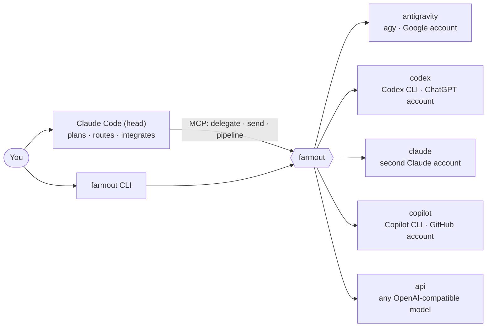

# farmout

<!-- mcp-name: io.github.JayPokale/farmout -->

**English** · [简体中文](https://github.com/JayPokale/farmout/blob/main/i18n/README.zh-CN.md) · [日本語](https://github.com/JayPokale/farmout/blob/main/i18n/README.ja.md) · [한국어](https://github.com/JayPokale/farmout/blob/main/i18n/README.ko.md) · [Español](https://github.com/JayPokale/farmout/blob/main/i18n/README.es.md)

**Put every AI subscription you pay for to work: Codex, Gemini, GitHub Copilot, DeepSeek, a second Claude account, local models. Conversations that remember, parallel review, races judged by your tests, and pipelines, from your terminal or from inside Claude Code. Read-only by default, no dependencies.**

[](https://github.com/JayPokale/farmout/actions/workflows/ci.yml)


> **Public preview.** Try it, tell us what breaks in [Discussions](https://github.com/JayPokale/farmout/discussions), and star or watch the repo to hear when 0.1.0 ships.

```bash
pipx install git+https://github.com/JayPokale/farmout
cd your-repo && farmout bench --share   # which of your AI subscriptions finds real bugs in your own code?
```

<p align="center"></p>

- **`farmout bench`**: which AI is best on *your* code? Recent bug fixes from your git history are undone in a scratch worktree, each of your subscriptions is asked to find the bug, and `--share` turns the scores into a post and an image card (scores only, never your code).
- **`farmout review`**: Codex, Gemini (through Antigravity), GitHub Copilot and a second Claude account review your change at the same time, read-only. Findings are merged across models with agreement counts, and any finding that cites a file or line that doesn't exist is dropped before you see it. In [our benchmark](https://github.com/JayPokale/farmout/blob/main/bench/README.md), each of 32 bugs (23 planted, 9 real regressions from open-source projects) was flagged by at least three of the four models.
- **`farmout race "<task>" --test "pytest -x"`**: every model attempts the same change in its own git worktree; your tests pick the winner, and nothing touches your tree until you `farmout apply` it.
- **`farmout run` / `send` / `fork`**: named sessions with any worker that remember the conversation, queue messages while busy, and hand one session's reply to another.
- **`farmout pipe run fix`**: review your change, fix what two or more models agree on in a worktree, then review the fix. Write your own pipelines with gates, approvals and parallel stages.
- **Skills, hooks and a store**: run `SKILL.md` skills (the format Claude Code, Codex and Copilot share) on any worker, hook into farmout's events, and install reviewed hooks, skills and tools with every file pinned by SHA-256.
- **Inside Claude Code**: Claude hands long reads and boilerplate to whichever subscription fits. Summarizing three papers this way cost Claude **59% fewer tokens** (74% less cost) for the same answers.

You pay for Claude. Maybe also ChatGPT, Google AI, GitHub Copilot, a second Claude seat, or an open model on a GPU. Each one sits in its own terminal, idle most of the day. farmout drives their official CLIs, logged in as you, so they can work in parallel, check each other, and take turns on one job. No API keys, no extra bill, no dependencies: standard-library Python you can read before you trust it with your accounts.

## Install

Requirements: Python 3.9+, Linux (tested) or macOS (untested), git, and at least one worker:

| worker | needs | good for |
|---|---|---|
| `antigravity` | [Antigravity CLI](https://antigravity.google) (`agy`), logged in | long PDFs, papers, many-file reading, web research; Gemini, plus other models listed by `agy models` |
| `codex` | [Codex CLI](https://github.com/openai/codex), logged in | well-specified coding, tests, refactors, reviews |
| `claude` | a second Claude Code account + `FARMOUT_CLAUDE_DIR`, or your main login with `FARMOUT_CLAUDE_MAIN=1` | general work on separate quota |
| `copilot` | [GitHub Copilot CLI](https://github.com/github/copilot-cli), logged in | code review, focused coding questions, second opinions; models from several vendors |
| `deepseek` | [DeepSeek Harness](https://github.com/deepseek-ai/deepseek-harness) (`npm i -g @deepseek-ai/dsh`) and `DEEPSEEK_API_KEY` | bulk reading, summaries, routine coding and one more opinion on DeepSeek V4, cheap per token (experimental) |
| `api` | `FARMOUT_API_BASE` + `FARMOUT_API_MODEL` | bulk or simple work on any OpenAI-compatible model (DeepSeek's API, Ollama, vLLM, OpenRouter) |

The command line (a PyPI release, for `uvx farmout`, is coming):

```bash
git clone https://github.com/JayPokale/farmout ~/.local/share/farmout
pipx install ~/.local/share/farmout      # or: pip install --user ~/.local/share/farmout
farmout doctor --live                    # which workers are ready; --live sends each one a tiny prompt
```

No install at all also works: `python3 ~/.local/share/farmout/server.py <command>` is the same CLI.

As a Claude Code plugin (adds the slash commands, the MCP tools and the read guard; `claude plugin update farmout` keeps it current):

```bash
claude plugin install farmout --marketplace JayPokale/farmout
```

**Second Claude account:** log in once with `CLAUDE_CONFIG_DIR=~/.claude-2 claude`, then `export FARMOUT_CLAUDE_DIR=~/.claude-2` in your shell profile. **Only one Claude account?** `farmout bench` ranks your main login anyway, and `export FARMOUT_CLAUDE_MAIN=1` makes it a worker for every command, on that account's quota. farmout never uses it from inside Claude Code, where it's the head's own account.

**OpenAI-compatible endpoint:** `export FARMOUT_API_BASE=http://localhost:11434/v1 FARMOUT_API_MODEL=qwen3:32b` (and `FARMOUT_API_KEY` if needed); for DeepSeek's API itself, `FARMOUT_API_BASE=https://api.deepseek.com FARMOUT_API_MODEL=deepseek-flash` and your key. The `api` worker has no tools, so file text goes into the prompt; PDFs need `pdftotext`.

## A quick tour

```bash
# One worker, one conversation. The session remembers; send more later.
farmout run codex "Add unit tests for parse_date() in src/dates.py and run them" --isolate -n dates
farmout send dates "Also cover leap years"
farmout diff dates            # the patch, from its own git worktree
farmout apply dates           # into your tree (or --pr: branch, push, open a pull request)

# Every model at once
farmout review                                    # your uncommitted change
farmout review --base main --min-agree 2          # the branch since main, only what 2+ models agree on
farmout ask "Is this migration safe to run online?" -f migrations/0042.sql
git diff | farmout ask "Anything here that could lose data?"
farmout race "Make the flaky test in tests/test_sync.py deterministic" --test "pytest tests/test_sync.py -x"

# Sessions talk to each other
farmout send dates --attach review-1-claude "Fix what this review found"
farmout fork review-1-codex "Why do you think line 42 races?"     # a side question, same context

# Pipelines: each stage starts when the previous one ends
farmout pipe run fix --set test="pytest -x"      # review → fix what 2+ models agree on → check the fix
farmout pipe run spec "Add CSV export to the reports page"
farmout pipe ls --runs

# Models argue, your history judges
farmout ask --debate "Should this cache be per-request or global?"   # each reads the others, then answers again
farmout bench -n 3                                                    # replay 3 of your past bug fixes as a test
farmout fix-pr 128 --test "pytest -x"            # PR review comments and failing checks become a race

# Skills, hooks, the store
farmout store ls && farmout store add security-review && farmout security-review
farmout skill add https://github.com/you/skills --path skills/changelog
farmout store add notify      # a desktop or phone notification when a long turn or a pipeline ends

# Housekeeping
farmout ls                    # sessions: worker, state, turns
farmout attach dates          # watch a running session (Ctrl-C detaches; it keeps going)
farmout stats                 # what each subscription did for you this week
farmout status --line         # "farmout: 2 running · fix-3 waiting · codex limited till 15:00", for tmux or a prompt
farmout ls --watch            # a live dashboard
farmout export dates --html -o dates.html   # share a conversation
farmout hook install          # review every commit; block it when 2+ models flag a high-severity bug
```

## Commands

| command | what it does |
|---|---|
| `run <worker> "<prompt>"` | start a session: `-n name`, `--write` (edit the current directory), `--isolate` (edit a private worktree, make a patch), `--model`, `--effort`, `--fallback w1,w2`, `--bg`, `-f file`. `auto` picks the first allowed worker that isn't at a usage limit |
| `send <session> "<msg>"` | the next message; a busy session queues it. `--attach <session>` hands over that session's last reply, `-f` adds files, `--bg` returns at once |
| `fork <session> "<msg>"` | a new session that starts from this one's conversation; `--worker` continues with a different model |
| `ask "<question>"` | the same question to every worker (`-w` to choose), answers side by side; `--debate` lets each read the others and answer again |
| `review [focus]` | every worker reviews `--staged`, `--base <ref>` or your uncommitted change; `--min-agree N`, `--fail-on high\|medium\|low` for exit codes |
| `race "<task>"` | every worker attempts the task in its own worktree; `--test <cmd>` picks the winner, `--apply` lands it |
| `fix-pr <number>` | a pull request's review comments and failing checks (via `gh`) become a race; check the PR out first |
| `bench [-n N]` | replay N recent small bug fixes from your history; each worker is scored on finding the bug |
| `ls [--watch]`, `log`, `attach`, `wait`, `stop`, `rm` | list (or watch, as a dashboard), read, watch, wait for, stop and delete sessions (`rm` also removes a session's worktree and branch) |
| `diff`, `apply [--pr]`, `undo` | an isolated session's patch: show it, apply it (several in order, stopping at the first that doesn't apply), open a pull request with `gh`, or take an applied one back out |
| `export <session> [--html]` | a conversation as Markdown or a standalone HTML page |
| `status [--line]` | what's running, queued, waiting for approval or at a usage limit |
| `skill ls\|show\|run\|add\|rm`, `<skill>` | skills; `farmout <skill> [args]` runs one |
| `store ls\|show\|add\|rm\|update`, `tool ls\|run` | the store, and the tools you installed from it |
| `trust [--revoke\|--list]`, `hooks` | let a project's own hooks run; list the hooks in effect here |
| `pipe run\|ls\|status\|resume\|approve\|stop` | pipelines and their runs |
| `stats` | runs, failures, usage limits, time and tokens per subscription |
| `hook install\|uninstall [--pre-push]` | a git hook that reviews each commit or push |
| `doctor [--live]`, `mcp` | check the workers; serve the MCP tools on stdio |

Every command takes `--json` for scripts and `-C <dir>`. Prompts can come from stdin; with a prompt given, piped stdin goes along as a file. Exit codes: 0 ok, 1 failed (or a review gate tripped), 130 stopped.

## Sessions

A session is a named conversation with one worker, saved in `~/.local/state/farmout/sessions/<name>/`. farmout resumes it through the worker CLI's own session id (`claude --resume`, `codex exec resume`, `copilot --session-id`, `agy --conversation`, `dsh --session-id`; for `api` it keeps the history itself), so the model really remembers earlier turns rather than rereading a summary.

Messages go through an inbox. The session's runner, a background process that holds the session's lock, answers them in order, which is why `send` to a busy session queues instead of failing, why `farmout attach` works from any terminal, and why `farmout stop` stops exactly one session's worker. Forking a Claude session uses Claude's native fork; other workers get the transcript as a file. Review, ask, race and pipeline stages all create sessions too, so you can follow up with any reviewer: `farmout send review-3-codex "Show me the input that breaks line 42"`.

## Pipelines

A pipeline is a list of stages in a `.toml` (Python 3.11+) or `.json` file in `<repo>/.farmout/pipelines/` or `~/.config/farmout/pipelines/`. Each stage runs a skill (`review`, `ask`, `race`) or sends its prompt to one or more workers, and starts when the previous one ends.

```toml
description = "Plan with Claude, build with Codex in a worktree, ship after I approve"

[[stage]]
name = "plan"
worker = "claude"
prompt = "Write a short plan for: {args}"

[[stage]]
name = "build"
worker = "codex"
isolate = true
prompt = "Implement the plan in {plan}. Run the tests."
test = "pytest -x"
gate = "tests"            # passes only if the test command passes in the worktree

[[stage]]
name = "review"
skill = "review"
in = "build"              # review the build's worktree
gate = "high == 0"

[[stage]]
name = "notes"
worker = "copilot"
approve = true            # waits for `farmout pipe approve <run>`
prompt = "Write release notes for the patch in {build.patch}"
```

- **Placeholders:** `{stage}` is that stage's output file, `{stage.patch}` its patch, `{args}` the free text after `farmout pipe run <name>`, `{key}` a parameter (`params` table, `--set key=value`), `{item}` a `foreach` item. A stage's output files are handed to the worker, so it can read them.
- **Gates:** `ok`, `tests`, `agree >= N`, `findings == 0`, `high == 0` (any `<`, `<=`, `==`, `!=`, `>=`, `>`), or `contains "TEXT"`. A gate that fails stops the stages after it.
- **`on`:** `success` (default), `failure` (only after something failed, e.g. cleanup or a notification), or `always`.
- **`foreach = "<stage>"`:** one session per `- item` line of that stage's output, spread over `workers`, in parallel (`max_items`, default 8).
- **`approve = true`:** the run pauses before the stage until `farmout pipe approve <run>` (or `--reject`).
- **Runs** live in `~/.local/state/farmout/runs/<run>/`. A failed, gated, stopped or interrupted run continues with `farmout pipe resume <run>`; `--bg` runs it in the background.

Built in: **`fix`** (review → fix what 2+ models agree on, `--set worker=codex test="pytest -x"` → review the fix) and **`spec`** (requirements → design → independent tasks → every task built in its own worktree in parallel → a check of the patches together). A worker your machine doesn't have is swapped for one it does.

## Skills

A skill is a folder with a `SKILL.md`: YAML frontmatter (`name`, `description`) and instructions, the format Claude Code, Codex and Copilot share. farmout runs it on your workers: `farmout <skill> [args]` (or `farmout skill run <skill>`). `$ARGUMENTS` in the instructions is replaced by the arguments, and the skill's folder is handed over so workers can read its references.

```markdown
---
name: security-review
description: Every worker reviews your change for security problems only.
mode: review          # ask (default) | review (farmout review, with these instructions as the focus) | race
workers: [codex, claude, copilot]   # default: one worker for ask, all of them for review and race
diff: true            # hand the workers your uncommitted change as a diff file
---
Look only for security problems that an attacker could trigger: ...
$ARGUMENTS
```

farmout also reads `write`, `isolate`, `test` (race mode), `model` and `effort`; other agents ignore these keys. Skills live in `<repo>/.farmout/skills/<name>/` (the project's, which win) and `~/.config/farmout/skills/<name>/` (yours). A pipeline stage can run one: `skill = "security-review"`, with the stage's `prompt` as its arguments.

`farmout skill add <source>` installs from anywhere: a local folder, a git repository (`--path` picks a skill in a repository of several, `--ref` a branch or tag; the commit is recorded), or a raw `SKILL.md` URL. A skill from a git repository or URL that contains code (a `scripts/` folder, executables, scripts) or symbolic links is refused: code comes only from [the store](#the-store), or from a folder you copy in yourself. And a skill can only make farmout *do* things (run its `test` command, give workers `write`) if it's one you vouch for: yours or the store's. A project's skills and fetched ones stay text; pass `--test` or `--write` yourself.

## Hooks

Commands that run on farmout's events, in your settings:

```toml
[[hooks]]
event = "TaskEnd"                       # SessionStart, MessageReceived, TaskStart, TaskEnd, StageEnd, PipelineEnd
command = "notify-send farmout done"
matcher = "codex|claude"                # optional: a regex on the worker, session or pipeline name
timeout = 30
```

A hook reads the event as one line of JSON on stdin (worker, prompt, files, session, result, run, stage and so on, by event). Exit 0 to go on; a `TaskStart` hook may print `{"prompt": "..."}` to rewrite the brief, or exit 2 (or print `{"decision": "block", "reason": "..."}`) to stop the task before it reaches the worker. Any other failure is shown and ignored. `farmout hooks` lists the hooks in effect.

Hooks are code, so farmout runs only yours (`~/.config/farmout/settings`), those installed from the store, and a project's own `.farmout/settings` hooks once you `farmout trust` that file. Trust is pinned to the file's SHA-256: if it changes, its hooks stop until you trust it again.

**`redact = true`** in your settings replaces credentials (API keys and tokens, private keys, JWTs, `password=…` values) in every brief and in piped stdin before they leave your machine. Files a worker reads itself are not touched; keep secrets out of `files`, or install the `guard-secrets` hook, which refuses tasks that list them.

## The store

`farmout store ls` lists reviewed skills, hooks and tools; `farmout store show <name>` prints an entry's files so you can read them first; `farmout store add <name>` installs it. Every file is checked against the SHA-256 in the store's index, and if any differs, nothing is installed. `farmout store update` reinstalls entries with a new version; tools run with `farmout tool run <name> [args]`.

| entry | kind | what it does |
|---|---|---|
| `security-review` | skill | every worker reviews your change for security problems only, merged with agreement counts |
| `test-gaps` | skill | the behaviours in your change that no test covers, and the test to add for each |
| `notify` | hook | a desktop notification, and a phone push through [ntfy](https://ntfy.sh) if `NTFY_TOPIC` is set, when a long turn or a pipeline ends |
| `guard-secrets` | hook | refuses a task that would hand a worker `.env`, private keys or credentials |
| `prune` | tool | deletes sessions idle for more than N days, with their worktrees |

The store is [`store/`](https://github.com/JayPokale/farmout/tree/main/store) in this repository (`index.json` plus each entry's files); every entry is read line by line before it's merged. Point `store` in your own settings (or `FARMOUT_STORE`) at another index, including a local path, to run your own. Only your settings can name a store, never a project's.

## Which model is best on your code

`farmout bench -n 3` finds recent small bug-fix commits in your history (a fix-like subject, at most 4 files and 80 changed lines of code), undoes each fix in a scratch worktree so the bug is back as an uncommitted change in its real codebase, has every worker review it, and scores a worker when one of its findings lands within 3 lines of the change. It costs one review per worker per commit; the report is saved under `~/.local/state/farmout/bench/`. On two tqdm fixes, Claude, Codex and Copilot found both and Antigravity's fast model one.

## Settings

`~/.config/farmout/settings.toml` (yours) and `<repo>/.farmout/settings.toml` (the project's; `.json` works too, and on Python 3.9–3.10 only `.json` does):

```toml
workers = ["codex", "claude"]   # which subscriptions may see this repo, e.g. keep work code off personal accounts
write = false                   # forbid write and isolate here
web = false                     # forbid web access (agy can't turn its search off, so it's refused)
fallback = ["codex", "copilot", "claude"]   # who takes over when one hits its usage limit
timeout = 900                   # seconds per task
redact = true                   # strip credentials from briefs and piped input
# [[hooks]] tables (see Hooks); in your own settings only: store = "<index URL or path>"
```

Neither file can loosen the other: worker lists intersect, `write` and `web` are off if either says so, and the shorter timeout wins. Settings are always read from the main working tree, so a worker editing its worktree's copy changes nothing.

**`.farmoutinclude`** at the repo root lists ignored files that isolated worktrees need (glob patterns, one per line, e.g. `.env` or `config/*.local`). They are copied in, and never end up in a patch.

## Usage limits and stats

When a worker fails because its subscription hit a limit, farmout notes how long to leave it alone ("try again in 20 minutes" is honoured, otherwise 15 minutes) and, if you gave `--fallback` (or a stage `fallback`, or the `fallback` setting), runs the task on the next worker instead; until the limit passes, tasks for that worker go straight to the next one, and `farmout run auto` skips it. `farmout stats` shows each subscription's runs, failures, limits, time and tokens from the usage log (`~/.local/state/farmout/usage.jsonl`, which never records prompts or outputs).

## The git hook

`farmout hook install` adds a pre-commit hook (`--pre-push` for a pre-push one) that runs `farmout review --staged --min-agree 2 --fail-on high`: the commit is blocked when two or more models flag a high-severity problem. `FARMOUT_SKIP=1` (or `git commit --no-verify`) skips it once; an existing hook is moved aside with `--force` and restored by `farmout hook uninstall`.

## Inside Claude Code and other MCP clients



farmout is also an MCP server (`farmout mcp`, or `python3 server.py`), so Claude Code, Codex CLI, Copilot CLI or any MCP client can be the **head**: it plans, splits a job into self-contained subtasks, sends each to a model that is good enough for it, and keeps its own quota for the hard parts. farmout ships its routing policy as MCP server instructions, so there is no extra router model.

| tool | what it does |
|---|---|
| `delegate` | one-shot subtasks in parallel (up to 8): `worker`, `prompt`, `files`, `cwd`, `write`, `isolate`, `model`, `effort`; `background: true` returns at once. Full outputs land in `~/.cache/farmout/`, the head gets capped copies plus the paths |
| `send` | a message to a named session (give `worker` to start one); the worker remembers the conversation |
| `sessions` | list sessions, or one session's turns and output files |
| `pipeline` | list, run, status, approve, reject, resume or stop pipeline runs (they run in the background) |

Plugin slash commands: `/farmout:review [--base <ref>] [focus]` (every worker reviews; Claude merges and also verifies each finding against the code), `/farmout:race <task>`, `/farmout:ask <question>` and `/farmout:setup`. The plugin's **read guard** asks Claude, once per file, to delegate a big read (more than 5 pages of a long PDF, or 500+ lines of a 200 KB+ file); on a 16-page deep read that [halved Claude's cost but took minutes instead of seconds](https://github.com/JayPokale/farmout/blob/main/bench/README.md#read-guard-a-deep-read-with-and-without-it). `FARMOUT_READ_GUARD=0` turns it off.

Other heads: `codex mcp add farmout -- farmout mcp`, `copilot mcp add farmout -- farmout mcp` (Codex asks before each MCP call; for `codex exec`, set `default_tools_approval_mode = "approve"` under `[mcp_servers.farmout]`). Without the plugin, Claude Code takes `claude mcp add -s user farmout -- farmout mcp`.

**Inside DeepSeek Harness:** dsh loads MCP servers from its patch files. Add this to `$DSH_HOME/cordis.patch.yml` (every profile) or to one profile's `cordis.patch.yml`, and farmout's tools show up as `mcp__farmout__delegate` and so on. dsh strips credential-like and `DSH_*` variables from MCP servers, so pass what farmout needs in `env`:

```yaml
- insert:
    - id: farmout
      name: '@deepseek-ai/dsh-mcp-client'
      config:
        serverName: farmout
        transport: stdio
        command: farmout
        args: [mcp]
        env: { FARMOUT_CLAUDE_DIR: /home/you/.claude-2 }
        cwd: !!js process.cwd()
```

## Safety

| worker | read-only (default) | write (`--write`, `--isolate`, `write: true`) |
|---|---|---|
| `antigravity` | `agy -p … --mode plan` | `--mode accept-edits --sandbox` |
| `codex` | `codex exec -s read-only` | `-s workspace-write` |
| `claude` | `claude -p --tools Read,Grep,Glob,WebSearch` | `--permission-mode acceptEdits` |
| `copilot` | `copilot -p … --allow-all-tools --available-tools view rg glob web_fetch` | adds `apply_patch edit create`; never a shell |
| `deepseek` | `dsh headless --permission-mode read-only --approval-policy never` | `--permission-mode workspace-write` |
| `api` | no tools | n/a |

- **Why plan mode for `agy`:** with `toolPermission: always-proceed` in agy's settings, `agy -p` runs shell commands without asking. Plan mode still answers questions about files but executes nothing, even with that setting on.
- **Why an allowlist for `copilot`:** headless Copilot needs `--allow-all-tools`, which also auto-approves every MCP server in your Copilot config (one of ours could delete cloud databases). `--available-tools` hides everything else from the model, MCP servers included.
- **Isolation:** an isolated worker edits its own worktree in `<repo>/.farmout/worktrees/`, and in-repo paths in its files and brief are rewritten to point there. Your tree changes only when you apply a patch. It is not a filesystem sandbox: a tracked symlink that points outside the repository can be written through, and `codex` and `copilot` may also write the system temp directory.
- **Prompt injection is real.** Workers read whatever you hand them, and a hostile document can try to instruct them. Read-only mode limits the damage but can't make injection impossible. Don't delegate secrets; `web = false` in settings closes the web tools.
- **Data leaves your machine.** Briefs and files go to each worker's provider. Use the `workers` setting to keep a work repository away from personal accounts.

## Terms of service

farmout runs each vendor's official, unmodified CLI in its documented non-interactive mode, on your machine, logged in as you. It never reads or stores a login token, scrapes a web app or proxies an API. You are still responsible for following each provider's terms. Don't use it to share accounts or resell access. What the terms say, as of November 2026:

- **Claude:** Anthropic's [Claude Code legal page](https://code.claude.com/docs/en/legal-and-compliance) bars third-party apps from routing requests through users' plan credentials. It also says that doesn't prevent "an end user from signing in to the unmodified Claude Code binary with their own Claude subscription", which is all farmout does. Plan limits assume ordinary, individual use.
- **Gemini through Antigravity:** Google's [Antigravity terms](https://antigravity.google/terms), section 6, count "using the Service in connection with products not provided by us" as a breach that may be grounds to suspend or terminate your Antigravity and Gemini CLI accounts. farmout calls the official `agy` binary and never touches its login, but Google hasn't said whether that's allowed. If you can't risk that account, leave Antigravity out: `workers = ["codex", "claude", "copilot"]` in `~/.config/farmout/settings.toml`, or `-w` per command.
- **Codex and Copilot:** `codex exec` and `copilot -p` are each CLI's documented non-interactive mode, and run within your plan's limits; Copilot spends your plan's AI credits.
- **DeepSeek and `api`:** your own API key, billed per token by the provider.

## Field notes

What we found building this, in case it saves you an afternoon:

- **Gemini CLI with a personal Google login now fails** with `IneligibleTierError`; that's why the Google worker drives Antigravity's `agy`, whose print mode works with the same login.
- **`agy -p` executes tools without asking under `toolPermission: always-proceed`.** Use `--mode plan` for anything meant to be read-only. In plan mode it sometimes returns only a plan stub, so farmout asks read-only tasks for the complete answer in the reply.
- **Headless Claude Code denies any tool that would ask for permission.** `--tools ...,WebSearch` alone gives the model a search tool it can never use; `--allowedTools WebSearch` pre-approves it.
- **`codex exec resume` takes no `-s` or `-C`.** Pass the sandbox as `-c sandbox_mode="read-only"` and run it in the session's directory.
- **Every worker CLI can resume a headless session by id**, but only Claude and Copilot let you choose the id up front; Codex and Antigravity report theirs (`thread.started` in `--json`, `conversation_id` in agy's JSON).
- **A nested `claude -p` inherits the parent session's variables** (`CLAUDECODE`, `CLAUDE_CODE_*`, ...). farmout strips them so every worker is a clean session on the other account. `claude --bare` never reads OAuth credentials, so it can't use a subscription login.
- **Copilot CLI's `--allow-all-tools` approves your MCP servers too**, and `--deny-tool` doesn't stop them. Allowlist with `--available-tools` instead.
- **Python's `text=True` turns CRLF into LF.** A diff read that way no longer applies to a CRLF file, so farmout moves patches as bytes.
- **Git hooks fire on internal commits and checkouts.** A review gate in pre-commit would review every worktree farmout makes, and `--no-verify` still runs post-commit and post-checkout hooks; farmout's own git calls use `-c core.hooksPath=/dev/null`.
- **Claude Code refuses edits under `.git`**, even inside a worktree placed there, so worktrees live in `<repo>/.farmout/worktrees/`.
- **Models cite paths relative to whatever directory they think in** (`cli.py` for `pkg/cli.py`) and line numbers inside a `.diff` file unless told otherwise. farmout's review brief asks for current-file line numbers, and its citation check accepts a unique suffix match.

Tested with agy 1.4.6, codex-cli 0.163.0, Claude Code 2.1.323, GitHub Copilot CLI 1.0.112 and Python 3.14 on Arch Linux (November 2026); the offline test suite also passes on Python 3.9 and 3.12. CLIs change often, so if a worker breaks, please open an issue with your CLI version. The `deepseek` worker is experimental: its flags follow DeepSeek Harness 0.2.2's documentation and haven't had a real smoke test yet.

## Configuration

| variable | default | effect |
|---|---|---|
| `FARMOUT_CLAUDE_DIR` | unset | config dir of a second Claude Code account; enables `claude` |
| `FARMOUT_CLAUDE_MAIN` | unset | `1` makes your main Claude login the `claude` worker when there's no second account (never inside Claude Code; `farmout bench` does it by itself) |
| `FARMOUT_API_BASE` | unset | OpenAI-compatible base URL ending in `/v1`; enables `api` together with `FARMOUT_API_MODEL` |
| `FARMOUT_API_MODEL` | unset | model name sent to that endpoint |
| `FARMOUT_API_KEY` | unset | bearer token for that endpoint |
| `FARMOUT_TIMEOUT` | `1200` | seconds per task (a `timeout` setting can lower it) |
| `FARMOUT_STATE` | `~/.local/state/farmout` | sessions, pipeline runs, the usage log, bench reports |
| `FARMOUT_STORE` | farmout's `store/index.json` on GitHub | the store's index (a URL or a local path) |
| `FARMOUT_READ_GUARD` | on | `0` turns off the plugin's read guard |
| `FARMOUT_SKIP` | unset | `1` skips the git hook once |

One-shot `delegate` outputs go to `~/.cache/farmout/` and are safe to delete. `farmout rm <session>` removes a session with its worktree and branch.

## FAQ

**How is this different from OpenAI's Codex plugin for Claude Code?** That plugin drives Codex only, from Claude Code. farmout drives whichever subscriptions you have (Codex, Gemini through Antigravity, Copilot, a second Claude, local models), several at once, from your terminal or any MCP client, with sessions and pipelines.

**Will it burn my other quotas?** Every task spends the quota of the worker that runs it. `review`, `ask` and `race` send one task per worker; `farmout stats` shows what each did. Use `-w` to pick workers.

**Does a review save Claude's quota?** The CLI's `farmout review` uses none of Claude's (unless a Claude login is a worker: a second account, or your main one with `FARMOUT_CLAUDE_MAIN=1`). Inside Claude Code, `/farmout:review` costs Claude more than reviewing alone, because Claude merges and verifies four reports: on our small benchmark change, 59s and $0.122 versus 13s and $0.033. Use it for agreement; delegate reading and grunt work to save quota.

**Is it slower?** A parallel call is as slow as its slowest worker: a four-model review takes about a minute, a race a few. Use `--bg`, `farmout attach` and `farmout wait` to keep working meanwhile.

**Does it need Claude Code?** No. The CLI needs only the worker CLIs you have; any MCP client can be the head.

## Alternatives

Good tools exist in this space; choose by what you need:

| project | choose it when |
|---|---|
| [Codex plugin for Claude Code](https://github.com/openai/codex-plugin-cc) | you only need Codex, and want OpenAI's official rescue, session-transfer and background-job commands |
| [Claude Octopus](https://github.com/nyldn/claude-octopus) | you want structured multi-model councils, many providers and workflow gates, and don't mind a large plugin |
| [PAL MCP Server](https://github.com/BeehiveInnovations/pal-mcp-server) (formerly Zen) | you want many workflow tools (consensus, code review, planning) and API-key models, plus its `clink` CLI bridge |
| [claude-squad](https://github.com/smtg-ai/claude-squad), [Conductor](https://conductor.build), [vibe-kanban](https://github.com/BloopAI/vibe-kanban) | you want a TUI, desktop app or board to run several interactive agents side by side |
| [claude-code-router](https://github.com/musistudio/claude-code-router) | you want to swap the model behind Claude Code rather than use other CLIs |
| [DeepSeek Harness](https://github.com/deepseek-ai/deepseek-harness) | you want an open, plugin-based harness to move into, built around DeepSeek's models (farmout can drive it as a worker, and run inside it) |
| **farmout** | you want the subscriptions you already have working together, read-only by default, from a terminal or an MCP client, with sessions, cross-model review, races, pipelines, skills, hooks and a hash-pinned store, in standard-library Python you can audit |

## Roadmap

- More workers with verified read-only flags: OpenCode, Qwen Code, Cursor CLI, Gemini CLI for API-key users
- PyPI release for `uvx farmout`
- A CI mode that comments on a pull request only with findings models agree on
- Editors driving farmout over the Agent Client Protocol; workers in containers

## Contributing

Issues and PRs are welcome; see [CONTRIBUTING.md](https://github.com/JayPokale/farmout/blob/main/CONTRIBUTING.md). Tests: `python3 -m unittest discover -s tests -v` (offline, with fake worker CLIs). The package is standard-library only. A new worker is one function in `farmout/workers.py` plus one `WORKERS` entry; state the CLI version you tested and show that its read-only mode really can't write. Report security issues privately: see [SECURITY.md](https://github.com/JayPokale/farmout/blob/main/SECURITY.md).

## License

[MIT](https://github.com/JayPokale/farmout/blob/main/LICENSE)

If farmout saves you quota, [star the repo](https://github.com/JayPokale/farmout/stargazers): it costs none.
