<!-- mcp-name: io.github.JayPokale/farmout -->

<h1 align="center">
  <picture>
    <source media="(prefers-color-scheme: dark)" srcset="https://raw.githubusercontent.com/JayPokale/farmout/main/assets/readme/banner-dark.svg">
    
  </picture>
</h1>

<p align="center">
  <a href="https://github.com/JayPokale/farmout/actions/workflows/ci.yml"></a>
  <a href="https://github.com/JayPokale/farmout/stargazers"></a>
  
  
  
  <a href="https://github.com/JayPokale/farmout/blob/main/LICENSE"></a>
  <a href="https://github.com/JayPokale"></a>
  <a href="https://github.com/sponsors/JayPokale"></a>
  <a href="https://buymeacoffee.com/jaypokale3b"></a>
</p>

<p align="center">
  <sub><b>English</b> &middot; <a href="https://github.com/JayPokale/farmout/blob/main/i18n/README.zh-CN.md">简体中文</a> &middot; <a href="https://github.com/JayPokale/farmout/blob/main/i18n/README.ja.md">日本語</a> &middot; <a href="https://github.com/JayPokale/farmout/blob/main/i18n/README.ko.md">한국어</a> &middot; <a href="https://github.com/JayPokale/farmout/blob/main/i18n/README.es.md">Español</a></sub>
</p>

<p align="center">
  <picture>
    <source media="(prefers-color-scheme: dark)" srcset="https://raw.githubusercontent.com/JayPokale/farmout/main/assets/readme/stats-dark.svg">
    
  </picture>
</p>

<p align="center"><b>The AI subscriptions you already pay for, working as one. Read-only by default.</b></p>

farmout hands work to Claude, Codex, Gemini, GitHub Copilot, DeepSeek, a second Claude account and local models. Give them the long reads and the reviews so your main model's quota lasts; when one hits its usage limit or its login lapses, the task moves to the next and the conversation goes with it. It drives each vendor's official CLI, logged in as you: no API keys, no extra bill, no dependencies, just standard-library Python you can read before you trust it with your accounts.

```bash
pipx install git+https://github.com/JayPokale/farmout
cd your-repo && farmout bench --share   # which of your AI subscriptions finds real bugs in your own code?
```

<p align="center"><sub><b>Public preview.</b> Try it, tell us what breaks in <a href="https://github.com/JayPokale/farmout/discussions">Discussions</a>, and star or watch the repo to hear when 0.1.0 ships.</sub></p>

<p align="center">
  <a href="https://buymeacoffee.com/jaypokale3b">
    <picture>
      <source media="(prefers-color-scheme: dark)" srcset="https://raw.githubusercontent.com/JayPokale/farmout/main/assets/readme/strip-dark.svg">
      
    </picture>
  </a>
</p>

<p align="center"></p>

<p align="center">
  <picture>
    <source media="(prefers-color-scheme: dark)" srcset="https://raw.githubusercontent.com/JayPokale/farmout/main/assets/readme/relay-dark.svg">
    
  </picture>
</p>

**Keep typing at Claude Code's limit.** Turn the relay on once (`farmout relay on --write`). When Claude Code says you've hit your limit, what you type next goes to another of your subscriptions with the whole conversation, and its answer shows right there in Claude Code; when the limit resets, Claude is told what happened meanwhile. `farmout continue --write` does the same from any terminal, for Codex and Copilot CLI sessions too. farmout's own conversations, tasks and pipeline stages do it by themselves: at a usage limit or a lost login, the next ready model takes over with the turns so far. [How it works](https://github.com/JayPokale/farmout/blob/main/docs/guide.md#sessions)

<details>
<summary><b>A real run</b>: a conversation moves from Claude to Codex, then <code>farmout bench</code> compares Opus and Sonnet on your own bug fixes</summary>
<br>

<p align="center">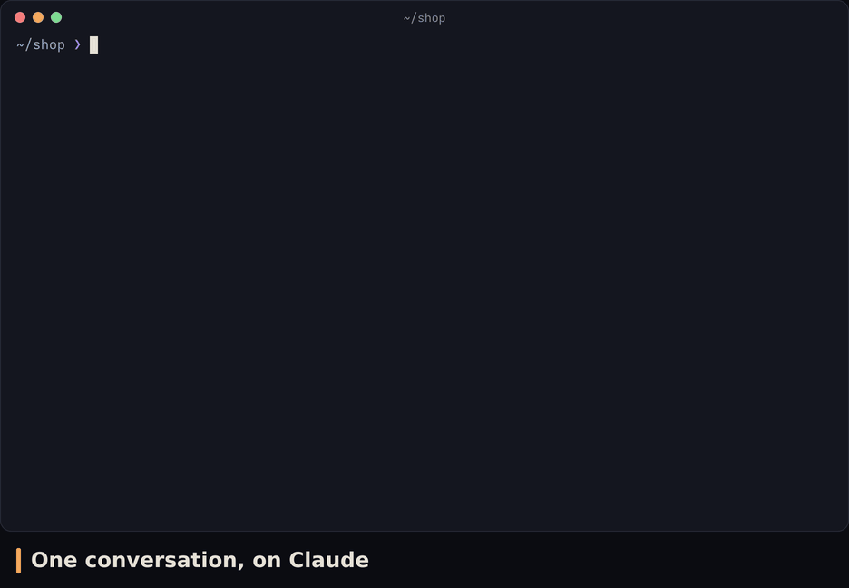</p>

</details>

<p align="center"></p>

<p align="center">
  <picture>
    <source media="(prefers-color-scheme: dark)" srcset="https://raw.githubusercontent.com/JayPokale/farmout/main/assets/readme/review-dark.svg">
    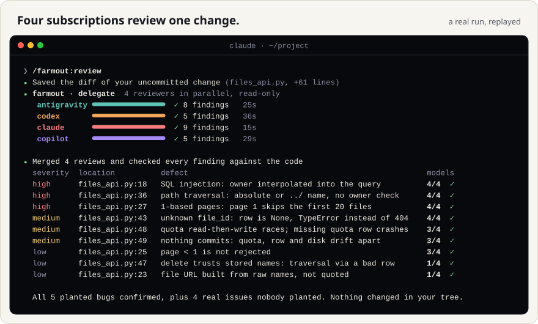
  </picture>
</p>

**`farmout review`**: Codex, Gemini (through Antigravity), GitHub Copilot and a second Claude account review your change at the same time, read-only. Findings are merged across models with agreement counts, and any finding that cites a file or line that doesn't exist is dropped before you see it. Inside Claude Code, `/farmout:review` also has Claude check every finding against the code. `farmout hook install` makes it a git hook that blocks a commit when two or more models flag a high-severity bug.

<p align="center">
  <picture>
    <source media="(prefers-color-scheme: dark)" srcset="https://raw.githubusercontent.com/JayPokale/farmout/main/assets/readme/race-dark.svg">
    
  </picture>
</p>

**`farmout race "<task>" --test "pytest -x"`**: every model that can edit files attempts the same change in its own git worktree; your tests pick the winner, and nothing touches your tree until you `farmout apply` it. `farmout fix-pr 128` turns a pull request's review comments and failing checks into a race.

<p align="center">
  <picture>
    <source media="(prefers-color-scheme: dark)" srcset="https://raw.githubusercontent.com/JayPokale/farmout/main/assets/readme/bench-dark.svg">
    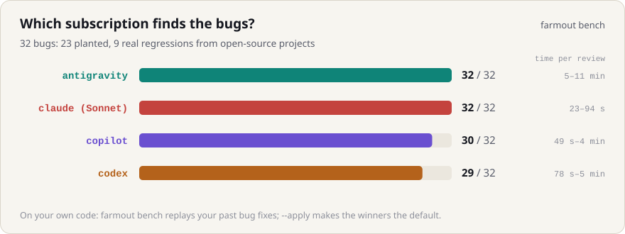
  </picture>
</p>

**`farmout bench`**: which AI is best on *your* code, and is Opus worth your quota there? Recent bug fixes from your git history are undone in a scratch worktree, every subscription (or `-w claude:opus,claude:sonnet`, two models of one plan) is asked to find the bug, and `--apply` makes the winners this repository's defaults. `--share` turns the scores into a post and an image card (scores only, never your code). The numbers above: [method and raw results](https://github.com/JayPokale/farmout/blob/main/bench/README.md), including where four reviewers don't beat the best one.

<p align="center"></p>

<p align="center">
  <picture>
    <source media="(prefers-color-scheme: dark)" srcset="https://raw.githubusercontent.com/JayPokale/farmout/main/assets/readme/tree-dark.svg">
    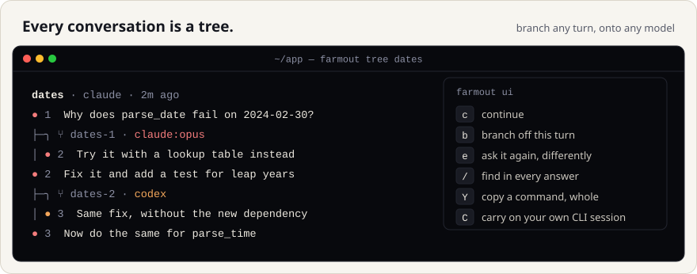
  </picture>
</p>

**Conversations that survive limits.** `farmout run codex "..." -n fix` starts a named conversation the worker really remembers; `farmout send fix "..."` goes on with it (a busy session queues), `-w claude:opus` moves it to another model with the conversation so far, and `farmout fork fix --at 2` branches off any turn. `farmout ui` shows every conversation as a graph, full-screen in your terminal or in your browser (`--web`): read any turn, continue it, branch off it, find words in any answer, copy a command whole.

<details>
<summary><b>A real run</b> of <code>farmout ui</code>: branching off turn 1 onto Copilot</summary>
<br>

<p align="center">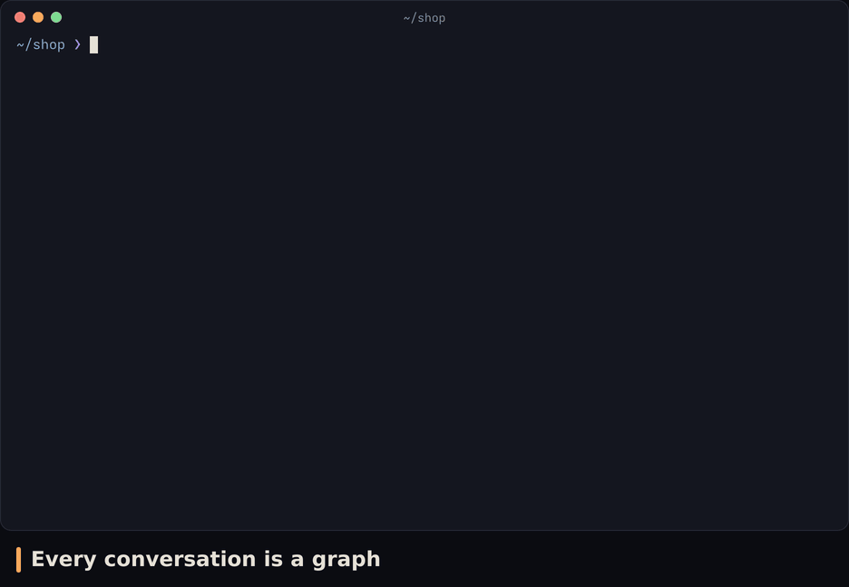</p>

</details>

<p align="center">
  <picture>
    <source media="(prefers-color-scheme: dark)" srcset="https://raw.githubusercontent.com/JayPokale/farmout/main/assets/readme/pipe-dark.svg">
    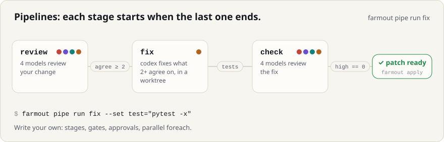
  </picture>
</p>

**Pipelines**: `farmout pipe run fix` reviews your change, fixes what two or more models agree on in a worktree, then reviews the fix. Write your own in TOML or JSON with gates, approvals and parallel stages, run `SKILL.md` skills on any worker, hook into farmout's events, and install reviewed skills, hooks and tools from a store where every file is pinned by SHA-256. [Pipelines](https://github.com/JayPokale/farmout/blob/main/docs/guide.md#pipelines) · [skills](https://github.com/JayPokale/farmout/blob/main/docs/guide.md#skills) · [hooks](https://github.com/JayPokale/farmout/blob/main/docs/guide.md#hooks) · [the store](https://github.com/JayPokale/farmout/blob/main/docs/guide.md#the-store)

<p align="center">
  <picture>
    <source media="(prefers-color-scheme: dark)" srcset="https://raw.githubusercontent.com/JayPokale/farmout/main/assets/readme/hub-dark.svg">
    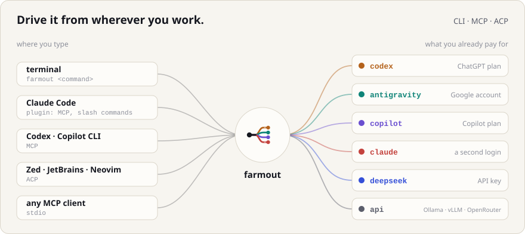
  </picture>
</p>

**Wherever you work.** The Claude Code plugin adds `/farmout:review`, `/farmout:race` and `/farmout:ask`, the MCP tools Claude uses to hand long reads and boilerplate to whichever subscription fits (summarizing three papers this way cost Claude 59% fewer tokens for the same answers), a read guard, and the limit relay. Codex CLI, Copilot CLI or any MCP client can drive farmout too (`farmout mcp`), and editors that speak ACP, like Zed and JetBrains IDEs, get your subscriptions as an agent (`farmout acp`). [MCP](https://github.com/JayPokale/farmout/blob/main/docs/guide.md#inside-claude-code-and-other-mcp-clients) · [ACP](https://github.com/JayPokale/farmout/blob/main/docs/guide.md#inside-editors-acp)

<p align="center"></p>

## Install

<p align="center">
  <picture>
    <source media="(prefers-color-scheme: dark)" srcset="https://raw.githubusercontent.com/JayPokale/farmout/main/assets/readme/install-dark.svg">
    
  </picture>
</p>

Requirements: Python 3.9+, Linux (tested) or macOS (untested), git, and at least one worker:

| worker | needs | good for |
|---|---|---|
| `antigravity` | [Antigravity CLI](https://antigravity.google) (`agy`), logged in | long PDFs, papers, many-file reading, web research; Gemini, plus other models listed by `agy models` |
| `codex` | [Codex CLI](https://github.com/openai/codex), logged in | well-specified coding, tests, refactors, reviews |
| `claude` | a second Claude Code account + `FARMOUT_CLAUDE_DIR`, or your main login with `FARMOUT_CLAUDE_MAIN=1` | general work on separate quota |
| `copilot` | [GitHub Copilot CLI](https://github.com/github/copilot-cli), logged in | code review, focused coding questions, second opinions; models from several vendors |
| `deepseek` | [DeepSeek Harness](https://github.com/deepseek-ai/deepseek-harness) (`npm i -g @deepseek-ai/dsh`) and `DEEPSEEK_API_KEY` | bulk reading, summaries, routine coding and one more opinion on DeepSeek V4, cheap per token (experimental) |
| `api` | `FARMOUT_API_BASE` + `FARMOUT_API_MODEL` | bulk or simple work on any OpenAI-compatible model (DeepSeek's API, Ollama, vLLM, OpenRouter) |

The command line (a PyPI release, for `uvx farmout`, is coming):

```bash
git clone https://github.com/JayPokale/farmout ~/.local/share/farmout
pipx install ~/.local/share/farmout      # or: pip install --user ~/.local/share/farmout
farmout doctor --live                    # which workers are ready; --live sends each one a tiny prompt
```

No install at all also works: `python3 ~/.local/share/farmout/server.py <command>` is the same CLI.

Tab completion: `eval "$(farmout completion bash)"` in `~/.bashrc` (or `zsh` in `~/.zshrc`, after compinit or your framework), or `farmout completion fish > ~/.config/fish/completions/farmout.fish`. It completes commands, options, workers and your session names.

As a Claude Code plugin (adds the slash commands, the MCP tools, the read guard and the limit relay's hook; `claude plugin update farmout` keeps it current):

```bash
claude plugin install farmout --marketplace JayPokale/farmout
```

<details>
<summary><b>A second Claude account, more logins of any subscription, local models</b></summary>
<br>

**Second Claude account:** log in once with `CLAUDE_CONFIG_DIR=~/.claude-2 claude`, then `export FARMOUT_CLAUDE_DIR=~/.claude-2` in your shell profile. **Only one Claude account?** `farmout bench` ranks your main login anyway, and `export FARMOUT_CLAUDE_MAIN=1` makes it a worker for every command, on that account's quota. farmout never uses it from inside Claude Code, where it's the head's own account.

**More logins of any subscription** (a work and a personal Codex, a second Copilot, a third Claude): name each in your own `~/.config/farmout/settings.json`, with the CLI it runs and the folder that CLI keeps that login in, and log in once with that folder:

```json
{"accounts": {
  "codex-work": {"worker": "codex", "home": "~/.codex-work"},
  "copilot-2": {"worker": "copilot", "home": "~/.copilot-2"},
  "claude-3": {"worker": "claude", "home": "~/.claude-3"}
}}
```

`CODEX_HOME=~/.codex-work codex login`, `COPILOT_HOME=~/.copilot-2 copilot login`, `CLAUDE_CONFIG_DIR=~/.claude-3 claude`. DeepSeek Harness reads `DSH_HOME`; Antigravity has no such variable, so farmout runs it with `HOME` set to the folder (log in with `HOME=~/.agy-2 agy`). Each account is a worker of its own: `farmout run codex-work "..."`, `-w codex,codex-work`, `fallback = ["codex", "codex-work"]`, its own limits, its own conversations, and `farmout doctor` checks it. `farmout continue` and the relay skip a login that ran out but can hand over to another login of the same CLI. A project's settings can't add accounts. See [Terms of service](#terms-of-service) before you add one.

**OpenAI-compatible endpoint:** `export FARMOUT_API_BASE=http://localhost:11434/v1 FARMOUT_API_MODEL=qwen3:32b` (and `FARMOUT_API_KEY` if needed); for DeepSeek's API itself, `FARMOUT_API_BASE=https://api.deepseek.com FARMOUT_API_MODEL=deepseek-flash` and your key. The `api` worker has no tools, so file text goes into the prompt; PDFs need `pdftotext`.

</details>

<p align="center"></p>

<p align="center">
  <picture>
    <source media="(prefers-color-scheme: dark)" srcset="https://raw.githubusercontent.com/JayPokale/farmout/main/assets/readme/commands-dark.svg">
    
  </picture>
</p>

<details>
<summary><b>A quick tour</b>: the whole CLI on one screen</summary>
<br>

```bash
# One worker, one conversation. The session remembers; send more later.
farmout run codex "Add unit tests for parse_date() in src/dates.py and run them" --isolate -n dates
farmout send dates "Also cover leap years"
farmout diff dates            # the patch, from its own git worktree
farmout apply dates           # into your tree (or --pr: branch, push, open a pull request)

# Every model at once
farmout review                                    # your uncommitted change
farmout review --base main --min-agree 2          # the branch since main, only what 2+ models agree on
farmout ask "Is this migration safe to run online?" -f migrations/0042.sql
git diff | farmout ask "Anything here that could lose data?"
farmout race "Make the flaky test in tests/test_sync.py deterministic" --test "pytest tests/test_sync.py -x"

# One subscription, several models
farmout review -w claude:opus,claude:sonnet          # two models of one plan; agreement counted per model
farmout bench -w claude:opus,claude:sonnet --apply   # the one that found more of your past bugs becomes the default here
farmout send dates --model opus                      # the same conversation on a bigger model
farmout send dates -w codex                          # or on another worker, which gets the conversation so far
farmout continue --write                             # Claude Code hit its limit? the same conversation carries on elsewhere
farmout relay on --write                             # or keep typing in Claude Code at its limit: Codex answers there
farmout copy                                         # copy a command from the newest answer, whole
farmout paste                                        # the clipboard's image as a file (in Claude Code: !farmout paste)

# Sessions talk to each other
farmout send dates --attach review-1-claude "Fix what this review found"
farmout fork review-1-codex "Why do you think line 42 races?"     # a side question, same context

# Every conversation is a tree: branch off any turn, on any model
farmout tree dates                                   # its turns as a graph, each branch off the turn it came from
farmout fork dates --at 2 -w claude:opus "Try it with a lookup table instead"
farmout ui                                           # all of it full-screen in your terminal: read, continue, branch

# Pipelines: each stage starts when the previous one ends
farmout pipe run fix --set test="pytest -x"      # review → fix what 2+ models agree on → check the fix
farmout pipe run spec "Add CSV export to the reports page"
farmout pipe ls --runs

# Models argue, your history judges
farmout ask --debate "Should this cache be per-request or global?"   # each reads the others, then answers again
farmout bench -n 3                                                    # replay 3 of your past bug fixes as a test
farmout fix-pr 128 --test "pytest -x"            # PR review comments and failing checks become a race

# Skills, hooks, the store
farmout store ls && farmout store add security-review && farmout security-review
farmout skill add https://github.com/you/skills --path skills/changelog
farmout store add notify      # a desktop or phone notification when a long turn or a pipeline ends

# Housekeeping
farmout ls                    # sessions: worker, state, turns
farmout attach dates          # watch a running session (Ctrl-C detaches; it keeps going)
farmout stats                 # what each subscription did for you this week
farmout status --line         # "farmout: 2 running · fix-3 waiting · codex limited till 15:00", for tmux or a prompt
farmout ls --watch            # a live dashboard
farmout export dates --html -o dates.html   # share a conversation
farmout hook install          # review every commit; block it when 2+ models flag a high-severity bug
```

</details>

Every command and option, and how sessions, pipelines, skills, hooks, the store and settings work: **[the guide](https://github.com/JayPokale/farmout/blob/main/docs/guide.md)**.

<p align="center"></p>

## Safety

| worker | read-only (default) | write (`--write`, `--isolate`, `write: true`) |
|---|---|---|
| `antigravity` | `agy -p … --mode plan` | `--mode accept-edits --sandbox` |
| `codex` | `codex exec -s read-only` | `-s workspace-write` |
| `claude` | `claude -p --tools Read,Grep,Glob,WebSearch` | `--permission-mode acceptEdits` |
| `copilot` | `copilot -p … --allow-all-tools --available-tools view rg glob web_fetch` | adds `apply_patch edit create`; never a shell |
| `deepseek` | `dsh headless --permission-mode read-only --approval-policy never` | `--permission-mode workspace-write` |
| `api` | no tools | n/a |

- **Why plan mode for `agy`:** with `toolPermission: always-proceed` in agy's settings, `agy -p` runs shell commands without asking. Plan mode still answers questions about files but executes nothing, even with that setting on.
- **Why an allowlist for `copilot`:** headless Copilot needs `--allow-all-tools`, which also auto-approves every MCP server in your Copilot config (one of ours could delete cloud databases). `--available-tools` hides everything else from the model, MCP servers included.
- **Isolation:** an isolated worker edits its own worktree in `<repo>/.farmout/worktrees/`, and in-repo paths in its files and brief are rewritten to point there. Your tree changes only when you apply a patch. It is not a filesystem sandbox: a tracked symlink that points outside the repository can be written through, and `codex` and `copilot` may also write the system temp directory.
- **Prompt injection is real.** Workers read whatever you hand them, and a hostile document can try to instruct them. Read-only mode limits the damage but can't make injection impossible. Don't delegate secrets; `web = false` in settings closes the web tools.
- **Data leaves your machine.** Briefs and files go to each worker's provider. Use the `workers` setting to keep a work repository away from personal accounts.

<details>
<summary><b>Everything farmout runs, sends, fetches, reads, listens on and writes</b></summary>
<br>

- *Runs:* your clipboard tool (`wl-copy`/`wl-paste`, `xclip`, `xsel`, `pbcopy`/`pngpaste`/`osascript`) when you copy or paste; the worker CLIs you installed (`agy`, `codex`, `claude`, `copilot`, `dsh`), `git`, `gh` for `fix-pr` and `apply --pr`, your own test command for `race` and pipelines, hooks you set up or trusted (`farmout hooks` lists them), tools you installed from the store when you run them (`farmout tool run`, through your shell), `pdftotext` when the `api` worker gets a PDF, an SVG converter (`rsvg-convert`, ImageMagick or Inkscape) for `bench --share`'s PNG card, in `farmout ui` your pager, your editor and a clipboard tool when you ask for them, and your browser for `farmout ui --web` (not with `--no-open`).
- *Sends:* each brief (your prompt, the files you name, the change under review, a continued conversation's earlier turns, the Claude Code, Codex or Copilot CLI session you `continue`, with `farmout relay on`, what you type in Claude Code at its usage limit with that session, and your project's instruction files for a worker that wouldn't read them itself; credentials replaced) to that worker's provider through its CLI, or to the endpoint you set for `api`. `apply --pr` pushes the session's branch to your `origin` and opens a pull request. No telemetry and no analytics.
- *Fetches:* only on request: `farmout store` reads the store index and the files you install from this repository on GitHub (or the store you set with `FARMOUT_STORE` or the `store` setting), each pinned by SHA-256, and `farmout skill add` downloads the skill you name. `bench/leaderboard.py`, a maintainer script the package doesn't install, clones the public repositories it scores.
- *Reads:* besides what you name: your project's instruction files (`CLAUDE.md`, `AGENTS.md`, `GEMINI.md`, `.github/copilot-instructions.md`) to quote for a worker that wouldn't read them itself (`rules = false` stops it); and only when you run `farmout continue`: the session files Claude Code (`~/.claude/projects`, or `$CLAUDE_CONFIG_DIR`), Codex (`~/.codex/sessions`, or `$CODEX_HOME`) and Copilot CLI (`~/.copilot/session-state`, or `$COPILOT_HOME`) keep, to find and read this folder's newest session; through the plugin's relay hook, on each prompt you type in Claude Code, the end of that session's file (to see whether Claude's last reply was a usage-limit message); and for `farmout status`, the end of Codex's newest session files, for the usage figures Codex writes there. It never writes to them.
- *Listens:* `farmout ui --web` serves its page on 127.0.0.1 with a key made for each run; `farmout mcp` and `farmout acp` speak over stdio only.
- *Writes:* sessions and results under `~/.local/state/farmout`, delegated results under `~/.cache/farmout`, settings under `~/.config/farmout`, pasted images under `~/.cache/farmout/pastes`, isolated worktrees under `<repo>/.farmout/worktrees/`, the change each review read under `<repo>/.git/farmout/`. In your project, only what you ask for: edits with `--write`, a patch you apply, a file you name (`export -o`), the settings `bench --apply` writes, a git hook you install. Outside it: `farmout relay install` adds the relay's two hooks to Claude Code's `~/.claude/settings.json`, keeping the file as it was beside it.

</details>

Tested with agy 1.4.6, codex-cli 0.163.0, Claude Code 2.1.323, GitHub Copilot CLI 1.0.116 and Python 3.14 on Arch Linux (November 2026); the offline test suite also passes on Python 3.9 and 3.12. CLIs change often, so if a worker breaks, please open an issue with your CLI version. The `deepseek` worker is experimental: its flags follow DeepSeek Harness 0.2.2's documentation and haven't had a real smoke test yet.

## Terms of service

farmout runs each vendor's official, unmodified CLI in its documented non-interactive mode, on your machine, logged in as you. It never reads or stores a login token, scrapes a web app or proxies an API. You are still responsible for following each provider's terms. Don't use it to share accounts or resell access. What the terms say, as of November 2026:

- **Claude:** Anthropic's [Claude Code legal page](https://code.claude.com/docs/en/legal-and-compliance) bars third-party apps from routing requests through users' plan credentials. It also says that doesn't prevent "an end user from signing in to the unmodified Claude Code binary with their own Claude subscription", which is all farmout does. Plan limits assume ordinary, individual use.
- **Gemini through Antigravity:** Google's [Antigravity terms](https://antigravity.google/terms), section 6, count "using the Service in connection with products not provided by us" as a breach that may be grounds to suspend or terminate your Antigravity and Gemini CLI accounts. farmout calls the official `agy` binary and never touches its login, but Google hasn't said whether that's allowed. If you can't risk that account, leave Antigravity out: `workers = ["codex", "claude", "copilot"]` in `~/.config/farmout/settings.toml`, or `-w` per command.
- **Codex and Copilot:** `codex exec` and `copilot -p` are each CLI's documented non-interactive mode, and run within your plan's limits; Copilot spends your plan's AI credits.
- **DeepSeek and `api`:** your own API key, billed per token by the provider.
- **More than one login of a subscription** (`accounts`): each must be an account you hold yourself, such as a work and a personal one. Some providers' terms don't allow using several accounts to get past their usage limits; farmout leaves that choice, and its terms, to you.

## FAQ

<details>
<summary><b>How is this different from OpenAI's Codex plugin for Claude Code?</b></summary>
<br>

That plugin drives Codex only, from Claude Code. farmout drives whichever subscriptions you have (Codex, Gemini through Antigravity, Copilot, a second Claude, local models), several at once, from your terminal or any MCP client, with sessions and pipelines.

</details>
<details>
<summary><b>Is this a way around usage limits?</b></summary>
<br>

No. A task at its limit moves on to another subscription you pay for, or to another model of the same plan if you name one (`fallback = ["claude:sonnet"]`); each one's limits still apply, and farmout leaves a worker alone until the reset time it reported. It never shares a login or rotates accounts. `farmout continue` and `farmout relay` move your own Claude Code, Codex or Copilot CLI conversation to another subscription you pay for; they don't stretch any limit. What saves quota is handing long reads and reviews to the other models (59% fewer Claude tokens in our three-paper test).

</details>
<details>
<summary><b>I only have one subscription. Is farmout for me?</b></summary>
<br>

Yes, though it does more with two. One plan holds several models: Claude's Opus, Sonnet and Haiku, several Codex models, or Copilot's models from several vendors. `farmout bench -w claude:opus,claude:sonnet --apply` tells you whether the bigger model finds more of your own past bugs and makes the better choice the default; `farmout review -w claude:opus,claude:sonnet` (or `-w codex,codex`) gets two independent reviews from one plan; `fallback = ["claude:sonnet"]` keeps you working when Opus hits its limit; and `farmout send <session> --model opus` moves a conversation up a model when it gets hard. A local model through the `api` worker (Ollama) adds a free second opinion.

</details>
<details>
<summary><b>I renamed my project folder. Can I continue my conversations?</b></summary>
<br>

Yes. Claude Code's `--continue` and its `/resume` list look only at the current folder's history, but farmout finds sessions by name: `farmout send <session> "..."` from anywhere in the renamed repository follows the folder and resumes the worker's own conversation. `farmout ls` marks sessions whose folder is gone, and `--here` covers folders outside git.

</details>
<details>
<summary><b>Will it burn my other quotas?</b></summary>
<br>

Every task spends the quota of the worker that runs it. `review`, `ask` and `race` send one task per worker; `farmout stats` shows what each did. Use `-w` to pick workers.

</details>
<details>
<summary><b>Does a review save Claude's quota?</b></summary>
<br>

The CLI's `farmout review` uses none of Claude's (unless a Claude login is a worker: a second account, or your main one with `FARMOUT_CLAUDE_MAIN=1`). Inside Claude Code, `/farmout:review` costs Claude more than reviewing alone, because Claude merges and verifies four reports: on our small benchmark change, 59s and $0.122 versus 13s and $0.033. Use it for agreement; delegate reading and grunt work to save quota.

</details>
<details>
<summary><b>Is it slower?</b></summary>
<br>

A parallel call is as slow as its slowest worker: a four-model review takes about a minute, a race a few. Use `--bg`, `farmout attach` and `farmout wait` to keep working meanwhile.

</details>
<details>
<summary><b>Does it need Claude Code?</b></summary>
<br>

No. The CLI needs only the worker CLIs you have; any MCP client can be the head.

</details>

## Contributing

Issues and PRs are welcome; see [CONTRIBUTING.md](https://github.com/JayPokale/farmout/blob/main/CONTRIBUTING.md). Tests: `python3 -m unittest discover -s tests -v` (offline, with fake worker CLIs). The package is standard-library only. A new worker is one function in `farmout/workers.py` plus one `WORKERS` entry; state the CLI version you tested and show that its read-only mode really can't write. Report security issues privately: see [SECURITY.md](https://github.com/JayPokale/farmout/blob/main/SECURITY.md).

<p align="center"></p>

<p align="center">
  <a href="https://www.star-history.com/?repos=JayPokale%2Ffarmout&type=date&legend=top-left">
    <picture>
      <source media="(prefers-color-scheme: dark)" srcset="https://api.star-history.com/svg?repos=JayPokale/farmout&type=date&legend=top-left&theme=dark">
      
    </picture>
  </a>
</p>

<p align="center"></p>

<p align="center">
  <a href="https://buymeacoffee.com/jaypokale3b">
    <picture>
      <source media="(prefers-color-scheme: dark)" srcset="https://raw.githubusercontent.com/JayPokale/farmout/main/assets/readme/support-dark.svg">
      
    </picture>
  </a>
</p>

<p align="center"><a href="https://github.com/sponsors/JayPokale">💖 Sponsor on GitHub</a> (monthly or one-time) · <a href="https://buymeacoffee.com/jaypokale3b">☕ Buy me a coffee</a></p>

<p align="center"><a href="https://github.com/JayPokale/farmout/stargazers">⭐ Star the repo</a>: it costs no quota. · <a href="https://github.com/JayPokale">Follow @JayPokale</a> for more tools.</p>

<p align="center">
  <a href="https://github.com/JayPokale/farmout/graphs/contributors"></a>
</p>

<p align="center"><sub><a href="https://github.com/JayPokale/farmout/blob/main/LICENSE">MIT</a> · <a href="https://github.com/JayPokale/farmout/blob/main/docs/guide.md">Guide</a> · <a href="https://github.com/JayPokale/farmout/blob/main/CONTRIBUTING.md">Contributing</a> · <a href="https://github.com/JayPokale/farmout/blob/main/SECURITY.md">Security</a> · <a href="https://github.com/JayPokale/farmout/blob/main/CHANGELOG.md">Changelog</a> · Art: <a href="https://github.com/JayPokale/farmout/blob/main/scripts/build_readme_art.py"><code>scripts/build_readme_art.py</code></a></sub></p>
