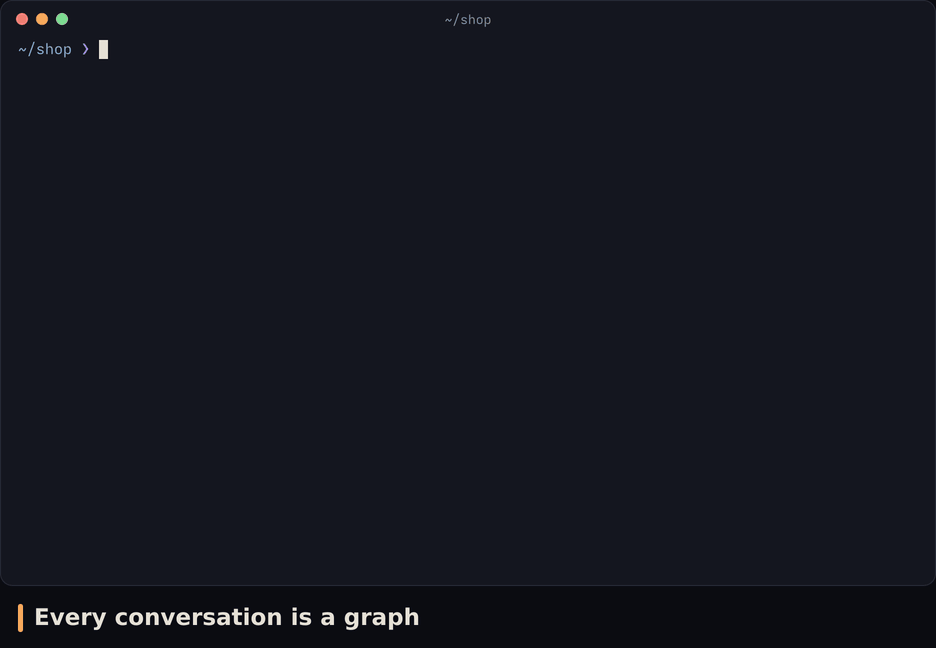
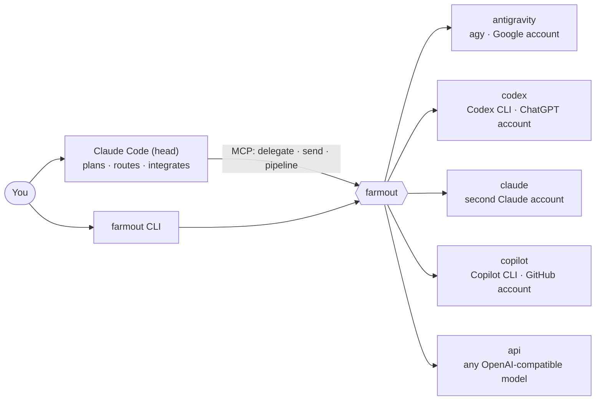

# The farmout guide

Every command, and how sessions, pipelines, skills, hooks, the store and settings work. Install, safety, terms of service and the FAQ are in the [README](../README.md).

**Contents:** [Commands](#commands) · [Sessions](#sessions) · [Pipelines](#pipelines) · [Skills](#skills) · [Hooks](#hooks) · [The store](#the-store) · [Which model is best on your code](#which-model-is-best-on-your-code) · [Settings](#settings) · [Usage limits and stats](#usage-limits-and-stats) · [The git hook](#the-git-hook) · [Inside Claude Code and other MCP clients](#inside-claude-code-and-other-mcp-clients) · [Inside editors (ACP)](#inside-editors-acp) · [Configuration](#configuration) · [Field notes](#field-notes) · [Alternatives](#alternatives) · [Roadmap](#roadmap)

## Commands

| command | what it does |
|---|---|
| `run <worker> "<prompt>"` | start a session: `-n name`, `--write` (edit the current directory), `--isolate` (edit a private worktree, make a patch), `--model` (or `claude:opus` as the worker), `--effort`, `--fallback w1,w2` (who takes over at a limit or a lost login; default: every other ready worker, `""` for none), `--bg`, `-f file`. `auto` picks the first allowed worker that isn't at a usage limit |
| `send <session> "<msg>"` | the next message; a busy session queues it. `--attach <session>` hands over that session's last reply, `-f` adds files, `--bg` returns at once. `--model opus` continues on another model, `-w codex[:model]` on another worker (it gets the conversation so far as a file). `--here` continues in the current folder after you moved the project (inside the same git repository farmout finds it without that) |
| `fork <session> "<msg>"` | branch a conversation: a new session that keeps its turns up to `--at N` (default: the newest; `0` keeps none) and goes on from there, on `-w worker[:model]` or `--model` if you like. Turns are numbered as `farmout tree` shows them |
| `continue ["<msg>"]` | carry on your own Claude Code, Codex or Copilot CLI session with another worker after a usage limit: the newest one you ran in this folder (or its git repository), `--session <id>` for another, `--list` to see them. The worker (`-w worker[:model]`; default: the first ready one not on the login that ran out; a second Claude account counts as another login) gets your prompts, the replies and a line per action, from the session's last compaction on, and the result is a farmout session like any other. Read-only unless `--write` or `--isolate` |
| `tree [session]` | every conversation as a graph: each turn's question, and each branch in a lane of its own off the turn it came from, as `git log --graph` draws branches (`--here` keeps this project's, `--all` adds review, ask and race runs; `--json`) |
| `relay [on\|off\|back\|test\|install\|uninstall]` | at Claude Code's usage limit, what you type there goes to another worker with the conversation, and the answer shows in Claude Code; once the limit resets, Claude is told what happened. `-w worker[:model]` (default: the first ready one not on Claude's login), `--write` or `--isolate`, `--wait <secs>` (600), `--auto` (carry on at once when the limit cuts a turn off). `back` hands prompts to Claude again before the reset; with no argument, the setting and what's being relayed. The farmout plugin's hook does the relaying |
| `ui [session]` | the same graph full-screen in your terminal: read any turn beside it, continue from the newest turn (`c`), branch off any turn (`b`) or ask one again differently (`e`) on any worker or model, find words in questions and answers (`/`), copy an answer (`y`), delete a branch (`D`); all the keys are under [Sessions](#sessions). `--web` shows it in your browser instead, on 127.0.0.1 with a key made for each run (paste an image into a message there to send it along) |
| `ask "<question>"` | the same question to every worker (`-w` to choose, `-w claude:opus,codex` to pick a model too, `-w claude:opus,claude:sonnet` for two models of one subscription), answers side by side; `--debate` lets each read the others and answer again |
| `review [focus]` | every worker reviews `--staged`, `--base <ref>` or your uncommitted change; `-w` takes the same lanes as `ask`, and `codex,codex` reviews twice with one model; `--min-agree N`, `--fail-on high\|medium\|low` for exit codes |
| `race "<task>"` | every worker attempts the task in its own worktree; `--test <cmd>` picks the winner, `--apply` lands it |
| `fix-pr <number>` | a pull request's review comments and failing checks (via `gh`; bots, the author's own replies and approvals left out) become a race; check the PR out first. `--dry-run` prints the brief and stops |
| `bench [-n N]` | replay N recent small bug fixes from your history; each worker (or `worker:model` lane) is scored on finding the bug. `--apply` makes the winners this repo's defaults, `--apply --last` applies your last run |
| `ls [--watch] [--here]`, `log`, `attach`, `wait`, `stop`, `rm` | list (or watch, as a dashboard; `--here` keeps this project's), read, watch, wait for, stop and delete sessions (`rm` also removes a session's worktree and branch, but keeps one with messages waiting or branches working in its worktree) |
| `diff`, `apply [--pr]`, `undo` | an isolated session's patch: show it, apply it (several in order, stopping at the first that doesn't apply), open a pull request with `gh`, or take an applied one back out |
| `export <session> [--html]` | a conversation as Markdown or a standalone HTML page |
| `status [--line]` | what's running, queued, waiting for approval or at a usage limit |
| `skill ls\|show\|run\|add\|rm`, `<skill>` | skills; `farmout <skill> [args]` runs one |
| `store ls\|show\|add\|rm\|update`, `tool ls\|run` | the store, and the tools you installed from it |
| `trust [--revoke\|--list]`, `hooks` | let a project's own hooks run; list the hooks in effect here |
| `pipe run\|ls\|status\|resume\|approve\|stop` | pipelines and their runs |
| `stats` | runs, failures, usage limits, time and tokens per subscription |
| `hook install\|uninstall [--pre-push]` | a git hook that reviews each commit or push |
| `copy [n]` · `paste` | copy a command from the newest answer, whole (a terminal breaks a long one over lines): `farmout copy` shows the code blocks and commands in the newest answer of your own Claude Code, Codex or Copilot CLI session here (or `-s <farmout session>`; `--all` for the last ten answers) to pick one with `↑` `↓` `⏎`, `farmout copy 2` copies the second (inside Claude Code, `!farmout copy` lists them); `farmout paste` saves the image on your clipboard to a file and prints its path, so in Claude Code `!farmout paste` puts a screenshot in the conversation without a trip through your screenshots folder (`-o` for where, `--copy` puts the path on the clipboard). They use wl-clipboard (Wayland), xclip (X11) or pbcopy/pngpaste (macOS); without one, copying goes through your terminal (OSC 52) and pasting can't work, as `farmout doctor` says |
| `doctor [--live]`, `mcp`, `acp`, `completion <shell>` | check the workers; serve the MCP tools on stdio; be an [ACP](#inside-editors-acp) agent for editors; print tab completion for bash, zsh or fish |

Every command but `mcp` takes `--json` for scripts and `-C <dir>`. Prompts can come from stdin; with a prompt given, piped stdin goes along as a file. Exit codes: 0 ok, 1 failed (or a review gate tripped), 130 stopped.

## Sessions

A session is a named conversation with one worker, saved in `~/.local/state/farmout/sessions/<name>/`. farmout resumes it through the worker CLI's own session id (`claude --resume`, `codex exec resume`, `copilot --session-id`, `agy --conversation`, `dsh --session-id`; for `api` it keeps the history itself), so the model really remembers earlier turns rather than rereading a summary.

Messages go through an inbox. The session's runner, a background process that holds the session's lock, answers them in order, which is why `send` to a busy session queues instead of failing, why `farmout attach` works from any terminal, and why `farmout stop` stops exactly one session's worker. Review, ask, race and pipeline stages all create sessions too, so you can follow up with any reviewer: `farmout send review-3-codex "Show me the input that breaks line 42"`.

**Branches.** `farmout fork <session> --at 3` starts a new session that keeps the conversation up to turn 3 and goes on from there, so one conversation becomes a tree: try Opus on one branch and Codex on another, or ask question 4 a different way, and keep both. Branching Claude off the end of its own conversation uses Claude's native fork; anything else gets the conversation so far as a file. A branch works in the same folder, read-only, and sees the files as they are now: the conversation branches, your files don't. `farmout tree` draws it as a graph:

```
dates · claude · 2m ago
● 1  Why does parse_date fail on 2024-02-30?
├─╮ ⑂ dates-1 · claude:opus
│ ● 2  Try it with a lookup table instead
● 2  Fix it and add a test for leap years
● 3  Now do the same for parse_time
```

`farmout ui` opens that graph full-screen in your terminal, every conversation in it, with the turn you're on beside it to read. Answers show their **bold** and `code`; a worker at its usage limit or logged out shows at the bottom, until when, and in the message box before you send to it. Paste a long message, or press Ctrl+G to write it in your editor.

<p align="center"></p>

| key | what it does |
|---|---|
| `↑` `↓` (`j` `k`, the mouse) | move; `J` `K` jump between conversations; `←` `→` fold and unfold a branch; `⏎` reads a turn |
| `c` · `b` · `e` · `R` | continue from the newest turn · branch off this one · ask this one again differently, on the same worker or another · send a failed newest turn again |
| `n` · `x` · `C` | a new conversation · stop a running turn · carry on your own Claude Code, Codex or Copilot CLI session from this folder (like `farmout continue`, read-only) |
| `Y` · Ctrl+P | copy one command from this answer, whole (pick it with `↑` `↓` `⏎`) · in the composer, attach the image on your clipboard (codex and copilot get it attached, the others as a file they open) |
| `a` · `f` · `S` | review, ask and race runs too (hidden at first) · only this project's conversations, or every folder's · what each subscription did this week (`farmout stats`) |
| `/` · `u` | find a question, a name, or words in an answer · go to the next answer you haven't read (the header counts them, and new ones are tagged) |
| `o` · `O` | this turn · its whole conversation, in your pager |
| `y` · `d` · `D` | copy the answer · an isolated session's patch · delete the conversation or branch, with the branches off it |
| `Tab` · `g` `G` · `r` · `?` · `q` | the graph or the reader · first, last · reload · these keys · quit |

Questions and answers are shown with escape sequences and control characters removed, so a worker's output can't rewrite your terminal. `farmout ui --web` shows the same in your browser: that page listens on 127.0.0.1 only and needs the key in the address it prints, so other sites you visit can't use it.

**Your own sessions.** When Claude Code tells you you've hit your limit, run `farmout continue --write` in another terminal (or after `!` at Claude Code's prompt, which runs a command without Claude). farmout reads the session file Claude Code keeps for this folder, takes the branch you were on from its last compaction (with Claude's summary of what came before), and hands your prompts, its replies and a line per action (`Edit cache.py`, `Bash: pytest -q`) to the next ready worker. Codex and Copilot CLI sessions work the same way (`--from codex`, `--from copilot`). Only sessions you ran yourself count: the `claude -p`, `codex exec` and `copilot -p` runs farmout starts are skipped. Credentials are replaced by the built-in patterns before anything leaves your machine, and the new session numbers its turns on from the imported ones, so `send`, `fork`, `tree` and `ui` work on it as usual (`export` includes the imported turns). When Claude is back, `farmout export <session>` shows it what happened meanwhile.

**At Claude Code's limit, keep typing.** Turn the relay on once (`farmout relay on --write`; without `--write` the worker only reads). When Claude Code says you've hit your limit, the next thing you type there goes to the first ready worker not on that login (or the one you named with `-w`), with the whole conversation as `continue` would hand it over, and its answer shows under your prompt: *Operation stopped by hook: Claude is at its usage limit until 03:40, so codex answered (farmout session codex-3): …*. Your next prompts go on in the same farmout session. Claude Code waits up to 10 minutes for an answer (`--wait` sets it, 840 seconds at most); a longer one comes with your next prompt, and `!farmout attach <session>` shows it as it goes. Once the limit resets, your prompts go to Claude again, and Claude is told once that those answers were the other worker's, what it may have changed (the files, with `--write`; `farmout diff` and `apply` with `--isolate`), and any answer you didn't see. Back early (another login, a model with quota left)? `farmout relay back`. With `--auto`, the moment the limit cuts a turn off, farmout carries on in the background (Claude Code's `StopFailure` hook), so a long task goes on with nobody at the keyboard, and your next prompt brings its answer. To see it work before you need it, `!farmout relay test` in Claude Code makes that session act as if at its limit for 10 minutes (`--minutes`), and `relay back` ends it. The farmout plugin installs the hook; it reads only the end of the session's file on each prompt (about 35 ms) and stays quiet until a limit, where with the relay off it only says the relay exists. Without the plugin, `farmout relay install` adds the hook to `~/.claude/settings.json` (`uninstall` takes it out). While it relays, `farmout status --line`, in Claude Code's status line too, says `claude out till 03:40 → codex`.

**Long conversations.** A worker that takes over a conversation (at a limit, with `send -w`, on a branch or through `continue`) reads it from a file. Past about 12k tokens that file is shortened: each older turn becomes one line, its question and the start of its answer, with the line range of the whole turn in a second file that holds every word; the newest three turns stay in full. The worker opens only the lines it needs, so moving a long conversation costs a fraction of rereading it.

**Moved or renamed folders.** Sessions are found by name, not by folder, and each remembers where its folder sits in its git repository. Rename or move the project, then `send` from anywhere inside it: the session follows, each worker resumes its own conversation by id, and its next message says where the folder went. An isolated session's worktree moves with the repository (farmout re-links it with `git worktree repair`). Outside a git repository, `farmout send <session> --here "..."` continues in the current folder. If a worker's CLI can't find its own conversation any more (a cleared session store, or an older Claude Code, which looked for a conversation only in its original folder), farmout gives it the conversation so far as a file instead of failing.

## Pipelines

A pipeline is a list of stages in a `.toml` (Python 3.11+) or `.json` file in `<repo>/.farmout/pipelines/` or `~/.config/farmout/pipelines/`. Each stage runs a skill (`review`, `ask`, `race`) or sends its prompt to one or more workers, and starts when the previous one ends. Names resolve to yours first, then the built-ins, then the project's: a repository can add pipelines but can't take over `fix`, `spec` or yours. A project's pipeline runs the `test` commands it contains, like a Makefile, so read it before you run it.

```toml
description = "Plan with Claude, build with Codex in a worktree, ship after I approve"

[[stage]]
name = "plan"
worker = "claude"
prompt = "Write a short plan for: {args}"

[[stage]]
name = "build"
worker = "codex"
isolate = true
prompt = "Implement the plan in {plan}. Run the tests."
test = "pytest -x"
gate = "tests"            # passes only if the test command passes in the worktree

[[stage]]
name = "review"
skill = "review"
in = "build"              # review the build's worktree
gate = "high == 0"

[[stage]]
name = "notes"
worker = "copilot"
approve = true            # waits for `farmout pipe approve <run>`
prompt = "Write release notes for the patch in {build.patch}"
```

- **Placeholders:** `{stage}` is that stage's output file, `{stage.patch}` its patch, `{args}` the free text after `farmout pipe run <name>`, `{key}` a parameter (`params` table, `--set key=value`), `{item}` a `foreach` item. A stage's output files are handed to the worker, so it can read them.
- **Gates:** `ok`, `tests`, `agree >= N`, `findings == 0`, `high == 0` (any `<`, `<=`, `==`, `!=`, `>=`, `>`), or `contains "TEXT"`. A gate that fails stops the stages after it.
- **`on`:** `success` (default), `failure` (only after something failed, e.g. cleanup or a notification), or `always`.
- **`foreach = "<stage>"`:** one session per `- item` line of that stage's output, spread over `workers`, in parallel (`max_items`, default 8).
- **`approve = true`:** the run pauses before the stage until `farmout pipe approve <run>` (or `--reject`).
- **Runs** live in `~/.local/state/farmout/runs/<run>/`. A failed, gated, stopped or interrupted run continues with `farmout pipe resume <run>`; `--bg` runs it in the background.

Built in: **`fix`** (review → fix what 2+ models agree on, `--set worker=codex test="pytest -x"` → review the fix) and **`spec`** (requirements → design → independent tasks → every task built in its own worktree in parallel → a check of the patches together). A worker your machine doesn't have is swapped for one it does.

## Skills

A skill is a folder with a `SKILL.md`: YAML frontmatter (`name`, `description`) and instructions, the format Claude Code, Codex and Copilot share. farmout runs it on your workers: `farmout <skill> [args]` (or `farmout skill run <skill>`). `$ARGUMENTS` in the instructions is replaced by the arguments, and the skill's folder is handed over so workers can read its references.

```markdown
---
name: security-review
description: Every worker reviews your change for security problems only.
mode: review          # ask (default) | review (farmout review, with these instructions as the focus) | race
workers: [codex, claude, copilot]   # default: one worker for ask, all of them for review and race
diff: true            # hand the workers your uncommitted change as a diff file
---
Look only for security problems that an attacker could trigger: ...
$ARGUMENTS
```

farmout also reads `write`, `isolate`, `test` (race mode), `model` and `effort`; other agents ignore these keys. Skills live in `<repo>/.farmout/skills/<name>/` (the project's, which win) and `~/.config/farmout/skills/<name>/` (yours). A pipeline stage can run one: `skill = "security-review"`, with the stage's `prompt` as its arguments.

`farmout skill add <source>` installs from anywhere: a local folder, a git repository (`--path` picks a skill in a repository of several, `--ref` a branch or tag; the commit is recorded), or a raw `SKILL.md` URL. A skill from a git repository or URL that contains code (a `scripts/` folder, executables, scripts) or symbolic links is refused: code comes only from [the store](#the-store), or from a folder you copy in yourself. And a skill can only make farmout *do* things (run its `test` command, give workers `write`) if it's one you vouch for: yours or the store's. A project's skills and fetched ones stay text; pass `--test` or `--write` yourself.

## Hooks

Commands that run on farmout's events, in your settings:

```toml
[[hooks]]
event = "TaskEnd"                       # SessionStart, MessageReceived, TaskStart, TaskEnd, StageEnd, PipelineEnd
command = "notify-send farmout done"
matcher = "codex|claude"                # optional: a regex on the worker, session or pipeline name
timeout = 30
```

A hook reads the event as one line of JSON on stdin (worker, prompt, files, session, result, run, stage and so on, by event). Exit 0 to go on; a `TaskStart` hook may print `{"prompt": "..."}` to rewrite the brief, or exit 2 (or print `{"decision": "block", "reason": "..."}`) to stop the task before it reaches the worker. Any other failure is shown and ignored. `farmout hooks` lists the hooks in effect.

Hooks are code, so farmout runs only yours (`~/.config/farmout/settings`), those installed from the store, and a project's own `.farmout/settings` hooks once you `farmout trust` that file. Trust is pinned to the file's SHA-256: if it changes, its hooks stop until you trust it again.

**`redact = true`** in your settings replaces credentials (API keys and tokens, private keys, JWTs, `password=…` values) in every brief and in piped stdin before they leave your machine. Files a worker reads itself are not touched; keep secrets out of `files`, or install the `guard-secrets` hook, which refuses tasks that list them.

## The store

`farmout store ls` lists reviewed skills, hooks and tools; `farmout store show <name>` prints an entry's files so you can read them first; `farmout store add <name>` installs it. Every file is checked against the SHA-256 in the store's index, and if any differs, nothing is installed. `farmout store update` reinstalls entries with a new version; tools run with `farmout tool run <name> [args]`.

| entry | kind | what it does |
|---|---|---|
| `security-review` | skill | every worker reviews your change for security problems only, merged with agreement counts |
| `test-gaps` | skill | the behaviours in your change that no test covers, and the test to add for each |
| `notify` | hook | a desktop notification, and a phone push through [ntfy](https://ntfy.sh) if `NTFY_TOPIC` is set, when a long turn or a pipeline ends |
| `guard-secrets` | hook | refuses a task that would hand a worker `.env`, private keys or credentials |
| `prune` | tool | deletes sessions idle for more than N days, with their worktrees |

The store is [`store/`](https://github.com/JayPokale/farmout/tree/main/store) in this repository (`index.json` plus each entry's files); every entry is read line by line before it's merged. Point `store` in your own settings (or `FARMOUT_STORE`) at another index, including a local path, to run your own. Only your settings can name a store, never a project's.

## Which model is best on your code

`farmout bench -n 3` finds recent small bug-fix commits in your history (a fix-like subject, 1-80 changed lines in at most 4 source files, and nothing else changed but tests and docs), undoes each fix's code in a scratch worktree so the bug is back as an uncommitted change in its real codebase, has every worker review it, and scores a worker when one of its findings lands within 3 lines of the change. The fix's tests and changelog stay as they are and the scratch copy's history doesn't name it, so nothing in the diff gives the bug away. `-w` takes lanes: `codex`, or `claude:opus` to name a model, and one worker on several models compares those models (side by side, in one review). A model the plan doesn't offer shows as failed, with the CLI's reason. It costs one review per lane per commit; the report, with every reply, is saved under `~/.local/state/farmout/bench/`. On two tqdm fixes, Claude, Codex and Copilot found both and Antigravity's fast model one.

`--apply` then puts the result to work in this repository: lanes are ranked by bugs found, then failures, then typical review time (so on a tie the quicker model wins), and `.farmout/settings.json` gets each compared worker's best model as its default (`models`) and a best-first `fallback` order, which `farmout run auto` follows too. Workers the bench didn't try stay at the end of the order. If the repository keeps its settings in `.farmout/settings.toml`, farmout doesn't rewrite TOML; it prints the lines to add instead. `farmout bench --apply --last` applies the newest saved run without spending anything. With one subscription this answers "is the big model worth my quota on this code?" with your own history instead of opinions.

## Settings

`~/.config/farmout/settings.toml` (yours) and `<repo>/.farmout/settings.toml` (the project's; `.json` works too, and on Python 3.9–3.10 only `.json` does):

```toml
workers = ["codex", "claude"]   # which subscriptions may see this repo, e.g. keep work code off personal accounts
write = false                   # forbid write and isolate here
web = false                     # forbid web access (agy can't turn its search off, so it's refused)
fallback = ["codex", "claude:sonnet"]   # who takes over at a usage limit or a lost login (default: every other ready worker; [] for none)
models = { claude = "sonnet", codex = "gpt-5.6-terra" }   # each worker's default model (`bench --apply` writes it)
timeout = 900                   # seconds per task
redact = true                   # strip credentials from briefs and piped input
rules = false                   # don't hand workers the project's CLAUDE.md, AGENTS.md or GEMINI.md (see below)
# [[hooks]] tables (see Hooks); in your own settings only: store = "<index URL or path>", and accounts (see Install)
```

Neither file can loosen the other: worker lists intersect, `write`, `web` and `rules` are off if either says so, and the shorter timeout wins. The project's `fallback` replaces yours and its `models` override yours (an explicit `--model` or `worker:model` always wins). Settings are always read from the main working tree, so a worker editing its worktree's copy changes nothing.

**One set of project rules.** Each CLI reads its own instruction file: Claude Code `CLAUDE.md` (or `AGENTS.md` when there's none), Codex `AGENTS.md`, Antigravity `GEMINI.md` or `AGENTS.md`, Copilot all of them. When a worker's CLI would read none of the files your project has (a `CLAUDE.md`-only repository and Codex, say), farmout quotes them in its brief and asks it to follow them, so a task, a review or a conversation carried on from Claude Code keeps those rules there too. A worker that reads one of them itself gets nothing added (keep `AGENTS.md` and `CLAUDE.md` in step if you have both). `rules = false` turns that off.

**`.farmoutinclude`** at the repo root lists ignored files that isolated worktrees need (glob patterns, one per line, e.g. `.env` or `config/*.local`). They are copied in, and never end up in a patch.

## Usage limits and stats

When a worker fails because its subscription hit a limit, farmout notes how long to leave it alone and runs the task on the next worker instead. The reset time is read from the CLI's message ("try again in 4 days 2 hours", "retry in 32.5s", "resets 3pm (Asia/Kolkata)", "try again at 3:04 PM"); if there's none, 15 minutes. A worker that isn't logged in, whose login expired or whose subscription ended gets the same treatment for 30 minutes, with a hint on how to log in again when nothing can take over. The next worker is the first available one from `--fallback`, a stage's `fallback` or the `fallback` setting, and otherwise every other ready worker except `api` (`[]` or `--fallback ""` turns it off). An entry can name a model, so `claude:opus` at its limit can hand over to `claude:sonnet`; limits are kept per model. In the middle of a conversation the next worker gets the turns so far as a file and the session carries on with it. Reviews never fall back, since agreement must count distinct reviewers; with no `-w`, a review leaves out workers known to be limited. Until a limit passes, tasks for that worker go straight to the next one, `farmout run auto` skips it, and `farmout status` and `farmout doctor` show it. `farmout stats` shows each subscription's runs, failures, limits, time and tokens from the usage log (`~/.local/state/farmout/usage.jsonl`, which never records prompts or outputs).

Your own Claude Code session doesn't run through farmout, but with `farmout relay on` what you type at its limit goes to another worker, answered in Claude Code, and `farmout continue` carries a Claude Code, Codex or Copilot CLI conversation on from any terminal ([Sessions](#sessions)). `farmout status` also shows how much of Codex's 5-hour and weekly limits is used, as Codex last wrote it into its own session files (after any turn, farmout's included); `--line` adds it once a window is half used. To keep an eye on limits, put `farmout status --line` in tmux's status bar, or in Claude Code's status line: `"statusLine": {"type": "command", "command": "farmout status --line"}` in `~/.claude/settings.json`.

## The git hook

`farmout hook install` adds a pre-commit hook (`--pre-push` for a pre-push one) that runs `farmout review --staged --min-agree 2 --fail-on high`: the commit is blocked when two or more models flag a high-severity problem. `FARMOUT_SKIP=1` (or `git commit --no-verify`) skips it once; an existing hook is moved aside with `--force` and restored by `farmout hook uninstall`.

## Inside Claude Code and other MCP clients



farmout is also an MCP server (`farmout mcp`, or `python3 server.py`), so Claude Code, Codex CLI, Copilot CLI or any MCP client can be the **head**: it plans, splits a job into self-contained subtasks, sends each to a model that is good enough for it, and keeps its own quota for the hard parts. farmout ships its routing policy as MCP server instructions, so there is no extra router model.

| tool | what it does |
|---|---|
| `delegate` | one-shot subtasks in parallel (up to 8): `worker`, `prompt`, `files`, `cwd`, `write`, `isolate`, `model`, `effort`; `background: true` returns at once. Full outputs land in `~/.cache/farmout/`, the head gets capped copies plus the paths |
| `send` | a message to a named session (give `worker` to start one); the worker remembers the conversation. For an existing session, `worker` or `model` moves the conversation there |
| `sessions` | list sessions, or one session's turns and output files |
| `pipeline` | list, run, status, approve, reject, resume or stop pipeline runs (they run in the background) |

Plugin slash commands: `/farmout:review [--base <ref>] [focus]` (every worker reviews; Claude merges and also verifies each finding against the code), `/farmout:race <task>`, `/farmout:ask <question>` and `/farmout:setup`. The plugin's **read guard** asks Claude, once per file, to delegate a big read (more than 5 pages of a long PDF, or 500+ lines of a 200 KB+ file); on a 16-page deep read that [halved Claude's cost but took minutes instead of seconds](https://github.com/JayPokale/farmout/blob/main/bench/README.md#read-guard-a-deep-read-with-and-without-it). `FARMOUT_READ_GUARD=0` turns it off. Its **relay hook** carries on your conversation with another subscription when Claude hits its usage limit, once you turn it on with `farmout relay on` ([Sessions](#sessions)).

Other heads: `codex mcp add farmout -- farmout mcp`, `copilot mcp add farmout -- farmout mcp` (Codex asks before each MCP call; for `codex exec`, set `default_tools_approval_mode = "approve"` under `[mcp_servers.farmout]`). Without the plugin, Claude Code takes `claude mcp add -s user farmout -- farmout mcp`.

**Inside DeepSeek Harness:** dsh loads MCP servers from its patch files. Add this to `$DSH_HOME/cordis.patch.yml` (every profile) or to one profile's `cordis.patch.yml`, and farmout's tools show up as `mcp__farmout__delegate` and so on. dsh strips credential-like and `DSH_*` variables from MCP servers, so pass what farmout needs in `env`:

```yaml
- insert:
    - id: farmout
      name: '@deepseek-ai/dsh-mcp-client'
      config:
        serverName: farmout
        transport: stdio
        command: farmout
        args: [mcp]
        env: { FARMOUT_CLAUDE_DIR: /home/you/.claude-2 }
        cwd: !!js process.cwd()
```

## Inside editors (ACP)

`farmout acp` is an [Agent Client Protocol](https://agentclientprotocol.com) agent, so editors that speak ACP (Zed, JetBrains IDEs, Neovim through CodeCompanion or avante.nvim, Emacs through agent-shell, several VS Code extensions) can use your subscriptions through farmout. In Zed, add it to your settings:

```json
"agent_servers": { "farmout": { "type": "custom", "command": "farmout", "args": ["acp"] } }
```

Each thread is a farmout session (`farmout ls`, `log`, `send` and `ui` see it), so a worker at its usage limit hands the thread to the next one, conversation included. Two pickers set a thread up: **Worker** (`auto`, the first ready one, or one you name) and **Files** (read only, the default; edit files; or a private git worktree whose patch you `farmout apply`). Files you link in the prompt go to the worker as files. Editors that list an agent's past sessions (Zed's thread history) see your farmout conversations, those from the CLI, `ui`, `continue` and the relay included, and opening one replays it and goes on in it. An answer arrives when the worker finishes (no word-by-word streaming), with a progress row meanwhile; cancel stops the turn.

## Configuration

| variable | default | effect |
|---|---|---|
| `FARMOUT_CLAUDE_DIR` | unset | config dir of a second Claude Code account; enables `claude` |
| `FARMOUT_CLAUDE_MAIN` | unset | `1` makes your main Claude login the `claude` worker when there's no second account (never inside Claude Code; `farmout bench` does it by itself) |
| `FARMOUT_API_BASE` | unset | OpenAI-compatible base URL ending in `/v1`; enables `api` together with `FARMOUT_API_MODEL` |
| `FARMOUT_API_MODEL` | unset | model name sent to that endpoint |
| `FARMOUT_API_KEY` | unset | bearer token for that endpoint |
| `FARMOUT_TIMEOUT` | `1200` | seconds per task (a `timeout` setting can lower it) |
| `FARMOUT_STATE` | `~/.local/state/farmout` | sessions, pipeline runs, the usage log, bench reports |
| `FARMOUT_STORE` | farmout's `store/index.json` on GitHub | the store's index (a URL or a local path) |
| `FARMOUT_READ_GUARD` | on | `0` turns off the plugin's read guard |
| `FARMOUT_SKIP` | unset | `1` skips the git hook once |

One-shot `delegate` outputs go to `~/.cache/farmout/` and are safe to delete. `farmout rm <session>` removes a session with its worktree and branch.

## Field notes

What we found building this, in case it saves you an afternoon:

- **Gemini CLI with a personal Google login now fails** with `IneligibleTierError`; that's why the Google worker drives Antigravity's `agy`, whose print mode works with the same login.
- **`agy -p` executes tools without asking under `toolPermission: always-proceed`.** Use `--mode plan` for anything meant to be read-only. In plan mode it sometimes returns only a plan stub, so farmout asks read-only tasks for the complete answer in the reply.
- **Headless Claude Code denies any tool that would ask for permission.** `--tools ...,WebSearch` alone gives the model a search tool it can never use; `--allowedTools WebSearch` pre-approves it.
- **`codex exec resume` takes no `-s` or `-C`.** Pass the sandbox as `-c sandbox_mode="read-only"` and run it in the session's directory.
- **Every worker CLI can resume a headless session by id**, but only Claude and Copilot let you choose the id up front; Codex and Antigravity report theirs (`thread.started` in `--json`, `conversation_id` in agy's JSON).
- **A nested `claude -p` inherits the parent session's variables** (`CLAUDECODE`, `CLAUDE_CODE_*`, ...). farmout strips them so every worker is a clean session on the other account. `claude --bare` never reads OAuth credentials, so it can't use a subscription login.
- **Copilot CLI's `--allow-all-tools` approves your MCP servers too**, and `--deny-tool` doesn't stop them. Allowlist with `--available-tools` instead.
- **Python's `text=True` turns CRLF into LF.** A diff read that way no longer applies to a CRLF file, so farmout moves patches as bytes.
- **Git hooks fire on internal commits and checkouts.** A review gate in pre-commit would review every worktree farmout makes, and `--no-verify` still runs post-commit and post-checkout hooks; farmout's own git calls use `-c core.hooksPath=/dev/null`.
- **Claude Code refuses edits under `.git`**, even inside a worktree placed there, so worktrees live in `<repo>/.farmout/worktrees/`.
- **Claude Code writes a usage limit into the session file.** The assistant entry carries `apiError: "usage_limit_reached"` and `apiErrorParams.rate_limit_info.resetsAt` (Unix seconds), not only the "You've hit your 5-hour limit · resets 3:40am" text; that's what `farmout relay` reads.
- **A `UserPromptSubmit` hook can answer in Claude's place.** `{"continue": false, "stopReason": "..."}` keeps the prompt in the conversation, shows the text under it and clears the input; Claude sees it later as a meta message. `{"decision": "block"}` instead puts the prompt back in the input box. `systemMessage` shows only when the prompt goes on.
- **`StopFailure` fires before the error is in the session file**, about 30 ms ahead; its `last_assistant_message` already has Claude Code's words. Commands typed after `!` in Claude Code get `CLAUDE_CODE_SESSION_ID`, but a new session's file holds no prompt until the first one is sent.
- **Codex keeps its usage figures in its session files** (`token_count` events: `used_percent` and `resets_at` for the 5-hour and weekly windows) but never writes errors there, so a Codex limit can't be read back the way Claude Code's can.
- **Models cite paths relative to whatever directory they think in** (`cli.py` for `pkg/cli.py`) and line numbers inside a `.diff` file unless told otherwise. farmout's review brief asks for current-file line numbers, and its citation check accepts a unique suffix match.


## Alternatives

Good tools exist in this space; choose by what you need:

| project | choose it when |
|---|---|
| [Codex plugin for Claude Code](https://github.com/openai/codex-plugin-cc) | you only need Codex, and want OpenAI's official rescue, session-transfer and background-job commands |
| [Claude Octopus](https://github.com/nyldn/claude-octopus) | you want structured multi-model councils, many providers and workflow gates, and don't mind a large plugin |
| [PAL MCP Server](https://github.com/BeehiveInnovations/pal-mcp-server) (formerly Zen) | you want many workflow tools (consensus, code review, planning) and API-key models, plus its `clink` CLI bridge |
| [claude-squad](https://github.com/smtg-ai/claude-squad), [Conductor](https://conductor.build), [vibe-kanban](https://github.com/BloopAI/vibe-kanban) | you want a TUI, desktop app or board to run several interactive agents side by side |
| [claude-code-router](https://github.com/musistudio/claude-code-router) | you want to swap the model behind Claude Code rather than use other CLIs |
| [DeepSeek Harness](https://github.com/deepseek-ai/deepseek-harness) | you want an open, plugin-based harness to move into, built around DeepSeek's models (farmout can drive it as a worker, and run inside it) |
| **farmout** | you want the subscriptions you already have working together, read-only by default, from a terminal or an MCP client, with sessions, cross-model review, races, pipelines, skills, hooks and a hash-pinned store, in standard-library Python you can audit |

## Roadmap

- More workers with verified read-only flags: OpenCode, Qwen Code, Cursor CLI, Gemini CLI for API-key users
- PyPI release for `uvx farmout`
- A CI mode that comments on a pull request only with findings models agree on
- Workers in containers
