# modelmux

[English](../README.md) · [简体中文](README.zh-CN.md) · [日本語](README.ja.md) · [한국어](README.ko.md) · **Español**

**Deja que Claude Code delegue el trabajo pesado a tus otras suscripciones de IA: en paralelo, de solo lectura por defecto, desde un único archivo Python sin dependencias.**

[](https://github.com/JayPokale/modelmux/actions/workflows/ci.yml)


<p align="center"></p>

- **`/modelmux:review`**: Codex, Gemini (mediante Antigravity), GitHub Copilot y una segunda cuenta de Claude revisan tu diff a la vez, en modo de solo lectura. Claude combina los hallazgos, cuenta cuántos modelos señalaron cada problema y verifica cada hallazgo contra el código. En [nuestro benchmark](../bench/README.md), cada uno de los 23 bugs introducidos intencionadamente fue señalado por al menos tres de los cuatro modelos.
- **`/modelmux:race <task>`**: cada modelo intenta la misma corrección en su propio git worktree; tus pruebas eligen al ganador y nada modifica tu árbol hasta que lo indiques.
- **Delegación diaria**: Claude delega lecturas largas y código repetitivo a la suscripción más adecuada. Resumir tres artículos así le costó a Claude **59% menos tokens** (74% menos coste) para obtener las mismas respuestas.

Pagas por Claude. Quizá también por ChatGPT, Google AI, una segunda licencia de Claude o ejecutas un modelo abierto en una GPU. Aun así, la cuota de tu mejor modelo sigue consumiéndose leyendo PDF y escribiendo código repetitivo mientras los demás están inactivos.

modelmux convierte Claude Code en la **cabeza**. Planifica, divide un trabajo en subtareas independientes, envía cada una a un modelo suficientemente bueno para ella y reserva su propia cuota para las partes difíciles:

- un artículo de 60 páginas va a **Antigravity** (Gemini), que lo lee y devuelve 150 palabras
- "escribe pruebas para `parse_date()`" va a **Codex**, que las escribe y ejecuta
- el trabajo de complejidad media va a tu **segunda cuenta de Claude**
- una segunda opinión sobre un cambio complejo va a **GitHub Copilot**, que ofrece modelos de varios proveedores
- clasificar 2.000 líneas va a **cualquier modelo compatible con OpenAI** (Ollama, vLLM, OpenRouter, Qwen, ...)

Todo se ejecuta a la vez desde una única llamada a herramienta. Cada worker es la CLI oficial del proveedor, autenticada con tu propia suscripción, por lo que los workers de CLI no necesitan claves de API.

## Inicio rápido

Requisitos: Python 3.9+, Linux (probado) o macOS (sin probar), [Claude Code](https://github.com/anthropics/claude-code) y al menos un worker:

| worker | necesita | adecuado para |
|---|---|---|
| `antigravity` | [Antigravity CLI](https://antigravity.google) (`agy`), con sesión iniciada | PDF largos, artículos, lectura de muchos archivos, investigación web; Gemini y otros modelos mostrados por `agy models` |
| `codex` | [Codex CLI](https://github.com/openai/codex), con sesión iniciada | programación bien especificada, pruebas, refactors, revisiones |
| `claude` | una segunda cuenta de Claude Code + `MODELMUX_CLAUDE_DIR` | trabajo general con cuota independiente |
| `copilot` | [GitHub Copilot CLI](https://github.com/github/copilot-cli), con sesión iniciada | revisión de código, preguntas concretas de programación, segundas opiniones; modelos de varios proveedores |
| `api` | `MODELMUX_API_BASE` + `MODELMUX_API_MODEL` | trabajo masivo o simple con cualquier modelo compatible con OpenAI |

```bash
git clone https://github.com/JayPokale/modelmux ~/.local/share/modelmux
claude mcp add -s user modelmux -- python3 ~/.local/share/modelmux/server.py
claude mcp list        # modelmux: ... ✔ Connected
```

O instálalo como plugin de Claude Code; `claude plugin update modelmux` lo mantiene actualizado:

```bash
claude plugin install modelmux --marketplace JayPokale/modelmux
```

El servidor de un plugin lee su configuración de tu entorno; por tanto, con el plugin, usa `export` para las variables `MODELMUX_*` siguientes en tu perfil de shell en vez de pasar `-e`. Usa un único método de instalación, no ambos.

**Otras cabezas.** Codex CLI y Copilot CLI también pueden manejar modelmux, así que pueden delegar trabajo en Claude, Gemini o entre sí (ambos probados con una ida y vuelta al worker `claude`):

```bash
codex mcp add modelmux -- python3 ~/.local/share/modelmux/server.py
copilot mcp add modelmux -- python3 ~/.local/share/modelmux/server.py
```

Codex pide confirmación antes de cada llamada a una herramienta MCP. Para `codex exec`, añade `default_tools_approval_mode = "approve"` bajo `[mcp_servers.modelmux]` en `~/.codex/config.toml`. Los comandos slash solo funcionan en Claude Code.

Reinicia Claude Code. Los workers se detectan al iniciar. Para ver cuáles están preparados y cómo habilitar el resto, ejecuta `python3 server.py doctor` (o `/modelmux:setup` con el plugin); `doctor --live` también envía a cada uno un prompt pequeño para comprobar que su inicio de sesión funciona.

## Uso

### Comandos slash (instalación mediante plugin)

| comando | qué hace |
|---|---|
| `/modelmux:review [--base <ref>] [focus]` | cada worker revisa en paralelo y en modo de solo lectura tus cambios sin confirmar (o la rama desde `<ref>`); Claude combina los hallazgos, cuenta cuántos modelos señalaron cada uno y los verifica contra el código |
| `/modelmux:ask <question>` | la misma pregunta a cada worker; obtienes el consenso, los desacuerdos y el veredicto de Claude |
| `/modelmux:race <task>` | cada worker con capacidad de escritura intenta el mismo cambio en su propio git worktree, en paralelo; Claude ejecuta tus pruebas en cada intento, compara los parches y aplica el mejor cuando estés de acuerdo |
| `/modelmux:setup` | qué workers están preparados y el paso exacto para habilitar cada uno que falte |

## Seguridad

| worker | solo lectura (predeterminado) | `write: true` |
|---|---|---|
| `antigravity` | `agy -p … --mode plan` | `--mode accept-edits --sandbox` |
| `codex` | `codex exec -s read-only` | `-s workspace-write` |
| `claude` | `claude -p --tools Read,Grep,Glob,WebSearch` | `--permission-mode acceptEdits` |
| `copilot` | `copilot -p … --allow-all-tools --available-tools view rg glob web_fetch` | añade `apply_patch edit create`; nunca una shell |
| `api` | sin herramientas | n/a |

---

Esta es una traducción abreviada. El [README](../README.md) en inglés es la referencia para la configuración, la herramienta `delegate`, notas de campo, las preguntas frecuentes y los benchmarks.
