# modelmux

[English](../README.md) · [简体中文](README.zh-CN.md) · **日本語** · [한국어](README.ko.md) · [Español](README.es.md)

**Claude Code の単純作業を、お手持ちの他の AI サブスクリプションに任せましょう。並列実行、デフォルトは読み取り専用、依存ゼロの Python ファイル 1 つで動きます。**

[](https://github.com/JayPokale/modelmux/actions/workflows/ci.yml)


<p align="center"></p>

- **`/modelmux:review`**: Codex、Gemini (Antigravity 経由)、GitHub Copilot、2 つ目の Claude アカウントが、あなたの diff を読み取り専用で同時にレビューします。Claude が結果を統合し、各問題を指摘したモデル数を集計して、すべての指摘をコードと照合します。[ベンチマーク](../bench/README.md)では、仕込んだ 23 件のバグのすべてが、4 モデル中 3 モデル以上に指摘されました。
- **`/modelmux:race <task>`**: 各モデルが同じ修正を、それぞれ専用の git worktree で試みます。勝者はテストで決まり、あなたが承認するまで作業ツリーには一切変更が入りません。
- **日常的な委譲**: Claude が長文の読み込みやボイラープレートの作成を、適したサブスクリプションに任せます。この方法で論文 3 本を要約したところ、同じ回答を得るのに Claude のトークン消費は **59% 減**(コストは 74% 減)でした。

Claude には課金している。ChatGPT や Google AI、2 つ目の Claude シート、あるいは GPU 上のオープンモデルもあるかもしれません。それなのに、最良のモデルのクォータは PDF の読み込みやボイラープレートの作成に消え、他のモデルは遊んでいます。

modelmux は Claude Code を**ヘッド**にします。ヘッドは計画を立て、ジョブを自己完結したサブタスクに分割し、それぞれを十分な能力を持つモデルに送って、自分のクォータは難しい部分のために温存します。

- 60 ページの論文は **Antigravity** (Gemini) が読み、150 語にまとめて返します
- 「`parse_date()` のテストを書いて」は **Codex** が、テストの作成と実行まで行います
- 中程度の複雑さの作業は **2 つ目の Claude アカウント**に任せます
- 難しい変更へのセカンドオピニオンは、複数ベンダーのモデルを提供する **GitHub Copilot** に任せます
- 2,000 行の分類は**任意の OpenAI 互換モデル**(Ollama、vLLM、OpenRouter、Qwen など)に任せます

これらは 1 回のツール呼び出しで同時に実行されます。各ワーカーはベンダー純正の CLI で、あなた自身のサブスクリプションでログインして使うため、CLI ワーカーに API キーは不要です。

## クイックスタート

必要なもの: Python 3.9+、Linux (動作確認済み) または macOS (未検証)、[Claude Code](https://github.com/anthropics/claude-code)、および 1 つ以上のワーカー:

| ワーカー | 必要なもの | 向いている用途 |
|---|---|---|
| `antigravity` | [Antigravity CLI](https://antigravity.google) (`agy`)、ログイン済み | 長い PDF、論文、多数ファイルの読み込み、Web 調査。Gemini のほか `agy models` に表示される他のモデルも使えます |
| `codex` | [Codex CLI](https://github.com/openai/codex)、ログイン済み | 仕様が明確なコーディング、テスト、リファクタリング、レビュー |
| `claude` | 2 つ目の Claude Code アカウント + `MODELMUX_CLAUDE_DIR` | 別クォータでの汎用的な作業 |
| `copilot` | [GitHub Copilot CLI](https://github.com/github/copilot-cli)、ログイン済み | コードレビュー、焦点を絞ったコーディングの質問、セカンドオピニオン。複数ベンダーのモデルを利用可能 |
| `api` | `MODELMUX_API_BASE` + `MODELMUX_API_MODEL` | 任意の OpenAI 互換モデルによる大量作業や単純作業 |

```bash
git clone https://github.com/JayPokale/modelmux ~/.local/share/modelmux
claude mcp add -s user modelmux -- python3 ~/.local/share/modelmux/server.py
claude mcp list        # modelmux: ... ✔ Connected
```

Claude Code プラグインとしてインストールすることもできます。`claude plugin update modelmux` で最新の状態を保てます。

```bash
claude plugin install modelmux --marketplace JayPokale/modelmux
```

プラグインのサーバーは設定を環境変数から読み込みます。そのため、プラグインを使う場合は `-e` を渡す代わりに、以下の `MODELMUX_*` 変数をシェルのプロファイルで `export` してください。インストール方法は 1 つだけにし、両方は使わないでください。

**他のヘッド。** Codex CLI と Copilot CLI も modelmux を操作でき、Claude や Gemini、あるいは互いに作業を任せられます (どちらも `claude` ワーカーとの往復で動作確認済み)。

```bash
codex mcp add modelmux -- python3 ~/.local/share/modelmux/server.py
copilot mcp add modelmux -- python3 ~/.local/share/modelmux/server.py
```

Codex は MCP ツールを呼び出すたびに確認を求めます。`codex exec` で使う場合は、`~/.codex/config.toml` の `[mcp_servers.modelmux]` に `default_tools_approval_mode = "approve"` を追加してください。スラッシュコマンドは Claude Code 専用です。

Claude Code を再起動してください。ワーカーは起動時に検出されます。どれが使用可能か、残りをどう有効にするかは `python3 server.py doctor` (プラグインなら `/modelmux:setup`) で確認できます。`doctor --live` は、各ワーカーに短いプロンプトも送り、ログインが機能していることを確かめます。

## 使い方

### スラッシュコマンド (プラグインインストール時)

| コマンド | 内容 |
|---|---|
| `/modelmux:review [--base <ref>] [focus]` | 全ワーカーが未コミットの変更 (または `<ref>` 以降のブランチ) を並列かつ読み取り専用でレビューします。Claude が指摘を統合し、各指摘を挙げたモデル数を集計して、コードと照合します |
| `/modelmux:ask <question>` | 同じ質問を全ワーカーに送ります。合意点、意見の相違点、Claude の判断が得られます |
| `/modelmux:race <task>` | 書き込み可能な全ワーカーが、同じ変更をそれぞれ専用の git worktree で並列に試みます。Claude が各結果に対してテストを実行してパッチを比較し、あなたが同意すれば最良のものを適用します |
| `/modelmux:setup` | 使用可能なワーカーと、未設定のワーカーを有効にするための具体的な手順を表示します |

## 安全性

| ワーカー | 読み取り専用 (デフォルト) | `write: true` |
|---|---|---|
| `antigravity` | `agy -p … --mode plan` | `--mode accept-edits --sandbox` |
| `codex` | `codex exec -s read-only` | `-s workspace-write` |
| `claude` | `claude -p --tools Read,Grep,Glob,WebSearch` | `--permission-mode acceptEdits` |
| `copilot` | `copilot -p … --allow-all-tools --available-tools view rg glob web_fetch` | `apply_patch edit create` を追加。シェルは一切不可 |
| `api` | ツールなし | 該当なし |

---

この翻訳は抄訳です。設定、`delegate` ツール、フィールドノート、FAQ、ベンチマークについては、英語版の [README](../README.md) が正となります。
