# farmout

[English](../README.md) · [简体中文](README.zh-CN.md) · [日本語](README.ja.md) · **한국어** · [Español](README.es.md)

**구독 중인 모든 AI를 일하게 하세요: Codex, Gemini, GitHub Copilot, 두 번째 Claude 계정, 로컬 모델. 대화를 기억하는 세션, 병렬 코드 리뷰, 테스트가 승자를 정하는 레이스, 파이프라인을 터미널에서도 Claude Code 안에서도 쓸 수 있습니다. 기본은 읽기 전용이고 의존성은 0개입니다.**

[](https://github.com/JayPokale/farmout/actions/workflows/ci.yml)


> **참고:** 이 번역은 이전 버전을 기준으로 합니다. 최신 기능(`farmout bench --share`, 실시간 진행 표시, DeepSeek 지원 등)은 [영어 README](../README.md)를 참고하세요.

```bash
pipx install git+https://github.com/JayPokale/farmout
cd your-repo && farmout bench --share   # 내 코드의 실제 버그를 가장 잘 찾는 AI는?
```

<p align="center"></p>

- **`/farmout:review`**: Codex, Gemini(Antigravity 경유), GitHub Copilot, 두 번째 Claude 계정이 동시에 읽기 전용으로 diff를 리뷰합니다. Claude는 각 모델이 발견한 내용을 병합하고, 문제를 지적한 모델 수를 집계하며, 코드와 대조하여 모든 항목을 검증합니다. [자체 벤치마크](../bench/README.md)에서는 32개의 버그(의도적으로 심은 23개, 오픈소스 프로젝트의 실제 회귀 9개) 모두가 4개 모델 중 최소 3개에서 지적되었습니다.
- **`/farmout:race <task>`**: 모든 모델이 각자의 git worktree에서 동일한 수정을 시도합니다. 테스트를 통해 최적의 결과를 선택하며, 사용자가 승인하기 전까지는 기존 트리를 전혀 변경하지 않습니다.
- **일상적인 작업 위임**: Claude가 긴 문서 읽기나 보일러플레이트 작성을 상황에 맞는 구독 서비스에 위임합니다. 이 방식으로 논문 3편을 요약했을 때 동일한 답변에 대해 Claude의 토큰 소비가 **59% 감소**(비용 74% 절감)했습니다.

Claude 구독료를 내고 계실 겁니다. 어쩌면 ChatGPT, Google AI, 추가 Claude 계정을 함께 쓰거나 GPU에서 오픈 모델을 구동하고 계실 수도 있습니다. 하지만 다른 모델들이 유휴 상태인 동안에도 가장 우수한 모델의 할당량이 여전히 PDF 읽기와 보일러플레이트 작성에 낭비되고 있습니다.

farmout는 Claude Code를 **헤드(head)** 로 만듭니다. 작업을 계획하고 독립적인 하위 작업으로 분할하여 적합한 성능의 모델로 전달하며, 자체 할당량은 고난도 작업에 집중합니다:

- 60페이지 분량의 논문은 **Antigravity**(Gemini)로 전달되어 문서를 읽고 150단어로 요약합니다
- "`parse_date()` 테스트 작성"은 **Codex**로 전달되어 테스트를 작성하고 실행합니다
- 중간 난이도의 작업은 **두 번째 Claude 계정**이 처리합니다
- 까다로운 변경 사항에 대한 2차 의견은 여러 벤더의 모델을 제공하는 **GitHub Copilot**에 맡깁니다
- 2,000줄 분류 작업은 **임의의 OpenAI 호환 모델**(Ollama, vLLM, OpenRouter, Qwen 등)로 전달됩니다

이 모든 작업은 단 한 번의 툴 호출로 동시에 실행됩니다. 각 워커는 사용자의 구독 계정으로 로그인된 각 벤더의 자체 CLI이므로 CLI 워커에는 API 키가 필요 없습니다.

## 명령줄

farmout은 CLI로도 쓸 수 있습니다. 저장소를 클론한 뒤 `pipx install`로 설치하고(PyPI 배포 예정), `farmout doctor --live`로 워커를 확인하세요:

```bash
# 모든 모델이 변경 사항을 리뷰하고, 몇 개 모델이 동의했는지와 함께 결과를 합칩니다
farmout review
# 각 모델이 자기 worktree에서 시도하고, 테스트가 승자를 고릅니다
farmout race "tests/test_sync.py의 불안정한 테스트를 결정적으로 만들기" --test "pytest tests/test_sync.py -x"
# 대화를 기억하는 세션
farmout run codex "src/dates.py의 parse_date()에 단위 테스트 추가" --isolate -n dates
farmout send dates "윤년도 다뤄 줘"
# 패치를 작업 트리에 적용(또는 --pr)
farmout apply dates
# 리뷰 → 2개 이상 모델이 동의한 문제 수정 → 수정 리뷰
farmout pipe run fix
# 각 구독이 해 준 일
farmout stats
```

세션, 파이프라인(단계·게이트·승인이 있는 `.toml` 또는 `.json` 파일), 저장소별 설정(`.farmout/settings.toml`: 코드를 볼 수 있는 제공자, 쓰기 금지, 웹 금지), 한 구독이 사용 한도에 도달하면 다른 워커로 자동 전환, 모든 커밋을 리뷰하는 git 훅은 [영문 README](../README.md)를 참고하세요.

## 빠른 시작

요구 사항: Python 3.9+, Linux(테스트 완료) 또는 macOS(미테스트), [Claude Code](https://github.com/anthropics/claude-code), 그리고 최소 하나 이상의 워커:

| 워커 | 필요 조건 | 추천 용도 |
|---|---|---|
| `antigravity` | [Antigravity CLI](https://antigravity.google) (`agy`), 로그인 필요 | 긴 PDF, 논문, 대량 파일 읽기, 웹 리서치; Gemini 및 `agy models`에 나열된 기타 모델 |
| `codex` | [Codex CLI](https://github.com/openai/codex), 로그인 필요 | 명확히 정의된 코딩, 테스트, 리팩터링, 리뷰 |
| `claude` | 두 번째 Claude Code 계정 + `FARMOUT_CLAUDE_DIR`, 또는 기본 로그인 + `FARMOUT_CLAUDE_MAIN=1` | 별도 할당량을 활용한 일반 작업 |
| `copilot` | [GitHub Copilot CLI](https://github.com/github/copilot-cli), 로그인 필요 | 코드 리뷰, 집중적인 코딩 질문, 2차 의견; 여러 벤더의 모델 활용 |
| `api` | `FARMOUT_API_BASE` + `FARMOUT_API_MODEL` | OpenAI 호환 모델 기반의 대량 또는 단순 작업 |

```bash
git clone https://github.com/JayPokale/farmout ~/.local/share/farmout
claude mcp add -s user farmout -- python3 ~/.local/share/farmout/server.py
claude mcp list        # farmout: ... ✔ Connected
```

또는 Claude Code 플러그인으로 설치할 수 있으며, `claude plugin update farmout`를 통해 최신 상태로 유지됩니다:

```bash
claude plugin install farmout --marketplace JayPokale/farmout
```

플러그인 서버는 환경 변수에서 설정을 읽어오므로, 플러그인 사용 시 `-e`로 넘기는 대신 셸 프로필에 아래 `FARMOUT_*` 변수들을 `export`하세요. 설치 방법은 둘 중 하나만 선택해야 합니다.

**다른 헤드.** Codex CLI와 Copilot CLI도 farmout를 구동할 수 있어 Claude, Gemini 또는 서로에게 작업을 넘길 수 있습니다 (둘 다 `claude` 워커와의 왕복 호출로 테스트됨):

```bash
codex mcp add farmout -- python3 ~/.local/share/farmout/server.py
copilot mcp add farmout -- python3 ~/.local/share/farmout/server.py
```

Codex는 MCP 도구를 호출할 때마다 승인을 요청합니다. `codex exec`에서는 `~/.codex/config.toml`의 `[mcp_servers.farmout]` 아래에 `default_tools_approval_mode = "approve"`를 추가하세요. 슬래시 명령어는 Claude Code 전용입니다.

Claude Code를 재시작하세요. 워커는 시작 시 자동으로 감지됩니다. 준비된 워커를 확인하고 나머지를 활성화하는 방법을 보려면 `python3 server.py doctor`(또는 플러그인 사용 시 `/farmout:setup`)를 실행하세요. `doctor --live`를 실행하면 각 워커에 간단한 프롬프트를 보내 로그인이 정상 동작하는지 테스트합니다.

## 사용법

### 슬래시 명령어 (플러그인 설치 시)

| 명령어 | 동작 |
|---|---|
| `/farmout:review [--base <ref>] [focus]` | 모든 워커가 커밋되지 않은 변경 사항(또는 `<ref>` 이후 브랜치)을 읽기 전용으로 병렬 리뷰합니다. Claude가 발견 항목을 병합하고 각 문제를 지적한 모델 수를 집계한 뒤 코드와 대조해 검증합니다 |
| `/farmout:ask <question>` | 모든 워커에 동일한 질문을 전달합니다. 모델 간의 합의점과 이견, 그리고 Claude의 최종 판단을 확인할 수 있습니다 |
| `/farmout:race <task>` | 쓰기 권한이 있는 모든 워커가 각자의 git worktree에서 동일한 변경을 병렬로 시도합니다. Claude가 각 시도에 대해 테스트를 실행하고 패치를 비교한 뒤 사용자가 동의하면 최선의 패치를 적용합니다 |
| `/farmout:setup` | 준비된 워커 목록과 비활성 워커를 활성화하는 정확한 단계를 보여줍니다 |

## 안전성

| 워커 | 읽기 전용 (기본값) | `write: true` |
|---|---|---|
| `antigravity` | `agy -p … --mode plan` | `--mode accept-edits --sandbox` |
| `codex` | `codex exec -s read-only` | `-s workspace-write` |
| `claude` | `claude -p --tools Read,Grep,Glob,WebSearch` | `--permission-mode acceptEdits` |
| `copilot` | `copilot -p … --allow-all-tools --available-tools view rg glob web_fetch` | `apply_patch edit create` 추가, 셸 실행은 절대 불가 |
| `api` | 도구 없음 | 해당 없음 |

---

이 문서는 요약 번역본입니다. 환경 설정, `delegate` 도구, 실무 참고 사항(field notes), FAQ 및 벤치마크에 대한 자세한 내용은 영문 [README](../README.md)를 참고하세요.
