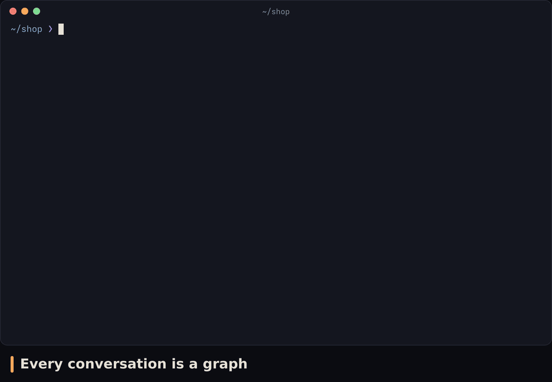
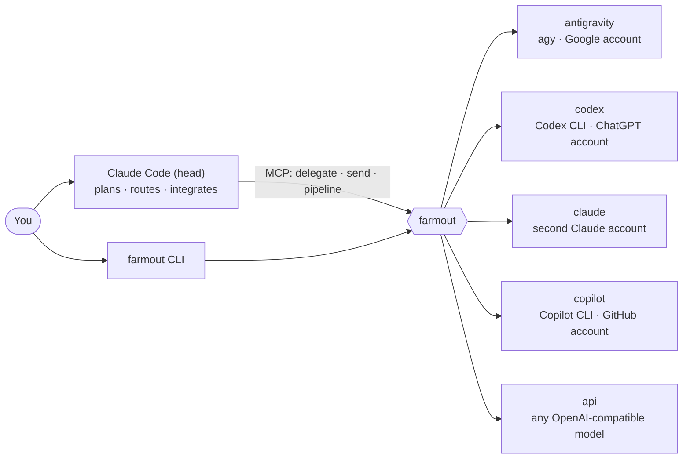

# farmout

[English](../README.md) · **简体中文** · [日本語](README.ja.md) · [한국어](README.ko.md) · [Español](README.es.md)

**少撞额度上限；撞上了也能接着干。**

farmout 把工作交给你已经付费的各个 AI 订阅：Claude、Codex、Gemini、GitHub Copilot、DeepSeek、第二个 Claude 账号、本地模型。把长篇阅读和代码审查交给它们，主力模型的额度就能撑得更久；其中某个订阅触及用量上限或登录失效时，任务会交给下一个，对话也一起带过去。可以从任意一轮分叉的对话、并行代码审查、由你的测试裁定胜负的竞速，还有流水线，在终端里或在 Claude Code 内部都能用。默认只读，零依赖。

[](https://github.com/JayPokale/farmout/actions/workflows/ci.yml)


> **公开预览版**：欢迎试用，遇到问题请到 [Discussions](https://github.com/JayPokale/farmout/discussions) 告诉我们；也可以给仓库点个 Star 或 Watch，0.1.0 发布时就能收到通知。

```bash
pipx install git+https://github.com/JayPokale/farmout
cd your-repo && farmout bench --share   # 哪个 AI 订阅最能在你自己的代码里找出真实的 bug？
```

<p align="center"></p>

- **在 Claude Code 撞上限时接着输入**：运行过 `farmout relay on` 之后，Claude Code 提示你已达用量上限时，你接着输入的内容会带着整段对话交给你的另一个订阅，回答直接显示在 Claude Code 里；额度重置后，Claude 会得知这期间发生了什么。`farmout continue --write` 在任意终端里做同样的事，Codex 和 Copilot CLI 会话也行。
- **撞上限也不停**：某个订阅触及用量上限或已退出登录时，farmout 的任务、对话或流水线阶段会带着此前的对话交给下一个可用的模型，而不是直接失败。也可以主动切换（`farmout send cache -w codex`，或 `--model opus`）。
- **在 Claude Code 里少用额度**：Claude 会把长篇阅读和样板代码交给最合适的订阅。用这种方式总结三篇论文，答案完全相同，Claude 却少用了 **59% 的 token**（成本降低 74%）。
- **`farmout bench`**：在你自己的代码上，哪个 AI 最强？Opus 值得占用你的额度吗？farmout 会在临时 worktree 里撤销你 git 历史中最近的 bug 修复，让你的每个订阅去把 bug 找出来；加上 `--share`，还能把得分做成一篇帖子和一张图片卡片（只有分数，绝不包含你的代码）。
- **`farmout review`**：Codex、Gemini（通过 Antigravity）、GitHub Copilot 和第二个 Claude 账号同时以只读方式审查你的改动。各模型的发现会合并在一起，并标出有几个模型意见一致；凡是引用了不存在的文件或行号的发现，在你看到之前就会被剔除。在[我们的基准测试](../bench/README.md)中，32 个 bug（23 个人为植入，9 个是来自开源项目的真实回归）每一个都被四个模型中的至少三个指出。
- **`farmout race "<task>" --test "pytest -x"`**：每个模型都在各自的 git worktree 里尝试同一处改动，由你的测试选出胜者；在你执行 `farmout apply` 之前，你的工作区不会有任何改动。
- **只有一个订阅也够用**：同一个订阅里的多个模型可以各占一条线路（`farmout review -w claude:opus,claude:sonnet`，或用 `-w codex,codex` 让同一个模型审查两次）；`farmout bench --apply` 会把在你自己代码上表现最好的模型设为默认；某个模型触及上限时，交给你指定的下一个模型（`fallback = ["claude:sonnet"]`）。
- **`farmout run` / `send` / `fork` / `ui`**：和任意 worker 开启命名对话，忙碌时把新消息排进队列，还能把一个会话的回复转交给另一个会话。可以从任意一轮分叉到另一个模型（`farmout fork cache --at 2 -w codex "..."`），用 `farmout ui` 在终端里把每段对话画成一张分支图：阅读任意一轮、接着往下聊，或从那里分叉。文件夹改名或移动后，对话照样能继续。
- **`farmout pipe run fix`**：先审查你的改动，再在 worktree 里修复两个及以上模型一致指出的问题，然后审查这次修复。你也可以自己编写流水线，支持门禁（gate）、审批和并行阶段。
- **技能、钩子和商店**：在任意 worker 上运行 `SKILL.md` 技能（Claude Code、Codex 和 Copilot 通用的格式），挂接 farmout 的各类事件，还能安装经过审核的钩子、技能和工具，每个文件都用 SHA-256 锁定。

你为 Claude 付了费，可能还订阅了 ChatGPT、Google AI、GitHub Copilot、第二个 Claude 席位，或者在 GPU 上跑着开源模型。它们各自待在自己的终端里，一天中的大部分时间都闲着。farmout 以你的身份驱动这些服务的官方 CLI，让它们并行干活、互相检查，在同一项工作上轮流接力。不需要 API Key，没有额外账单，也没有任何依赖：纯 Python 标准库实现，在把账号托付给它之前，你可以先把代码通读一遍。

## 安装

运行要求：Python 3.9+、Linux（已测试）或 macOS（未测试）、git，以及至少一个 worker：

| worker | 需要 | 适合 |
|---|---|---|
| `antigravity` | 已登录的 [Antigravity CLI](https://antigravity.google)（`agy`） | 长篇 PDF、论文、大量文件阅读、网络调研；Gemini，以及 `agy models` 列出的其他模型 |
| `codex` | 已登录的 [Codex CLI](https://github.com/openai/codex) | 需求明确的编码、测试、重构、审查 |
| `claude` | 第二个 Claude Code 账号 + `FARMOUT_CLAUDE_DIR`，或使用主账号并设置 `FARMOUT_CLAUDE_MAIN=1` | 用另一份额度处理常规工作 |
| `copilot` | 已登录的 [GitHub Copilot CLI](https://github.com/github/copilot-cli) | 代码审查、有针对性的编码问题、第二意见；可用多家厂商的模型 |
| `deepseek` | [DeepSeek Harness](https://github.com/deepseek-ai/deepseek-harness)（`npm i -g @deepseek-ai/dsh`）和 `DEEPSEEK_API_KEY` | 用 DeepSeek V4 做批量阅读、摘要、常规编码，或多听一份意见；按 token 计价很便宜（实验性） |
| `api` | `FARMOUT_API_BASE` + `FARMOUT_API_MODEL` | 在任意兼容 OpenAI 的模型上处理批量或简单的工作（DeepSeek 的 API、Ollama、vLLM、OpenRouter） |

安装命令行工具（PyPI 版本即将发布，届时可直接用 `uvx farmout`）：

```bash
git clone https://github.com/JayPokale/farmout ~/.local/share/farmout
pipx install ~/.local/share/farmout      # or: pip install --user ~/.local/share/farmout
farmout doctor --live                    # which workers are ready; --live sends each one a tiny prompt
```

完全不安装也行：`python3 ~/.local/share/farmout/server.py <command>` 就是同一个 CLI。

Tab 补全：在 `~/.bashrc` 里加 `eval "$(farmout completion bash)"`（zsh 则用 `zsh`，加进 `~/.zshrc`，放在 compinit 或你的框架之后），fish 用 `farmout completion fish > ~/.config/fish/completions/farmout.fish`。可以补全命令、选项、worker 和你的会话名。

作为 Claude Code 插件安装（会加入斜杠命令、MCP 工具、读取守卫和撞限转交的钩子；用 `claude plugin update farmout` 保持最新）：

```bash
claude plugin install farmout --marketplace JayPokale/farmout
```

**第二个 Claude 账号**：先用 `CLAUDE_CONFIG_DIR=~/.claude-2 claude` 登录一次，然后在 shell 配置文件里加上 `export FARMOUT_CLAUDE_DIR=~/.claude-2`。**只有一个 Claude 账号？** `farmout bench` 仍会给主账号排名；设置 `export FARMOUT_CLAUDE_MAIN=1` 后，它会用该账号的额度将主账号作为每个命令的 worker。farmout 在 Claude Code 内部绝不会使用它，因为那里是主控自身的账号。

**OpenAI 兼容接口**：`export FARMOUT_API_BASE=http://localhost:11434/v1 FARMOUT_API_MODEL=qwen3:32b`（需要的话再加上 `FARMOUT_API_KEY`）；如果直接用 DeepSeek 官方的 API，就设置 `FARMOUT_API_BASE=https://api.deepseek.com FARMOUT_API_MODEL=deepseek-flash` 并提供你的密钥。`api` worker 没有任何工具，所以文件内容会直接放进 prompt；处理 PDF 需要 `pdftotext`。

## 功能速览

```bash
# One worker, one conversation. The session remembers; send more later.
farmout run codex "Add unit tests for parse_date() in src/dates.py and run them" --isolate -n dates
farmout send dates "Also cover leap years"
farmout diff dates            # the patch, from its own git worktree
farmout apply dates           # into your tree (or --pr: branch, push, open a pull request)

# Every model at once
farmout review                                    # your uncommitted change
farmout review --base main --min-agree 2          # the branch since main, only what 2+ models agree on
farmout ask "Is this migration safe to run online?" -f migrations/0042.sql
git diff | farmout ask "Anything here that could lose data?"
farmout race "Make the flaky test in tests/test_sync.py deterministic" --test "pytest tests/test_sync.py -x"

# One subscription, several models
farmout review -w claude:opus,claude:sonnet          # two models of one plan; agreement counted per model
farmout bench -w claude:opus,claude:sonnet --apply   # the one that found more of your past bugs becomes the default here
farmout send dates --model opus                      # the same conversation on a bigger model
farmout send dates -w codex                          # or on another worker, which gets the conversation so far
farmout continue --write                             # Claude Code 撞上限了？同一段对话换个订阅接着做
farmout relay on --write                             # 或者在撞上限的 Claude Code 里继续输入：Codex 在那里回答

# Sessions talk to each other
farmout send dates --attach review-1-claude "Fix what this review found"
farmout fork review-1-codex "Why do you think line 42 races?"     # a side question, same context

# Every conversation is a tree: branch off any turn, on any model
farmout tree dates                                   # its turns as a graph, each branch off the turn it came from
farmout fork dates --at 2 -w claude:opus "Try it with a lookup table instead"
farmout ui                                           # all of it full-screen in your terminal: read, continue, branch

# Pipelines: each stage starts when the previous one ends
farmout pipe run fix --set test="pytest -x"      # review → fix what 2+ models agree on → check the fix
farmout pipe run spec "Add CSV export to the reports page"
farmout pipe ls --runs

# Models argue, your history judges
farmout ask --debate "Should this cache be per-request or global?"   # each reads the others, then answers again
farmout bench -n 3                                                    # replay 3 of your past bug fixes as a test
farmout fix-pr 128 --test "pytest -x"            # PR review comments and failing checks become a race

# Skills, hooks, the store
farmout store ls && farmout store add security-review && farmout security-review
farmout skill add https://github.com/you/skills --path skills/changelog
farmout store add notify      # a desktop or phone notification when a long turn or a pipeline ends

# Housekeeping
farmout ls                    # sessions: worker, state, turns
farmout attach dates          # watch a running session (Ctrl-C detaches; it keeps going)
farmout stats                 # what each subscription did for you this week
farmout status --line         # "farmout: 2 running · fix-3 waiting · codex limited till 15:00", for tmux or a prompt
farmout ls --watch            # a live dashboard
farmout export dates --html -o dates.html   # share a conversation
farmout hook install          # review every commit; block it when 2+ models flag a high-severity bug
```

真实的 `farmout review` 回放：一处改动，四个订阅，一张合并后的表格。

<p align="center"></p>

## 命令

| 命令 | 作用 |
|---|---|
| `run <worker> "<prompt>"` | 启动一个会话：`-n name`、`--write`（直接修改当前目录）、`--isolate`（在私有 worktree 中修改并生成补丁）、`--model`、`--effort`、`--fallback w1,w2`、`--bg`、`-f file`。worker 填 `auto` 时，会选第一个允许使用且未触及用量上限的 worker |
| `send <session> "<msg>"` | 发送下一条消息；会话忙碌时消息会排队。`--attach <session>` 把那个会话的最后一条回复一并交过去，`-f` 附加文件，`--bg` 立即返回。`--model opus` 换个模型继续，`-w codex[:model]` 换个 worker 继续（它会以文件形式拿到此前的对话）。项目文件夹挪了位置后，`--here` 在当前文件夹继续（在同一个 git 仓库里，farmout 不用它也能自己找到） |
| `fork <session> "<msg>"` | 给对话开一个分支：新会话保留到第 `--at N` 轮为止的对话（默认最新一轮；`0` 表示一轮都不保留），从那里接着聊，还可以用 `-w worker[:model]` 或 `--model` 换 worker 或模型。轮次编号与 `farmout tree` 显示的一致 |
| `continue ["<msg>"]` | 撞上用量上限后，让另一个 worker 接着你自己的 Claude Code、Codex 或 Copilot CLI 会话：默认是你在这个文件夹（或它所在的 git 仓库）里最近的一段，`--session <id>` 指定别的，`--list` 列出它们。接手的 worker（`-w worker[:model]`；默认是第一个就绪、且不在刚用完额度的那个登录上的 worker；第二个 Claude 账号算另一个登录）会拿到你的提问、它的回答，以及每个操作一行，从该会话最后一次压缩算起；之后它就是一个普通的 farmout 会话。默认只读，加 `--write` 或 `--isolate` 才能改文件 |
| `tree [session]` | 把每段对话画成一张图：每一轮的问题，每个分支各占一条线，从它分出的那一轮引出，就像 `git log --graph` 画分支那样（`--all` 连 review、ask、race 的运行也列出；支持 `--json`） |
| `relay [on\|off\|back\|test\|install\|uninstall]` | Claude Code 撞上用量上限时，你在那里输入的内容会带着对话交给另一个 worker，回答显示在 Claude Code 里；额度重置后，Claude 会得知这期间发生了什么。`-w worker[:model]`（默认是第一个就绪、且不在 Claude 这个登录上的 worker），`--write` 或 `--isolate`，`--wait <secs>`（600），`--auto`（上限打断一轮时立刻接着做）。`back` 在重置之前就把提问交回给 Claude；不带参数时显示设置和正在转交的会话。由 farmout 插件的钩子完成转交 |
| `ui [session]` | 在终端里全屏显示同一张图：在旁边阅读任意一轮，从最新一轮继续（`c`），从任意一轮分叉（`b`），或把某个问题换个问法再问（`e`），可换任意 worker 或模型；在问题和回答里查找（`/`），复制回答（`y`），删除分支（`D`）；全部按键见[会话](#会话)一节。加 `--web` 则改在浏览器里打开，只监听 127.0.0.1，每次运行都生成新的密钥 |
| `ask "<question>"` | 把同一个问题发给每个 worker（用 `-w` 挑选，`-w claude:opus,codex` 还能指定模型，`-w claude:opus,claude:sonnet` 用同一个订阅的两个模型），答案并排展示；`--debate` 让每个 worker 读完其他人的回答后再答一次 |
| `review [focus]` | 每个 worker 审查 `--staged`、`--base <ref>` 或你未提交的改动；`-w` 的写法与 `ask` 相同，`codex,codex` 让同一个模型审查两次；`--min-agree N`，以及决定退出码的 `--fail-on high\|medium\|low` |
| `race "<task>"` | 每个 worker 在各自的 worktree 中尝试这个任务；`--test <cmd>` 选出胜者，`--apply` 直接应用 |
| `fix-pr <number>` | 把一个 pull request 的审查评论和失败的检查（通过 `gh` 获取；不含机器人、PR 作者自己的回复和批准）变成一场竞速；请先把该 PR 检出到本地。`--dry-run` 只打印将交给 worker 的说明，不开始 |
| `bench [-n N]` | 重放你历史中最近 N 次小型 bug 修复，按能否找出 bug 给每个 worker（或 `worker:model` 线路）打分。`--apply` 把胜出者设为本仓库的默认，`--apply --last` 应用上一次的结果 |
| `ls [--watch] [--here]`, `log`, `attach`, `wait`, `stop`, `rm` | 列出（或以仪表盘形式实时查看；`--here` 只看这个项目的）、阅读、观看、等待、停止和删除会话（`rm` 还会删除会话的 worktree 和分支，但还有待处理消息、或有分支在它的 worktree 里工作的会话会被保留） |
| `diff`, `apply [--pr]`, `undo` | 处理隔离会话的补丁：查看、应用（可按顺序应用多个，遇到第一个应用不上的就停下）、用 `gh` 开 pull request，或把已应用的补丁撤回 |
| `export <session> [--html]` | 把一段对话导出为 Markdown 或独立的 HTML 页面 |
| `status [--line]` | 查看哪些任务在运行、在排队、在等待审批或已触及用量上限 |
| `skill ls\|show\|run\|add\|rm`, `<skill>` | 管理技能；`farmout <skill> [args]` 运行其中一个 |
| `store ls\|show\|add\|rm\|update`, `tool ls\|run` | 商店，以及你从商店安装的工具 |
| `trust [--revoke\|--list]`, `hooks` | 允许运行项目自带的钩子；列出当前项目中生效的钩子 |
| `pipe run\|ls\|status\|resume\|approve\|stop` | 流水线及其运行记录 |
| `stats` | 每个订阅的运行次数、失败次数、用量上限、耗时和 token 数 |
| `hook install\|uninstall [--pre-push]` | 安装（或卸载）一个审查每次提交或推送的 git 钩子 |
| `doctor [--live]`, `mcp`, `acp`, `completion <shell>` | 检查各个 worker；通过 stdio 提供 MCP 工具；作为编辑器的 [ACP](#在编辑器里用acp) agent；输出 bash、zsh 或 fish 的 tab 补全脚本 |

所有命令都支持 `--json`（方便脚本使用）和 `-C <dir>`。prompt 也可以从 stdin 传入；如果命令里已经给了 prompt，通过管道传入的 stdin 会作为文件一起附上。退出码：0 表示成功，1 表示失败（或触发了审查门禁），130 表示被停止。

## 会话

会话（session）就是与某个 worker 的一段命名对话，保存在 `~/.local/state/farmout/sessions/<name>/`。farmout 借助 worker CLI 自己的会话 ID 来恢复会话（`claude --resume`、`codex exec resume`、`copilot --session-id`、`agy --conversation`、`dsh --session-id`；`api` 则由 farmout 自己保存历史），所以模型是真的记得之前的轮次，而不是重读一份摘要。

消息会先进入收件箱。会话的 runner 是一个持有该会话锁的后台进程，按顺序处理这些消息。正因如此，向忙碌的会话 `send` 消息会排队而不是失败，`farmout attach` 在任何终端里都能用，`farmout stop` 也只会停掉这一个会话的 worker。review、ask、race 和流水线的各个阶段也都会创建会话，所以你可以继续追问任何一位审查者：`farmout send review-3-codex "Show me the input that breaks line 42"`。

**分支。** `farmout fork <session> --at 3` 开一个新会话，保留到第 3 轮为止的对话，再从那里接着聊。于是一段对话就成了一棵树：一个分支试 Opus，另一个分支试 Codex，或者把第 4 个问题换个问法，两边都留着。从 Claude 自己对话的末尾分支时用的是 Claude 原生的 fork；其他情况下，新分支会以文件形式拿到此前的对话。分支在同一个文件夹里工作，只读，看到的是文件现在的样子：分支的是对话，不是你的文件。`farmout tree` 把它画成一张图：

```
dates · claude · 2m ago
● 1  Why does parse_date fail on 2024-02-30?
├─╮ ⑂ dates-1 · claude:opus
│ ● 2  Try it with a lookup table instead
● 2  Fix it and add a test for leap years
● 3  Now do the same for parse_time
```

`farmout ui` 在终端里全屏打开这张图，里面是你所有的对话，当前所在的那一轮显示在旁边供你阅读。回答里的**粗体**和 `代码` 会按样式显示；触及用量上限或已退出登录的 worker 会显示在底部，写明到几点为止，你要发给它时消息框里也会提示。长消息可以直接粘贴，或按 Ctrl+G 在编辑器里写。

<p align="center"></p>

| 按键 | 作用 |
|---|---|
| `↑` `↓`（`j` `k`、鼠标） | 移动；`J` `K` 在对话之间跳转；`←` `→` 折叠、展开分支；`⏎` 阅读这一轮 |
| `c` · `b` · `e` · `R` | 从最新一轮继续 · 从这一轮分叉 · 把这一轮换个问法再问，用同一个 worker 或换一个 · 把失败的最新一轮再发一次 |
| `n` · `x` · `C` | 新对话 · 停止正在运行的一轮 · 在这个文件夹里接着你自己的 Claude Code、Codex 或 Copilot CLI 会话（同 `farmout continue`，只读） |
| `a` · `f` · `S` | 也显示审查、提问和竞速的运行（默认隐藏） · 只看这个项目的对话，或所有文件夹的 · 每个订阅这一周做了什么（`farmout stats`） |
| `/` · `u` | 查找问题、名称或回答里的词 · 跳到下一条你还没读的回答（标题栏会计数，新的回答带有标记） |
| `o` · `O` | 在分页器里打开这一轮 · 整段对话 |
| `y` · `d` · `D` | 复制回答 · 隔离会话的补丁 · 删除这段对话或分支，连同从它分出的分支 |
| `Tab` · `g` `G` · `r` · `?` · `q` | 在图和阅读区之间切换 · 第一行、最后一行 · 重新加载 · 查看这些按键 · 退出 |

问题和回答显示前会去掉转义序列和控制字符，所以 worker 的输出改不了你的终端。`farmout ui --web` 在浏览器里显示同样的内容：这个页面只监听 127.0.0.1，并且需要它打印的地址里带的密钥，所以你访问的其他网站用不了它。

**你自己的会话。** Claude Code 提示你已达用量上限时，在另一个终端运行 `farmout continue --write`（或者在 Claude Code 的输入框里以 `!` 开头运行，这样命令会直接执行，不经过 Claude）。farmout 会读取 Claude Code 为这个文件夹保存的会话文件，取你当前所在的那条分支，从最后一次压缩开始（连同 Claude 对之前内容的总结），把你的提问、它的回答和每个操作一行（`Edit cache.py`、`Bash: pytest -q`）交给下一个就绪的 worker。Codex 和 Copilot CLI 的会话同样可以（`--from codex`、`--from copilot`）。只算你自己运行的会话：farmout 自己启动的 `claude -p`、`codex exec` 和 `copilot -p` 会被跳过。任何内容离开你的电脑之前，凭据都会按内置规则替换掉；新会话的轮次接着导入的轮次编号，所以 `send`、`fork`、`tree` 和 `ui` 照常可用（`export` 会包含导入的轮次）。等 Claude 恢复后，用 `farmout export <session>` 让它看看这段时间发生了什么。

**撞上限也接着输入。** 先打开一次转交（`farmout relay on --write`；不加 `--write` 时 worker 只能读）。Claude Code 提示你已达用量上限后，你在那里输入的下一句话会交给第一个就绪、且不在这个登录上的 worker（或你用 `-w` 指定的那个），连同整段对话，就像 `continue` 交接时一样；它的回答显示在你的提问下面：*Operation stopped by hook: Claude is at its usage limit until 03:40, so codex answered (farmout session codex-3): …*。之后的提问会在同一个 farmout 会话里继续。Claude Code 最多等 10 分钟（用 `--wait` 设置，最多 840 秒）；更久的回答会随你的下一次提问一起出现，`!farmout attach <session>` 可以边做边看。额度重置后，提问重新交给 Claude，Claude 会被告知一次：那些回答来自另一个 worker、它可能改了什么（`git diff`，或者用了 `--isolate` 时的 `farmout diff` 和 `apply`），以及你没看到的回答。提前恢复了（换了登录、换了还有额度的模型）？运行 `farmout relay back`。加上 `--auto` 时，一旦上限打断了某一轮，farmout 会立刻在后台接着做（借助 Claude Code 的 `StopFailure` 钩子），所以没人守在键盘前，长任务也会继续，你下一次提问时会带回它的回答。想在用得上之前先看看效果：在 Claude Code 里运行 `!farmout relay test`，那个会话会像撞上限一样持续 10 分钟（`--minutes`），`relay back` 结束它。钩子由 farmout 插件安装；每次提问时它只读取会话文件的末尾（约 35 毫秒），没撞上限时什么也不做，转交关闭时只提示一句它的存在。没有插件时，`farmout relay install` 会把钩子加进 `~/.claude/settings.json`（`uninstall` 再拿掉）。转交期间，`farmout status --line`（也包括放在 Claude Code 状态栏里时）会显示 `claude out till 03:40 → codex`。

**长对话。** 接手对话的 worker（触及上限时、用 `send -w` 时、在分支上或通过 `continue`）是从一个文件里读对话的。超过约 12k token 时，这个文件会被缩短：较早的每一轮变成一行，包括问题和回答的开头，并标出整轮在第二个文件里的行号范围，第二个文件逐字保存全部内容；最新的三轮保持完整。worker 只打开需要的那几行，所以转移一段长对话的花费只是重读一遍的一小部分。

**文件夹被移动或改名。** farmout 按名字找会话，而不是按文件夹，每个会话还记得自己的文件夹在 git 仓库里的位置。项目改名或挪走之后，在仓库里任何地方 `send` 即可：会话会跟过去，每个 worker 按 id 恢复自己的对话，下一条消息还会告诉它文件夹搬到了哪里。隔离会话的 worktree 会随仓库一起移动（farmout 用 `git worktree repair` 重新连上）。不在 git 仓库里时，用 `farmout send <session> --here "..."` 在当前文件夹继续。如果某个 worker 的 CLI 找不到自己的对话了（会话存储被清空，或旧版 Claude Code 只在原来的文件夹里找对话），farmout 会以文件形式把此前的对话交给它，而不是直接失败。

## 流水线

流水线（pipeline）就是一组阶段，写在 `<repo>/.farmout/pipelines/` 或 `~/.config/farmout/pipelines/` 下的 `.toml`（需要 Python 3.11+）或 `.json` 文件里。每个阶段要么运行一个技能（`review`、`ask`、`race`），要么把自己的 prompt 发给一个或多个 worker；上一个阶段结束后，下一个阶段才开始。同名时先找你自己的流水线，再找内置的，最后才是项目里的：仓库可以新增流水线，但不能顶替 `fix`、`spec` 或你自己的。项目里的流水线会运行它写的 `test` 命令，就像 Makefile 一样，运行前先读一遍。

```toml
description = "Plan with Claude, build with Codex in a worktree, ship after I approve"

[[stage]]
name = "plan"
worker = "claude"
prompt = "Write a short plan for: {args}"

[[stage]]
name = "build"
worker = "codex"
isolate = true
prompt = "Implement the plan in {plan}. Run the tests."
test = "pytest -x"
gate = "tests"            # passes only if the test command passes in the worktree

[[stage]]
name = "review"
skill = "review"
in = "build"              # review the build's worktree
gate = "high == 0"

[[stage]]
name = "notes"
worker = "copilot"
approve = true            # waits for `farmout pipe approve <run>`
prompt = "Write release notes for the patch in {build.patch}"
```

- **占位符**：`{stage}` 是该阶段的输出文件，`{stage.patch}` 是它的补丁，`{args}` 是 `farmout pipe run <name>` 后面的自由文本，`{key}` 是一个参数（`params` 表或 `--set key=value`），`{item}` 是 `foreach` 中的一项。阶段的输出文件会交给 worker，所以 worker 能读取它们。
- **门禁**：`ok`、`tests`、`agree >= N`、`findings == 0`、`high == 0`（`<`、`<=`、`==`、`!=`、`>=`、`>` 均可），或 `contains "TEXT"`。门禁不通过时，它之后的阶段都不会再运行。
- **`on`**：`success`（默认）、`failure`（只在前面有步骤失败后才运行，比如清理或发通知），或 `always`。
- **`foreach = "<stage>"`**：为该阶段输出中的每一行 `- item` 各开一个会话，分配到 `workers` 上并行运行（`max_items`，默认 8）。
- **`approve = true`**：运行到该阶段之前会暂停，直到执行 `farmout pipe approve <run>`（或 `--reject`）。
- **运行记录**保存在 `~/.local/state/farmout/runs/<run>/`。失败、被门禁拦下、被停止或被中断的运行，都可以用 `farmout pipe resume <run>` 继续；`--bg` 让它在后台运行。

内置流水线：**`fix`**（审查 → 修复 2 个及以上模型一致指出的问题，`--set worker=codex test="pytest -x"` → 审查这次修复）和 **`spec`**（需求 → 设计 → 拆成相互独立的任务 → 每个任务在各自的 worktree 中并行实现 → 把所有补丁放在一起检查）。流水线里指定的 worker 如果你的机器上没有，会自动换成一个可用的。

## 技能

技能（skill）就是一个包含 `SKILL.md` 的文件夹：YAML frontmatter（`name`、`description`）加上指令，这是 Claude Code、Codex 和 Copilot 通用的格式。farmout 会在你的 worker 上运行它：`farmout <skill> [args]`（或 `farmout skill run <skill>`）。指令中的 `$ARGUMENTS` 会被替换为传入的参数，技能所在的文件夹也会一并交给 worker，方便它们读取其中引用的资料。

```markdown
---
name: security-review
description: Every worker reviews your change for security problems only.
mode: review          # ask (default) | review (farmout review, with these instructions as the focus) | race
workers: [codex, claude, copilot]   # default: one worker for ask, all of them for review and race
diff: true            # hand the workers your uncommitted change as a diff file
---
Look only for security problems that an attacker could trigger: ...
$ARGUMENTS
```

farmout 还会读取 `write`、`isolate`、`test`（race 模式）、`model` 和 `effort`；其他 agent 会忽略这些字段。技能放在 `<repo>/.farmout/skills/<name>/`（项目级，同名时以它为准）和 `~/.config/farmout/skills/<name>/`（你自己的）。流水线阶段也可以运行技能：`skill = "security-review"`，该阶段的 `prompt` 就是它的参数。

`farmout skill add <source>` 可以从任何地方安装技能：本地文件夹、git 仓库（仓库里有多个技能时用 `--path` 指定其中一个，用 `--ref` 指定分支或标签；对应的 commit 会被记录下来），或者指向原始 `SKILL.md` 文件的 URL。来自 git 仓库或 URL 的技能，只要包含代码（`scripts/` 文件夹、可执行文件、脚本）或符号链接，就会被拒绝：代码只能来自[商店](#商店)，或者你自己复制进来的文件夹。而且，只有你担保的技能（你自己的或商店里的）才能让 farmout **真正执行操作**（运行它的 `test` 命令、给 worker 开 `write`）。项目自带的技能和从外部拉取的技能都只当作纯文本；需要的话，请自己传入 `--test` 或 `--write`。

## 钩子

钩子（hook）是在 farmout 事件发生时运行的命令，写在你的设置里：

```toml
[[hooks]]
event = "TaskEnd"                       # SessionStart, MessageReceived, TaskStart, TaskEnd, StageEnd, PipelineEnd
command = "notify-send farmout done"
matcher = "codex|claude"                # optional: a regex on the worker, session or pipeline name
timeout = 30
```

钩子从 stdin 读取一行 JSON 格式的事件（视事件而定，包含 worker、prompt、files、session、result、run、stage 等）。以 0 退出表示继续；`TaskStart` 钩子可以输出 `{"prompt": "..."}` 来改写任务说明（brief），或以 2 退出（或输出 `{"decision": "block", "reason": "..."}`），在任务到达 worker 之前把它拦下。其他任何失败都只会显示出来，然后被忽略。`farmout hooks` 会列出当前生效的钩子。

钩子就是代码，所以 farmout 只运行这几类：你自己的（`~/.config/farmout/settings`）、从商店安装的，以及项目自带的 `.farmout/settings` 里的钩子，后者要等你对该文件执行 `farmout trust` 之后才会运行。信任与文件的 SHA-256 绑定：文件一旦改动，其中的钩子就会停用，直到你再次信任它。

在设置中加上 **`redact = true`**，farmout 就会在每份任务说明和管道传入的 stdin 离开你的机器之前，把其中的凭据（API 密钥和令牌、私钥、JWT、`password=…` 的值）替换掉。worker 自己读取的文件不受影响；不要把机密放进 `files`，或者安装 `guard-secrets` 钩子，它会拒绝列出了这类文件的任务。

## 商店

`farmout store ls` 列出经过审核的技能、钩子和工具；`farmout store show <name>` 打印某个条目的文件，方便你先读一遍；`farmout store add <name>` 安装它。每个文件都会与商店索引中的 SHA-256 进行比对，只要有一个对不上，就什么都不会安装。`farmout store update` 会重新安装有新版本的条目；工具通过 `farmout tool run <name> [args]` 运行。

| 条目 | 类型 | 作用 |
|---|---|---|
| `security-review` | 技能 | 每个 worker 只针对安全问题审查你的改动，合并结果并标出有几个模型一致 |
| `test-gaps` | 技能 | 找出你的改动中没有任何测试覆盖的行为，并为每一项给出应补的测试 |
| `notify` | 钩子 | 耗时较长的一轮对话或一条流水线结束时发送桌面通知；如果设置了 `NTFY_TOPIC`，还会通过 [ntfy](https://ntfy.sh) 推送到手机 |
| `guard-secrets` | 钩子 | 拒绝会把 `.env`、私钥或凭据交给 worker 的任务 |
| `prune` | 工具 | 删除闲置超过 N 天的会话，连同它们的 worktree |

商店就是本仓库中的 [`store/`](../store/)（`index.json` 加上各条目的文件）；每个条目在合并之前都会被逐行审读。想自建商店，就把你自己设置里的 `store`（或 `FARMOUT_STORE`）指向另一个索引，本地路径也可以。只有你自己的设置才能指定商店，项目的设置永远不行。

## 哪个模型最懂你的代码

`farmout bench -n 3` 会在你的提交历史中找出最近的小型 bug 修复提交（标题像是修复，最多 4 个源码文件、1 到 80 行改动，除此之外只改了测试和文档），在临时 worktree 里撤销每次修复的代码，让 bug 以未提交改动的形式回到它真实所在的代码库，再让每个 worker 审查；只要某个 worker 有一条发现落在改动处的 3 行以内，就给它计分。修复附带的测试和 changelog 保持原样，临时副本的提交历史也不会出现这次修复，所以 diff 里没有任何东西会泄露 bug 在哪里。`-w` 接受多条线路：`codex`，或用 `claude:opus` 指定模型；同一个 worker 写上几个模型，就能比较这些模型（在同一次审查中并排进行）。代价是每个提交、每条线路各一次审查；报告（含每条原始回复）保存在 `~/.local/state/farmout/bench/` 下。在 tqdm 的两次修复上，Claude、Codex 和 Copilot 两次都找到了，Antigravity 的快速模型找到了一次。

`--apply` 会把结果用到这个仓库：各线路先比找到的 bug 数，再比失败次数，最后比典型审查耗时（打平时更快的模型胜出）；`.farmout/settings.json` 会写入每个参与比较的 worker 的最佳模型（`models`）和从优到劣的 `fallback` 顺序，`farmout run auto` 也按这个顺序来。bench 没有测试的 worker 排在最后。如果仓库的设置写在 `.farmout/settings.toml` 里，farmout 不会改写 TOML，而是打印出需要你自己加上的几行。`farmout bench --apply --last` 直接应用最近一次保存的结果，不再消耗额度。只有一个订阅时，它能用你自己的历史回答“大模型在这份代码上值不值得花额度”。

## 设置

`~/.config/farmout/settings.toml`（你自己的）和 `<repo>/.farmout/settings.toml`（项目的；也可以用 `.json`，在 Python 3.9–3.10 上只能用 `.json`）：

```toml
workers = ["codex", "claude"]   # which subscriptions may see this repo, e.g. keep work code off personal accounts
write = false                   # forbid write and isolate here
web = false                     # forbid web access (agy can't turn its search off, so it's refused)
fallback = ["codex", "claude:sonnet"]   # 触及上限或登录失效时由谁接手（默认：其他所有可用 worker；[] 表示不接手）
models = { claude = "sonnet", codex = "gpt-5.6-terra" }   # 每个 worker 的默认模型（`bench --apply` 会写入）
timeout = 900                   # seconds per task
redact = true                   # strip credentials from briefs and piped input
rules = false                   # don't hand workers the project's CLAUDE.md, AGENTS.md or GEMINI.md (see below)
# [[hooks]] tables (see Hooks); in your own settings only: store = "<index URL or path>"
```

两个文件都不能放宽对方的限制：worker 列表取交集，`write`、`web` 和 `rules` 只要任一方关闭就是关闭，超时以较短的为准。设置总是从主工作区读取，所以 worker 修改它 worktree 里的那份副本不会改变任何东西。

**一套项目规则。** 每个 CLI 只读自己的说明文件：Claude Code 读 `CLAUDE.md`（没有时读 `AGENTS.md`），Codex 读 `AGENTS.md`，Antigravity 读 `GEMINI.md` 或 `AGENTS.md`，Copilot 全都读。如果某个 worker 的 CLI 一个也读不到你项目里的说明文件（比如只有 `CLAUDE.md` 的仓库交给 Codex），farmout 会把这些文件的内容引用进它的任务说明并请它遵守，这样无论任务、审查，还是从 Claude Code 接过来的对话，到了那里也守着这些规则。自己能读到其中某个文件的 worker 不会额外收到什么（如果 `AGENTS.md` 和 `CLAUDE.md` 都有，请保持两者一致）。`rules = false` 可以关闭。

仓库根目录下的 **`.farmoutinclude`** 列出隔离 worktree 需要、但被 git 忽略的文件（glob 模式，每行一个，比如 `.env` 或 `config/*.local`）。这些文件会被复制进去，而且绝不会出现在补丁里。

## 用量上限与统计

当某个 worker 因订阅触及用量上限而失败时，farmout 会记下该让它歇多久，并改由下一个 worker 执行该任务。重置时间从 CLI 的报错里读取（“try again in 4 days 2 hours”、“retry in 32.5s”、“resets 3pm (Asia/Kolkata)”、“try again at 3:04 PM”），读不到就按 15 分钟算。未登录、登录过期或订阅已结束的 worker 也按同样方式处理，暂停 30 分钟；如果没有别的 worker 能接手，会提示如何重新登录。下一个 worker 依次取自 `--fallback`、阶段的 `fallback` 或 `fallback` 设置，都没有时就是除 `api` 以外的其他所有可用 worker（`[]` 或 `--fallback ""` 可关闭）。条目可以指定模型，比如 `claude:opus` 触及上限后交给 `claude:sonnet`；上限按模型分别记录。对话进行到一半时，下一个 worker 会以文件形式拿到此前的对话，会话由它继续。审查从不改换 worker，因为“意见一致”必须来自不同的审查者；不加 `-w` 时，已知触及上限的 worker 会被排除在审查之外。在限制解除之前，发给这个 worker 的任务会直接转给下一个，`farmout run auto` 会跳过它，`farmout status` 和 `farmout doctor` 也会显示出来。`farmout stats` 根据用量日志（`~/.local/state/farmout/usage.jsonl`，从不记录 prompt 或输出内容）显示每个订阅的运行次数、失败次数、限额情况、耗时和 token 数。

你自己的 Claude Code 会话不经过 farmout，但打开 `farmout relay on` 之后，你在上限处输入的内容会交给另一个 worker，并在 Claude Code 里得到回答；`farmout continue` 则能在任意终端里让另一个 worker 接着一段 Claude Code、Codex 或 Copilot CLI 对话（见[会话](#会话)）。`farmout status` 还会显示 Codex 的 5 小时和每周额度用了多少，数字来自 Codex 自己写进会话文件的记录（任何一轮之后都会写，包括 farmout 发起的）；某个窗口用过一半后，`--line` 也会显示它。想随时看到上限情况，可以把 `farmout status --line` 放进 tmux 的状态栏，或放进 Claude Code 的状态栏：在 `~/.claude/settings.json` 里写 `"statusLine": {"type": "command", "command": "farmout status --line"}`。

## git 钩子

`farmout hook install` 会添加一个 pre-commit 钩子（加 `--pre-push` 则是 pre-push 钩子），运行 `farmout review --staged --min-agree 2 --fail-on high`：只要有两个或以上的模型指出高严重度问题，提交就会被拦下。`FARMOUT_SKIP=1`（或 `git commit --no-verify`）可以跳过一次；已有的钩子可以用 `--force` 挪到一边，执行 `farmout hook uninstall` 时会还原。

## 在 Claude Code 和其他 MCP 客户端中使用



farmout 同时也是一个 MCP 服务器（`farmout mcp`，或 `python3 server.py`），所以 Claude Code、Codex CLI、Copilot CLI 或任何 MCP 客户端都可以充当**主控**（head）：由它负责规划，把一项工作拆成相互独立的子任务，把每个子任务交给足以胜任的模型，并把自己的额度留给真正困难的部分。farmout 把路由策略作为 MCP 服务器的 instructions 一起提供，所以不需要额外的路由模型。

| 工具 | 作用 |
|---|---|
| `delegate` | 并行执行一次性子任务（最多 8 个）：`worker`、`prompt`、`files`、`cwd`、`write`、`isolate`、`model`、`effort`；`background: true` 会立即返回。完整输出写入 `~/.cache/farmout/`，主控拿到的是截断后的副本和文件路径 |
| `send` | 向命名会话发送消息（给出 `worker` 则新开一个会话）；worker 会记住对话内容。对已有会话给出 `worker` 或 `model`，对话就转到那里继续 |
| `sessions` | 列出所有会话，或某个会话的各轮对话和输出文件 |
| `pipeline` | 列出、运行、查看状态、批准、拒绝、恢复或停止流水线运行（它们在后台运行） |

插件的斜杠命令：`/farmout:review [--base <ref>] [focus]`（每个 worker 都参与审查，Claude 负责合并，还会对照代码逐条核实每项发现）、`/farmout:race <task>`、`/farmout:ask <question>` 和 `/farmout:setup`。插件的**读取守卫**（read guard）遇到大块读取（长 PDF 超过 5 页，或 200 KB 以上文件中的 500 行以上）时，会请 Claude 把这次读取委托出去，每个文件只提醒一次；在一次 16 页的深度阅读中，它[让 Claude 的成本减半，但耗时从几十秒变成了几分钟](../bench/README.md#read-guard-a-deep-read-with-and-without-it)。设置 `FARMOUT_READ_GUARD=0` 即可关闭。它的**转交钩子**在 Claude 撞上用量上限时让另一个订阅接着你的对话，用 `farmout relay on` 打开（见[会话](#会话)）。

其他主控：`codex mcp add farmout -- farmout mcp`、`copilot mcp add farmout -- farmout mcp`（Codex 每次调用 MCP 前都会先询问；使用 `codex exec` 时，请在 `[mcp_servers.farmout]` 下设置 `default_tools_approval_mode = "approve"`）。不装插件的话，Claude Code 用 `claude mcp add -s user farmout -- farmout mcp` 添加。

**在 DeepSeek Harness 中使用**：dsh 从它的 patch 文件中加载 MCP 服务器。把下面的内容加到 `$DSH_HOME/cordis.patch.yml`（对所有 profile 生效）或某个 profile 的 `cordis.patch.yml` 中，farmout 的工具就会以 `mcp__farmout__delegate` 等名称出现。dsh 会对 MCP 服务器剔除疑似凭据的变量和 `DSH_*` 变量，所以 farmout 需要的变量请通过 `env` 传入：

```yaml
- insert:
    - id: farmout
      name: '@deepseek-ai/dsh-mcp-client'
      config:
        serverName: farmout
        transport: stdio
        command: farmout
        args: [mcp]
        env: { FARMOUT_CLAUDE_DIR: /home/you/.claude-2 }
        cwd: !!js process.cwd()
```

## 在编辑器里用（ACP）

`farmout acp` 是一个 [Agent Client Protocol](https://agentclientprotocol.com) agent，所以支持 ACP 的编辑器（Zed、JetBrains IDE、通过 CodeCompanion 或 avante.nvim 的 Neovim、通过 agent-shell 的 Emacs，以及几个 VS Code 扩展）都能经由 farmout 使用你的各个订阅。在 Zed 里，把它加进设置：

```json
"agent_servers": { "farmout": { "type": "custom", "command": "farmout", "args": ["acp"] } }
```

每个对话线程就是一个 farmout 会话（`farmout ls`、`log`、`send` 和 `ui` 都能看到），所以某个 worker 撞上用量上限时，线程会连同对话交给下一个。线程有两个选项：**Worker**（`auto` 即第一个就绪的，或者你指定一个）和 **Files**（默认只读；可以改文件；或者在私有 git worktree 里改，用 `farmout apply` 应用补丁）。你在提问里链接的文件会作为文件交给 worker。能列出 agent 历史会话的编辑器（比如 Zed 的线程历史）会看到你的 farmout 对话，包括来自命令行、`ui`、`continue` 和转交的那些；打开一个就会重放它，并在里面接着聊。回答在 worker 完成后一次性出现（不是逐字流式输出），期间有一行进度；取消会停止这一轮。

## 安全

| worker | 只读（默认） | 写入（`--write`、`--isolate`、`write: true`） |
|---|---|---|
| `antigravity` | `agy -p … --mode plan` | `--mode accept-edits --sandbox` |
| `codex` | `codex exec -s read-only` | `-s workspace-write` |
| `claude` | `claude -p --tools Read,Grep,Glob,WebSearch` | `--permission-mode acceptEdits` |
| `copilot` | `copilot -p … --allow-all-tools --available-tools view rg glob web_fetch` | 增加 `apply_patch edit create`；绝不开放 shell |
| `deepseek` | `dsh headless --permission-mode read-only --approval-policy never` | `--permission-mode workspace-write` |
| `api` | 无工具 | 不适用 |

- **为什么 `agy` 要用 plan 模式**：如果 agy 的设置里有 `toolPermission: always-proceed`，`agy -p` 会不经询问直接执行 shell 命令。plan 模式仍然能回答关于文件的问题，但不会执行任何东西，即使开着这个设置也一样。
- **为什么 `copilot` 要用白名单**：无头（headless）模式下的 Copilot 必须加 `--allow-all-tools`，而这也会自动批准你 Copilot 配置中的所有 MCP 服务器（我们自己的配置里就有一个能删除云数据库）。`--available-tools` 会对模型隐藏其他一切，MCP 服务器也包括在内。
- **隔离**：隔离的 worker 修改的是它自己位于 `<repo>/.farmout/worktrees/` 中的 worktree，交给它的文件和任务说明中的仓库内路径都会被改写为指向那里。只有在你应用补丁时，你的工作区才会改变。但这不是文件系统沙箱：被 git 跟踪、指向仓库外部的符号链接仍然可以被写穿，`codex` 和 `copilot` 还可能写入系统临时目录。
- **提示词注入是真实存在的风险**。worker 会读取你交给它们的任何内容，恶意文档可能会试图对它们下指令。只读模式能限制损害，但无法让注入变得不可能。不要把机密委托出去；在设置中写 `web = false` 可以关闭联网工具。
- **数据会离开你的机器**。任务说明和文件会发送给各个 worker 的服务商。可以用 `workers` 设置让工作仓库远离个人账号。
- **farmout 运行、发送和获取的全部内容：**
  - *运行：* 你安装的 worker CLI（`agy`、`codex`、`claude`、`copilot`、`dsh`）、`git`、`fix-pr` 和 `apply --pr` 用到的 `gh`、`race` 和流水线里你自己的测试命令、你设置或信任的钩子（`farmout hooks` 会列出它们）、你从商店安装的工具（用 `farmout tool run` 运行时，经由你的 shell）、`api` worker 收到 PDF 时用的 `pdftotext`、`bench --share` 生成 PNG 卡片时用的 SVG 转换工具（`rsvg-convert`、ImageMagick 或 Inkscape），在 `farmout ui` 里你要求时打开的分页器、编辑器和剪贴板工具，以及 `farmout ui --web` 打开的浏览器（加 `--no-open` 时不打开）。
  - *发送：* 每份任务说明（你的提示词、你指定的文件、待审查的改动、继续一段对话时它此前的各轮，你用 `continue` 接着做的 Claude Code、Codex 或 Copilot CLI 会话，打开 `farmout relay on` 后你在撞上限的 Claude Code 里输入的内容和那段会话，以及交给读不到它们的 worker 的项目说明文件；凭据已替换）通过 CLI 发给对应 worker 的服务商，`api` 则发给你设置的端点。`apply --pr` 会把会话的分支推送到你的 `origin` 并创建 pull request。没有遥测，也没有分析统计。
  - *获取：* 只在你要求时：`farmout store` 从 GitHub 上的本仓库（或你用 `FARMOUT_STORE` 或 `store` 设置指定的商店）读取商店索引和你安装的文件，每个文件都用 SHA-256 锁定；`farmout skill add` 下载你指定的技能。`bench/leaderboard.py` 是维护者用的脚本，不随包安装，它会克隆它评分的公开仓库。
  - *读取：* 除了你指定的内容：项目的说明文件（`CLAUDE.md`、`AGENTS.md`、`GEMINI.md`、`.github/copilot-instructions.md`），用来引用给读不到它们的 worker（`rules = false` 可停止）；以及只在你运行 `farmout continue` 时读取 Claude Code（`~/.claude/projects` 或 `$CLAUDE_CONFIG_DIR`）、Codex（`~/.codex/sessions` 或 `$CODEX_HOME`）和 Copilot CLI（`~/.copilot/session-state` 或 `$COPILOT_HOME`）保存的会话文件，用来找到并读取这个文件夹最近的会话；插件的转交钩子在你每次向 Claude Code 提问时读取该会话文件的末尾（看 Claude 的上一条回复是不是用量上限提示）；以及 `farmout status` 读取 Codex 最新会话文件的末尾，取 Codex 写在那里的用量数字。它从不写入这些文件。
  - *监听：* `farmout ui --web` 只在 127.0.0.1 上提供页面，并且每次运行都生成新的密钥；`farmout mcp` 和 `farmout acp` 只通过 stdio 通信。
  - *写入：* 会话和结果在 `~/.local/state/farmout`，委派的结果在 `~/.cache/farmout`，设置在 `~/.config/farmout`，隔离的 worktree 在 `<repo>/.farmout/worktrees/`，每次审查读取的改动在 `<repo>/.git/farmout/`。在你的项目里只写你要求的：`--write` 的改动、你应用的补丁、你指定的文件（`export -o`）、`bench --apply` 写入的设置、你安装的 git 钩子。在项目之外：`farmout relay install` 会往 Claude Code 的 `~/.claude/settings.json` 里加上转交的两个钩子，并在旁边保留原文件。

## 服务条款

farmout 在你的机器上以你的登录身份，按各厂商文档中说明的非交互模式运行其官方、未经修改的 CLI。它绝不会读取或存储登录令牌，不会抓取网页应用，也不会代理 API。遵守各服务商的条款仍然是你自己的责任。不要用它来共享账号或转售访问权限。截至 2026 年 11 月，条款内容如下：

- **Claude：**Anthropic 的 [Claude Code 法律页面](https://code.claude.com/docs/en/legal-and-compliance)禁止第三方应用通过用户的套餐凭证路由请求。但其中也说，这并不阻止“an end user from signing in to the unmodified Claude Code binary with their own Claude subscription”（最终用户使用自己的 Claude 订阅登录未经修改的 Claude Code 二进制文件），而这正是 farmout 所做的全部。套餐限额以正常的个人使用为前提。
- **通过 Antigravity 使用 Gemini：**Google 的 [Antigravity 条款](https://antigravity.google/terms)第 6 节将“using the Service in connection with products not provided by us”（将服务与非我们提供的产品一起使用）列为违约行为，可能成为暂停或终止你的 Antigravity 和 Gemini CLI 账号的理由。farmout 调用官方 `agy` 二进制文件，绝不触碰其登录信息，但 Google 尚未说明这是否被允许。若不能承担该账号的风险，请不要使用 Antigravity：在 `~/.config/farmout/settings.toml` 中设置 `workers = ["codex", "claude", "copilot"]`，或每个命令使用 `-w`。
- **Codex 和 Copilot：**`codex exec` 和 `copilot -p` 分别是两者 CLI 文档说明的非交互模式，且在你的套餐限额内运行；Copilot 会消耗你套餐的 AI 积分。
- **DeepSeek 和 `api`：**使用你自己的 API 密钥，由服务商按 token 计费。

## 踩坑笔记

以下是我们开发过程中踩过的坑，也许能帮你省下一个下午：

- **用个人 Google 账号登录的 Gemini CLI 现在会失败**，报错 `IneligibleTierError`；所以 Google 这边的 worker 驱动的是 Antigravity 的 `agy`，它的 print 模式用同一个登录就能正常工作。
- **在 `toolPermission: always-proceed` 下，`agy -p` 会不经询问直接执行工具**。凡是只读的任务都要用 `--mode plan`。plan 模式下它有时只返回一个计划空壳，所以 farmout 会要求只读任务把完整答案直接写在回复里。
- **无头模式的 Claude Code 会拒绝任何需要申请权限的工具**。只写 `--tools ...,WebSearch` 的话，模型拿到的是一个永远用不了的搜索工具；`--allowedTools WebSearch` 才会预先批准它。
- **`codex exec resume` 不接受 `-s` 或 `-C`**。沙箱要通过 `-c sandbox_mode="read-only"` 传入，并在会话所在目录中运行。
- **每个 worker CLI 都能按 ID 恢复无头会话**，但只有 Claude 和 Copilot 允许你事先指定 ID；Codex 和 Antigravity 会把各自的 ID 报告出来（`--json` 中的 `thread.started`，agy JSON 中的 `conversation_id`）。
- **嵌套调用的 `claude -p` 会继承父会话的环境变量**（`CLAUDECODE`、`CLAUDE_CODE_*` 等）。farmout 会把它们清除，确保每个 worker 都是另一个账号上的干净会话。`claude --bare` 从不读取 OAuth 凭据，所以没法使用订阅登录。
- **Copilot CLI 的 `--allow-all-tools` 连你的 MCP 服务器也会一并批准**，而且 `--deny-tool` 拦不住它们。请改用 `--available-tools` 设置白名单。
- **Python 的 `text=True` 会把 CRLF 转成 LF**。这样读进来的 diff 无法再应用到 CRLF 文件上，所以 farmout 以字节形式传递补丁。
- **git 钩子在内部的提交和检出时也会触发**。放在 pre-commit 里的审查门禁会把 farmout 创建的每个 worktree 都审查一遍，而 `--no-verify` 仍然会运行 post-commit 和 post-checkout 钩子；因此 farmout 自己调用 git 时都会带上 `-c core.hooksPath=/dev/null`。
- **Claude Code 拒绝修改 `.git` 下的内容**，即使 worktree 就放在那里面也不行，所以 worktree 都放在 `<repo>/.farmout/worktrees/`。
- **模型引用路径时，是相对于它自认为所在的目录**（把 `pkg/cli.py` 写成 `cli.py`），而且除非另有说明，给出的行号是 `.diff` 文件内的行号。farmout 的审查任务说明会要求给出当前文件中的行号，它的引用检查也接受唯一的后缀匹配。

测试环境：Arch Linux 上的 agy 1.4.6、codex-cli 0.163.0、Claude Code 2.1.323、GitHub Copilot CLI 1.0.114 和 Python 3.14（2026 年 11 月）；离线测试套件在 Python 3.9 和 3.12 上也能通过。这些 CLI 变化很快，如果某个 worker 出了问题，请提交 issue 并附上你的 CLI 版本。`deepseek` worker 尚处于实验阶段：它的参数依据 DeepSeek Harness 0.2.2 的文档编写，还没经过真正的冒烟测试。

## 配置

| 变量 | 默认值 | 作用 |
|---|---|---|
| `FARMOUT_CLAUDE_DIR` | 未设置 | 第二个 Claude Code 账号的配置目录；设置后启用 `claude` |
| `FARMOUT_CLAUDE_MAIN` | 未设置 | 设为 `1` 时，在没有第二个账号的情况下将主 Claude 登录作为 `claude` worker（绝不在 Claude Code 内部使用；`farmout bench` 会自行使用） |
| `FARMOUT_API_BASE` | 未设置 | 以 `/v1` 结尾的 OpenAI 兼容 base URL；与 `FARMOUT_API_MODEL` 一起设置后启用 `api` |
| `FARMOUT_API_MODEL` | 未设置 | 发送给该接口的模型名称 |
| `FARMOUT_API_KEY` | 未设置 | 该接口的 Bearer 令牌 |
| `FARMOUT_TIMEOUT` | `1200` | 每个任务的超时秒数（`timeout` 设置可以把它调低） |
| `FARMOUT_STATE` | `~/.local/state/farmout` | 会话、流水线运行记录、用量日志、基准测试报告的存放位置 |
| `FARMOUT_STORE` | GitHub 上 farmout 的 `store/index.json` | 商店索引（URL 或本地路径） |
| `FARMOUT_READ_GUARD` | 开启 | 设为 `0` 关闭插件的读取守卫 |
| `FARMOUT_SKIP` | 未设置 | 设为 `1` 跳过一次 git 钩子 |

一次性 `delegate` 的输出存放在 `~/.cache/farmout/`，可以放心删除。`farmout rm <session>` 会删除一个会话，连同它的 worktree 和分支。

## 常见问题

**它和 OpenAI 为 Claude Code 推出的 Codex 插件有什么不同？** 那个插件只能在 Claude Code 里驱动 Codex。farmout 能驱动你拥有的任何订阅（Codex、通过 Antigravity 使用的 Gemini、Copilot、第二个 Claude 账号、本地模型），可以同时用好几个，在终端或任何 MCP 客户端里都能用，还支持会话和流水线。

**这是绕过用量上限的办法吗？** 不是。触及上限的任务会转到你付费的另一个订阅，或者（如果你指定了）同一订阅里的另一个模型（`fallback = ["claude:sonnet"]`）；每个订阅自己的上限照样有效，farmout 会在 worker 报告的重置时间之前不再使用它。它从不共享登录，也不轮换账号。`farmout continue` 和 `farmout relay` 把你自己的 Claude Code、Codex 或 Copilot CLI 对话转给你付费的另一个订阅，并不会放宽任何上限。真正省额度的是把长篇阅读和代码审查交给其他模型（在我们总结三篇论文的测试里，Claude 少用了 59% 的 token）。

**我只有一个订阅，farmout 适合我吗？** 适合，只是订阅越多能做的越多。一个订阅里就有好几个模型：Claude 的 Opus、Sonnet 和 Haiku，几个 Codex 模型，或者 Copilot 里来自多家厂商的模型。`farmout bench -w claude:opus,claude:sonnet --apply` 告诉你更大的模型能不能在你自己过去的 bug 上找得更多，并把更合适的那个设为默认；`farmout review -w claude:opus,claude:sonnet`（或 `-w codex,codex`）用一个订阅拿到两份独立的审查；`fallback = ["claude:sonnet"]` 让你在 Opus 触及上限时继续工作；遇到难题时，`farmout send <session> --model opus` 把对话换到更大的模型上。再通过 `api` worker 接一个本地模型（Ollama），就多了一个免费的第二意见。

**我把项目文件夹改名了，还能接着聊吗？** 能。Claude Code 的 `--continue` 和 `/resume` 列表只看当前文件夹的历史，但 farmout 按名字找会话：在改名后的仓库里任何地方运行 `farmout send <session> "..."`，会话就会跟着文件夹走，并恢复 worker 自己的对话。`farmout ls` 会标出文件夹已不存在的会话，git 之外的文件夹用 `--here`。

**会不会把我其他订阅的额度烧光？** 每个任务消耗的是执行它的那个 worker 的额度。`review`、`ask` 和 `race` 会给每个 worker 各发一个任务；`farmout stats` 会显示每个 worker 做了什么。用 `-w` 挑选要用的 worker。

**审查能省下 Claude 的额度吗？** 命令行里的 `farmout review` 完全不消耗 Claude 的额度（除非某个 Claude 登录是 worker：第二个账号，或设置了 `FARMOUT_CLAUDE_MAIN=1` 的主账号）。在 Claude Code 里，`/farmout:review` 反而比让 Claude 自己审查花得更多，因为 Claude 要合并并核实四份报告：在我们那个小型基准改动上，前者用了 59 秒、$0.122，后者是 13 秒、$0.033。用它是为了看多个模型的共识；想省额度，就把阅读和体力活委托出去。

**会更慢吗？** 并行调用的速度取决于最慢的那个 worker：四个模型的审查大约要一分钟，竞速要几分钟。可以用 `--bg`、`farmout attach` 和 `farmout wait`，在等待的同时继续工作。

**一定要用 Claude Code 吗？** 不用。命令行只需要你已有的 worker CLI；任何 MCP 客户端都可以充当主控。

## 同类工具

这个领域已经有不少好工具，按需选择即可：

| 项目 | 适合以下情况 |
|---|---|
| [Claude Code 的 Codex 插件](https://github.com/openai/codex-plugin-cc) | 你只需要 Codex，并且想要 OpenAI 官方的 rescue（救援）、会话转移和后台任务命令 |
| [Claude Octopus](https://github.com/nyldn/claude-octopus) | 你想要结构化的多模型议事（council）、众多服务商和工作流门禁，并且不介意插件体量较大 |
| [PAL MCP Server](https://github.com/BeehiveInnovations/pal-mcp-server)（前身为 Zen） | 你想要大量工作流工具（共识、代码审查、规划）和基于 API Key 的模型，外加它的 `clink` CLI 桥接 |
| [claude-squad](https://github.com/smtg-ai/claude-squad)、[Conductor](https://conductor.build)、[vibe-kanban](https://github.com/BloopAI/vibe-kanban) | 你想用 TUI、桌面应用或看板并排运行多个交互式 agent |
| [claude-code-router](https://github.com/musistudio/claude-code-router) | 你想替换 Claude Code 背后的模型，而不是使用其他 CLI |
| [DeepSeek Harness](https://github.com/deepseek-ai/deepseek-harness) | 你想迁移到一个围绕 DeepSeek 模型打造、开放且基于插件的 harness（farmout 既能把它当作 worker 驱动，也能在它内部运行） |
| **farmout** | 你想让手上已有的订阅协同工作：默认只读，在终端或 MCP 客户端中使用，具备会话、跨模型审查、竞速、流水线、技能、钩子和按哈希锁定的商店，而且是可以审计的纯 Python 标准库实现 |

## 路线图

- 更多 worker，且只读参数都经过验证：OpenCode、Qwen Code、Cursor CLI，以及面向 API Key 用户的 Gemini CLI
- 发布到 PyPI，支持 `uvx farmout`
- CI 模式：只把多个模型一致认可的发现作为评论发到 pull request 上
- 在容器中运行 worker

## 参与贡献

欢迎提交 issue 和 PR，详见 [CONTRIBUTING.md](../CONTRIBUTING.md)。测试：`python3 -m unittest discover -s tests -v`（离线运行，使用模拟的 worker CLI）。整个包只依赖标准库。新增一个 worker 只需在 `farmout/workers.py` 里加一个函数，再加一条 `WORKERS` 条目；请注明你测试所用的 CLI 版本，并证明它的只读模式确实无法写入。安全问题请私下报告，见 [SECURITY.md](../SECURITY.md)。

## 许可证

[MIT](../LICENSE)

如果 farmout 帮你省下了额度，欢迎[给仓库点个 Star](https://github.com/JayPokale/farmout/stargazers)：这个不花额度。
